# kafka-in-practice: Kafka Fundamentals

How records move from a producer, through replicated partition logs, to consumer groups, and how the KRaft controller quorum keeps the whole cluster agreeing on who leads what.

Companion document: [tiered-storage-and-security.md](tiered-storage-and-security.md).

## Contents

**Part 1: Foundations**

1. [The big picture](#1-the-big-picture)
2. [Topics, partitions, and the log](#2-topics-partitions-and-the-log)
3. [Replication and the ISR](#3-replication-and-the-isr)

**Part 2: Writing**

4. [Inside the producer](#4-inside-the-producer)
5. [Acks and idempotence](#5-acks-and-idempotence)
6. [Transactions](#6-transactions)

**Part 3: Reading**

7. [Inside the consumer](#7-inside-the-consumer)
8. [Consumer groups](#8-consumer-groups)
9. [The group coordinator](#9-the-group-coordinator)
10. [Rebalancing, old and new](#10-rebalancing-old-and-new)
11. [Share groups](#11-share-groups-queues-for-kafka)
12. [Delivery guarantees](#12-delivery-guarantees)

**Part 4: Control plane (KRaft)**

13. [Why KRaft exists](#13-why-kraft-exists)
14. [The Raft quorum](#14-the-raft-quorum)
15. [The active controller](#15-the-active-controller)
16. [Brokers in KRaft](#16-brokers-in-kraft)

**Part 5: Putting it together**

17. [A record's whole journey](#17-a-records-whole-journey)
18. [Configs that matter](#18-configs-that-matter)
19. [Where it lives in the code](#19-where-it-lives-in-the-code)

---

## The one idea behind everything

**Everything important in Kafka is an append-only log.**

| What | Log |
|---|---|
| Your data | a partition, e.g. `orders-0` |
| Consumer group state and committed offsets | `__consumer_offsets` |
| Transaction state | `__transaction_state` |
| Share group state | `__share_group_state` |
| Tiered storage segment metadata | `__remote_log_metadata` |
| The cluster's own metadata | `__cluster_metadata` (replicated with Raft) |

Once you see that, most of Kafka's design follows from three questions: *who appends to this log, who reads it, and what happens when the leader dies?*

---

# Part 1: Foundations

## 1. The big picture

A Kafka cluster has two kinds of server roles:

- **Brokers** store partitions and handle **Produce** requests (writes) and **Fetch** requests (reads). "Produce" and "Fetch" are the names of the two main request types in Kafka's network protocol. This is the **data plane**: it carries your actual records.
- **Controllers** form a small Raft quorum that owns the cluster metadata: which brokers are alive, which topics exist, and which replica leads each partition. This is the **control plane**. Controllers never see your records; they only decide who leads.

A single JVM can run either role or both (`process.roles=broker,controller`). Production clusters usually run 3 or 5 dedicated controllers.

Clients are smart. A producer or consumer asks any broker for metadata, learns which broker leads each partition, and then talks to those leaders directly. There is no proxy or load balancer in the path.

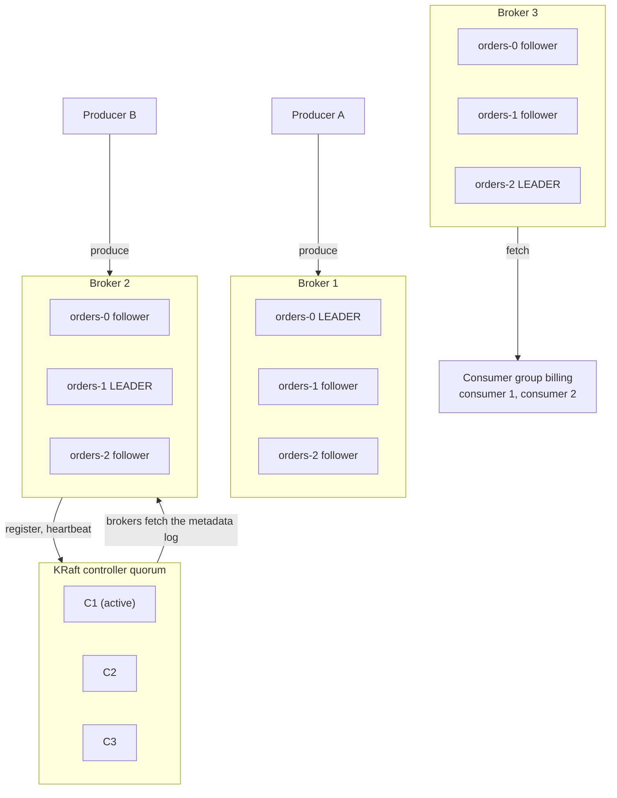

*One topic, three partitions, replication factor 3. Leadership is spread so each broker leads one partition. Producers and consumers talk only to leaders by default.*

### Vocabulary

| Term | What it is |
|---|---|
| **Record** | Key (optional), value, headers, timestamp. Immutable once written. |
| **Topic** | A named stream of records, like `orders`. Only a logical name; the real storage unit is the partition. |
| **Partition** | An ordered, append-only log. The unit of ordering, parallelism, and replication. |
| **Offset** | A record's position in its partition: 0, 1, 2… Never reused. |
| **Replica** | A copy of a partition on some broker. One replica is the leader; the others are followers. |
| **Broker** | A server that hosts replicas and answers client requests. |
| **Controller** | A member of the KRaft quorum. One is *active* and makes all metadata decisions. |
| **Consumer group** | A set of consumers sharing a `group.id` that split a topic's partitions between them. |

## 2. Topics, partitions, and the log

A partition is a file-backed append-only log. New records always go on the end and get the next offset. Nothing in the middle changes. This gives Kafka two famous properties:

- Writes are sequential disk appends, which are fast.
- Readers keep their own position and can re-read history at will. The broker does not track "delivered" state per message for normal consumers.

```
orders-0 on the leader

  segment ...00.log         segment ...04.log         active segment ...08.log
 ┌────┬────┬────┬────┐    ┌────┬────┬────┬────┐    ┌────┬────┬╌╌╌╌┬╌╌╌╌┐
 │ 0  │ 1  │ 2  │ 3  │    │ 4  │ 5  │ 6  │ 7  │    │ 8  │ 9  │ 10 │ 11 │  ──► append
 └────┴────┴────┴────┘    └────┴────┴────┴────┘    └────┴────┴╌╌╌╌┴╌╌╌╌┘
 ▲                                  ▲                        ▲          ▲
 log start 0                billing committed: 6     high watermark 10  log end 12
 (retention trims here)     (next offset to read)    (readable below)   (next write)

 solid  = replicated to every in-sync replica, visible to consumers
 dashed = on the leader only, not yet visible
```

A partition is a sequence of **segment files**. Each segment is named after its first offset and has two sparse indexes beside it:

- `.index`: offset → byte position in the file
- `.timeindex`: timestamp → offset

Only the active segment is written to. Retention deletes whole old segments.

### Four offsets you should know

- **Log start offset**: the oldest offset still on disk. It moves forward when retention deletes segments (`retention.ms`, default 7 days, or `retention.bytes`).
- **Committed offset** (per consumer group): where that group will resume. It is stored by the group coordinator, not in the partition.
- **High watermark (HW)**: the first offset not yet copied to every in-sync replica. Consumers can only read below it, which is why a record you have seen can never "disappear" after a leader change.
- **Log end offset (LEO)**: the offset the next appended record will get.

### Keys decide the partition

Ordering is guaranteed only **within** a partition. If you need all events for `customer-42` in order, give them the key `customer-42`. The default partitioner hashes the key (murmur2) modulo the partition count, so the same key always lands on the same partition.

Adding partitions later changes that mapping, so keys move to different partitions. That is why people over-provision partitions up front.

### Two cleanup policies

| Policy | Behaviour | Typical use |
|---|---|---|
| `cleanup.policy=delete` (default) | Old segments are dropped after time or size limits. | A time-bounded event history. |
| `cleanup.policy=compact` | The log cleaner keeps at least the latest record per key and removes older ones. A record with a `null` value (a **tombstone**) deletes the key. | A changelog table. `__consumer_offsets` is compacted. |

**Tiered storage** (KIP-405) adds a third dimension: closed segments can be copied to object storage like S3, so the broker keeps only a hot tail on local disk while consumers can still read the full history. See the companion README.

## 3. Replication and the ISR

Every partition has `replication.factor` replicas (3 is the usual choice). The leader accepts writes. Followers replicate by sending the leader ordinary **Fetch** requests, the same API consumers use, with their current LEO as the fetch offset. That fetch offset tells the leader how far each follower has got.

```
                                          high watermark 11 = lowest LEO in the ISR
                                                     ┆
Broker 1 · leader    [0][1][2][3][4][5][6][7][8][9][10][11]   LEO 12
Broker 2 · follower  [0][1][2][3][4][5][6][7][8][9][10]       Fetch(offset=11)   in ISR
Broker 3 · follower  [0][1][2][3][4][5]                       Fetch(offset=6)    OUT of ISR
                                                     ┆
ISR = {1, 2}. Broker 3 was removed after not catching up for replica.lag.time.max.ms (30 s).
```

The leader advances the **high watermark** to the lowest LEO among in-sync replicas. A slow follower does not hold the HW back forever: once it lags longer than `replica.lag.time.max.ms`, the leader asks the controller to shrink the ISR, and the HW moves on without it. When it catches up, it is added back.

### The in-sync replica set (ISR)

The **ISR** is the set of replicas that are caught up enough to take over as leader without losing committed data.

- The controller stores the ISR in metadata, and only the controller can change it. The leader asks for changes with `AlterPartition` requests.
- When a leader dies, the controller picks a new leader from the ISR.
- `min.insync.replicas` (often set to 2) is the safety floor. A write with `acks=all` fails with `NotEnoughReplicas` if the ISR is smaller than this, instead of being accepted with too few copies.

### Leader epochs

Every leader change bumps the partition's **leader epoch**. Each replica records which epoch began at which offset (the `leader-epoch-checkpoint` file).

When a former leader comes back, it asks the new leader where its epoch ended and truncates any records past that point. Truncation can only remove records above the old high watermark, which no consumer was ever allowed to see.

### Newer refinements

- **Eligible Leader Replicas** (KIP-966) track replicas that dropped out of the ISR but are still known to hold all committed data. This makes leader election safer when `min.insync.replicas` is set.
- `unclean.leader.election.enable=false` (the default) means Kafka would rather keep a partition offline than elect a replica that is missing committed data.

---

# Part 2: Writing

## 4. Inside the producer

`producer.send(record)` does not send anything. It puts the record into a buffer and returns a `Future` right away. A separate I/O thread called the **Sender** drains that buffer into network requests. This split is why a single producer can push hundreds of thousands of records per second.

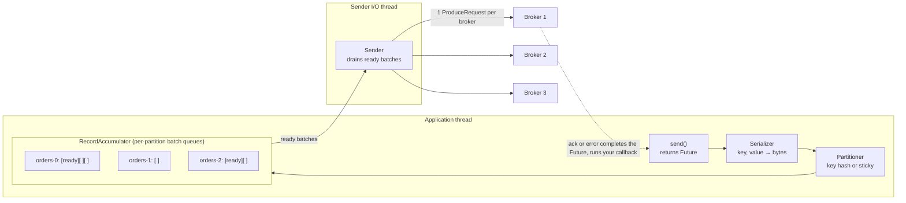

Records are grouped into **per-partition batches**. A batch is sent when it fills to `batch.size` (16 KB) or has waited `linger.ms` (5 ms by default since Kafka 4.0). The Sender merges all ready batches bound for the same broker into one request, so larger batches mean fewer requests and better compression.

Key behaviours:

- **Partitioner.** With a key: `murmur2(key) % partitions`. Without a key: the built-in partitioner sticks to one partition until a batch fills, then switches, preferring partitions on less-loaded brokers. Sticking avoids sending many tiny batches.
- **Memory.** The accumulator has `buffer.memory` (32 MB). When it is full, `send()` blocks up to `max.block.ms`. That backpressure is how a fast producer learns the cluster is slow.
- **Compression** (`compression.type`: `lz4`, `zstd`, `snappy`, `gzip`) is applied per batch. Brokers store the batch compressed and consumers decompress it, so the broker rarely does the work.
- **Retries.** Retriable errors (leader moved, timeout) are retried until `delivery.timeout.ms` (2 minutes) runs out. On `NotLeaderOrFollower`, the producer refreshes metadata and resends to the new leader.

## 5. Acks and idempotence

`acks` decides when the leader responds. It is the main knob between latency and durability.

| `acks` | Leader replies when… | Can acknowledged data be lost? |
|---|---|---|
| `0` | Never. The producer does not wait. | **Yes.** Anything can be lost. |
| `1` | The leader has written it to its own log. | **Yes**, if the leader dies before followers copy it. |
| `all` (default) | Every replica in the ISR has it, and ISR ≥ `min.insync.replicas`. | **No**, unless more than (replication factor − `min.insync.replicas`) replicas fail together. |

### Idempotence: retries without duplicates

Retries create a classic problem: the broker wrote the batch, the acknowledgement got lost, the producer retries, and now the record exists twice.

Idempotence (on by default since Kafka 3.0) fixes this:

1. The producer gets a **producer ID** (PID) from the broker.
2. It numbers every batch per partition with a **sequence number**.
3. The partition leader remembers the last few sequences per producer ID (in `ProducerStateManager`) and drops repeats.

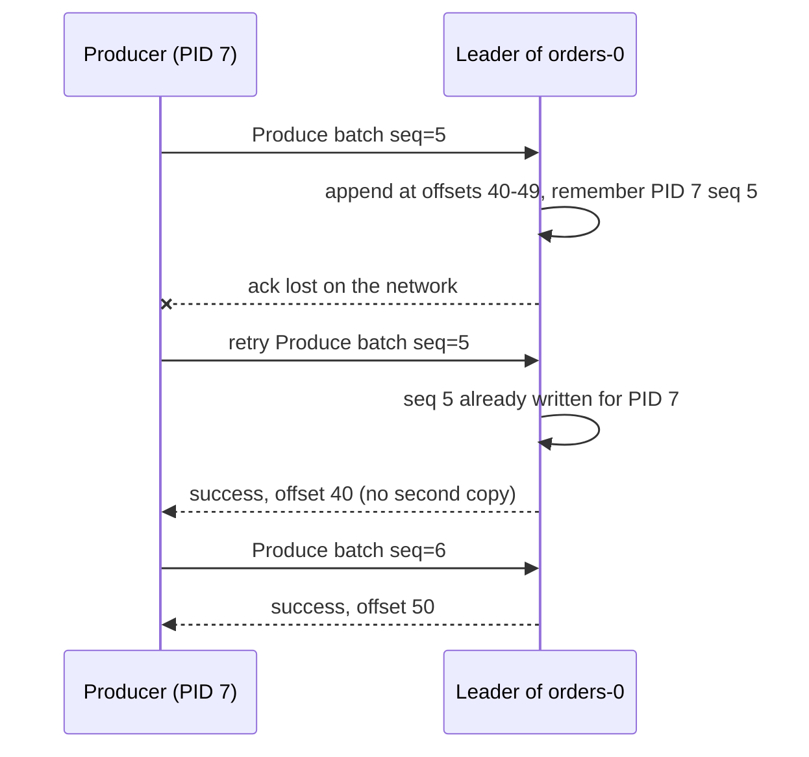

The broker deduplicates by (producer ID, partition, sequence). Sequence gaps are rejected too, so ordering survives retries even with up to 5 requests in flight per connection.

Idempotence covers **one producer session writing to one partition**. If your application restarts, it gets a new producer ID. Surviving restarts and writing atomically across partitions is what transactions are for.

## 6. Transactions

A transaction lets a producer write to several partitions, and commit consumer offsets, as one atomic unit: either everything becomes visible or nothing does. This is the basis of exactly-once stream processing: read from topic A, write to topic B, and commit the input offset, all atomically.

### Fencing zombies

You set `transactional.id` to a stable name. The **transaction coordinator** maps it to a producer ID and an **epoch**. The coordinator is a role on one broker, chosen by hashing the `transactional.id` onto a partition of `__transaction_state`.

When a new instance starts with the same `transactional.id`, the epoch is bumped and the old instance is fenced. Any write from a "zombie" with the stale epoch is rejected.

### The commit protocol

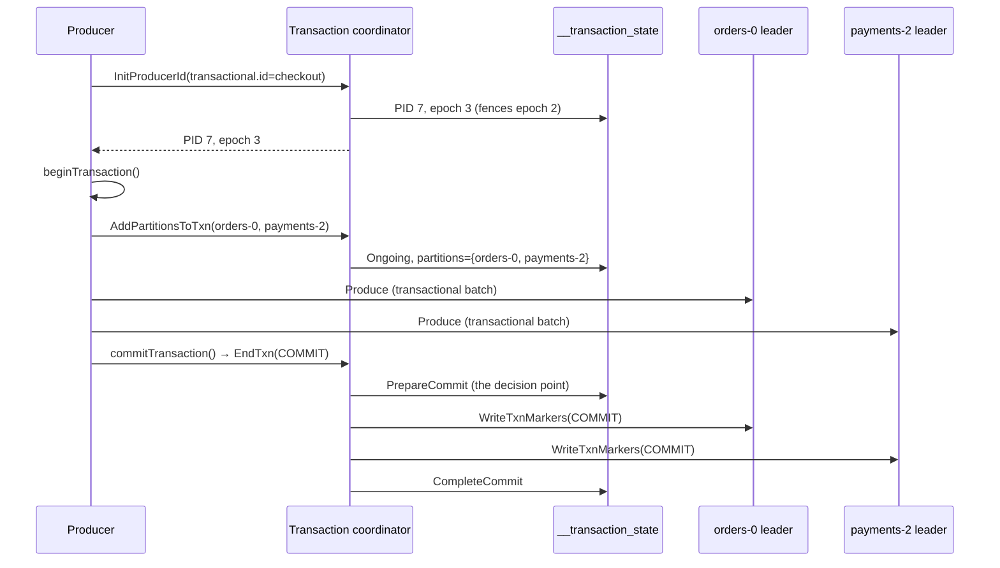

This is a two-phase commit with Kafka logs as the durable state. Once `PrepareCommit` is in `__transaction_state`, the commit will finish even if the coordinator crashes, because the next coordinator replays the log. Commit markers are special control records written into each data partition.

### Reading transactional data

- `isolation.level=read_committed`: consumers read only up to the **last stable offset** (LSO), the first offset that belongs to a transaction still open. Records from aborted transactions are filtered out.
- `isolation.level=read_uncommitted` (the default): consumers read up to the high watermark and see everything, including aborted data.

Kafka 4.x also includes **KIP-890** ("transactions server-side defense"): the epoch is bumped on every transaction, and the broker adds partitions to the transaction implicitly. This closes several hanging-transaction bugs.

---

# Part 3: Reading

## 7. Inside the consumer

Consumers **pull**. The broker never pushes records. Your code calls `poll()` in a loop; the consumer returns records it has already fetched and fetches more in the background. Pulling lets each consumer go at its own pace and makes replay trivial: to re-read, seek to an older offset.

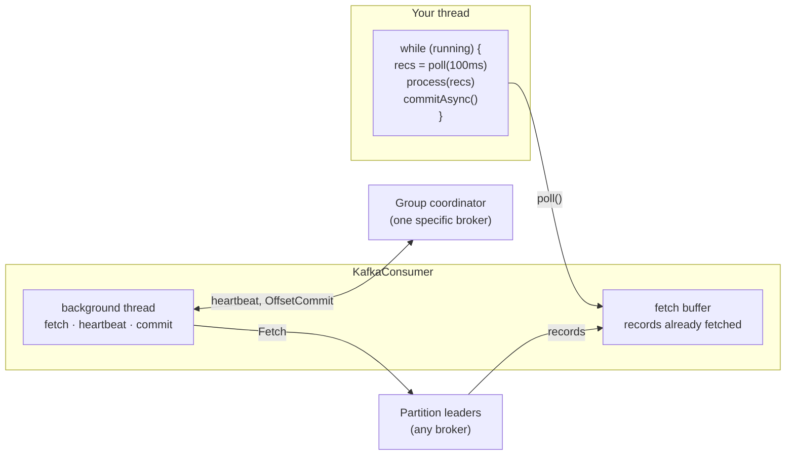

Two different brokers matter to a consumer:

- **Partition leaders** serve the data.
- **The group coordinator** handles membership, assignment, and committed offsets.

In the newer `AsyncKafkaConsumer` (used with `group.protocol=consumer`), network work runs on a background thread as drawn. The older `ClassicKafkaConsumer` does it inside `poll()`.

### Position vs committed offset

A consumer tracks two numbers per partition:

- **Position**: the next offset `poll()` will return. It lives in memory.
- **Committed offset**: what it has told the coordinator it has finished. It is durable, and it is where the group resumes after a crash or reassignment.

The gap between them is what you might reprocess after a failure.

### Commit and liveness settings

- `enable.auto.commit=true` (default) commits the position every 5 s during `poll()`. Simple, but a crash can replay up to 5 s of records, or skip records if you hand them to another thread for processing.
- Manual `commitSync()` / `commitAsync()` after processing gives you at-least-once with tight control.
- `auto.offset.reset` (`latest` by default, or `earliest`) applies only when the group has no committed offset, or the committed offset points to data that retention already deleted.
- `max.poll.interval.ms` (5 min) is a liveness check on **your code**. If you do not call `poll()` within it, the consumer leaves the group and its partitions are reassigned.

Consumers can also read from a follower in the same rack (`client.rack` on the client plus `replica.selector.class` on the broker), which saves cross-zone network cost.

## 8. Consumer groups

A consumer group is how Kafka scales reading. All consumers that start with the same `group.id` form one group. Kafka divides the topic's partitions among them so that **each partition is read by exactly one member of the group**. Different groups are independent: each gets the full stream and keeps its own offsets.

This section covers what a group is and how it behaves from your application's point of view. Section 9 covers the broker component that manages groups, and section 10 covers the rebalance protocols in detail.

### 8.1 Queue and publish/subscribe in one model

Messaging systems traditionally offer two models:

- **Queue:** each message goes to *one* of several workers. Work is shared.
- **Publish/subscribe:** each message goes to *every* subscriber.

Consumer groups give you both, depending on how you set `group.id`:

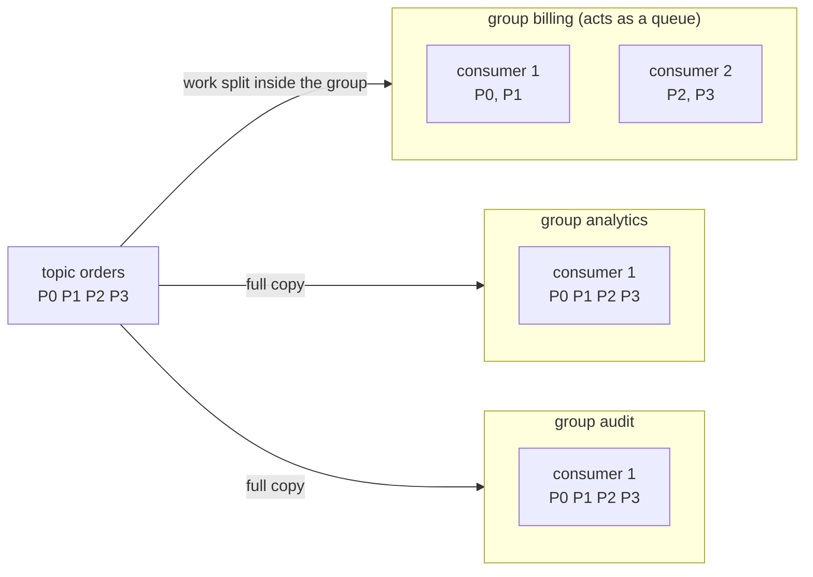

- **Inside a group**, partitions are split between members, so each record is processed by one member. That is the queue behaviour.
- **Across groups**, every group receives every record. That is the publish/subscribe behaviour.
- Reading does not remove anything. The records stay in the log until retention deletes them, so a fourth group created next week can still read from the beginning.

### 8.2 The assignment rules

1. Within a group, a partition is owned by **at most one** member at a time. This is what keeps per-partition ordering intact: one partition, one reader, in order.
2. One member can own **many** partitions.
3. A member that owns no partitions sits **idle**.
4. Different groups never affect each other's assignments.

```
topic orders · 6 partitions:   P0  P1  P2  P3  P4  P5     (each group reads all of these)

group billing · 3 members
  ┌ consumer 1 ┐ ┌ consumer 2 ┐ ┌ consumer 3 ┐
  │  P0   P1   │ │  P2   P3   │ │  P4   P5   │
  └────────────┘ └────────────┘ └────────────┘

group analytics · 1 member
  ┌ consumer 1 ─────────────────┐
  │  P0  P1  P2  P3  P4  P5     │
  └─────────────────────────────┘

group search · 7 members, so one has nothing to do
  [c1·P0] [c2·P1] [c3·P2] [c4·P3] [c5·P4] [c6·P5] [c7·idle]
```

### 8.3 Scaling a group up and down

The number of partitions is the ceiling on parallelism within one group. Here is the same six-partition topic as a group grows:

```
members │ assignment                                        │ partitions per member
────────┼───────────────────────────────────────────────────┼──────────────────────────────
   1    │ c1:[P0 P1 P2 P3 P4 P5]                            │ 6
   2    │ c1:[P0 P1 P2]  c2:[P3 P4 P5]                      │ 3 3
   3    │ c1:[P0 P1]  c2:[P2 P3]  c3:[P4 P5]                │ 2 2 2
   4    │ c1:[P0 P1]  c2:[P2 P3]  c3:[P4]  c4:[P5]          │ 2 2 1 1   ← uneven
   6    │ c1:[P0] c2:[P1] c3:[P2] c4:[P3] c5:[P4] c6:[P5]   │ 1 each    ← maximum parallelism
   7    │ same as 6, plus c7:[ ]                            │ one idle  ← no gain
```

What this means in practice:

- **Choose the partition count for the largest group you expect.** With 6 partitions, no group can ever use more than 6 consumers.
- **Partition counts with many divisors** (6, 12, 24, 60) spread evenly over more group sizes. With 4 consumers on 6 partitions, two consumers do twice the work of the other two.
- **Idle members are still useful** as hot standbys: if an active member dies, a standby takes over its partitions in the next rebalance.
- Each consumer handles all its partitions in one `poll()` loop. If one consumer is too slow for its share, add members (up to the partition count) or speed up processing.

### 8.4 Each group has its own offsets

A group's progress is a set of **committed offsets**, one per partition it reads. They are stored in `__consumer_offsets` under the key *(group, topic, partition)*. Two groups reading the same partition have completely separate positions:

```
orders-0   [0][1][2][3][4][5][6][7][8][9][10][11][12][13][14][15][16][17][18][19]
                       ▲                                    ▲                  ▲
                analytics committed 4             billing committed 13     log end 20

  billing   lag = 20 - 13 = 7      (nearly caught up)
  analytics lag = 20 - 4  = 16     (behind, maybe slower processing or newly started)
```

- **Committed offset** means "the next offset this group should read". After processing offset 12, the consumer commits 13.
- **Consumer lag** is log end offset minus committed offset: how many records the group still has to process. Lag is the most important metric for a consumer group. Steadily growing lag means the group cannot keep up.
- **Where a new group starts** is set by `auto.offset.reset`: `latest` (the default) starts at the end and skips history, while `earliest` starts at the log start offset.
- **Offsets of an empty group expire.** When a group has no members for `offsets.retention.minutes` (7 days by default), its committed offsets are deleted. If it comes back later, `auto.offset.reset` decides where it starts again.

You can see all of this with the CLI:

```bash
bin/kafka-consumer-groups.sh --bootstrap-server localhost:9092 --describe --group billing
```

```
GROUP    TOPIC   PARTITION  CURRENT-OFFSET  LOG-END-OFFSET  LAG  CONSUMER-ID       HOST         CLIENT-ID
billing  orders  0          13              20              7    consumer-1-4f2a…  /10.0.0.11   consumer-1
billing  orders  1          88              88              0    consumer-1-4f2a…  /10.0.0.11   consumer-1
billing  orders  2          41              57              16   consumer-2-9c1d…  /10.0.0.12   consumer-2
```

`CURRENT-OFFSET` is the committed offset, not the consumer's in-memory position.

### 8.5 How a group knows a member is alive

A group has to tell the difference between a member that is healthy, one that has crashed, and one whose processing is stuck. It uses **two independent checks**:

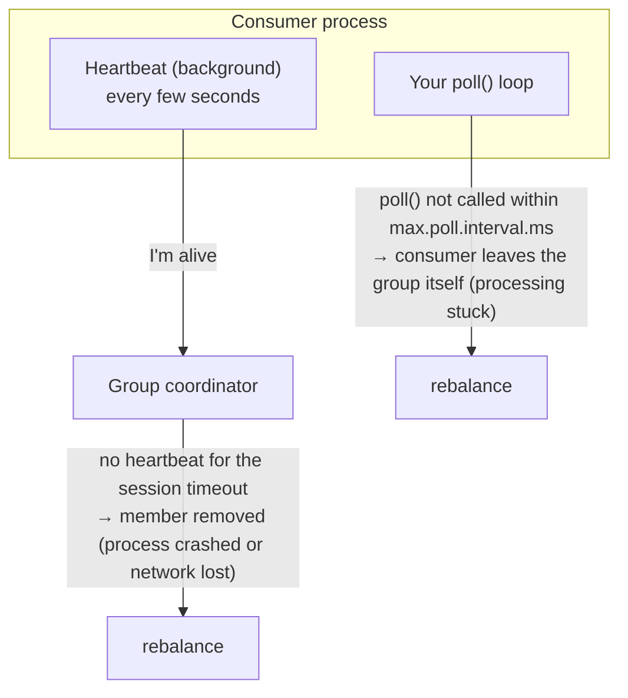

| Check | Detects | Classic protocol | Consumer protocol (KIP-848) |
|---|---|---|---|
| Heartbeats + session timeout | Process crash, network loss | Client sets `heartbeat.interval.ms` (3 s) and `session.timeout.ms` (45 s) | Broker sets `group.consumer.heartbeat.interval.ms` (5 s) and `group.consumer.session.timeout.ms` (45 s) |
| Poll interval | Your code being too slow or stuck | `max.poll.interval.ms` (5 min) | `max.poll.interval.ms` (5 min) |

How the common situations play out:

| Situation | What happens | How long until partitions move |
|---|---|---|
| `consumer.close()` | Member leaves the group at once | Immediately |
| Process killed (`kill -9`), machine dies | Heartbeats stop | Up to the session timeout (45 s) |
| One batch takes 10 minutes to process | Heartbeats continue, but `poll()` is late | After `max.poll.interval.ms` (5 min); the member is removed, and its next commit fails |
| Rolling restart with static membership | Member returns within the session timeout with the same `group.instance.id` | No reassignment at all |

**Always close consumers on shutdown** (`consumer.close()`, for example from a shutdown hook). Otherwise every deploy makes the group wait 45 seconds for the dead members to time out, with their partitions unprocessed in the meantime.

### 8.6 What triggers a rebalance

Partitions are redistributed when the inputs to the assignment change:

- A member **joins** (new instance, scale-up).
- A member **leaves** cleanly (`close()`) or is **removed** (session timeout, poll interval exceeded).
- A member changes its **subscription** (for example, a regex subscription starts matching a new topic).
- A subscribed topic **gains partitions**.
- A subscribed topic is **created or deleted**.

That redistribution is a **rebalance**, and it is run by the **group coordinator** (section 9). With the classic protocol every member takes part in every rebalance; with the new consumer protocol only members whose partitions change are affected (section 10).

### 8.7 What your code sees during a rebalance

Your application is told about ownership changes through a `ConsumerRebalanceListener`. These callbacks run inside `poll()` on your thread:

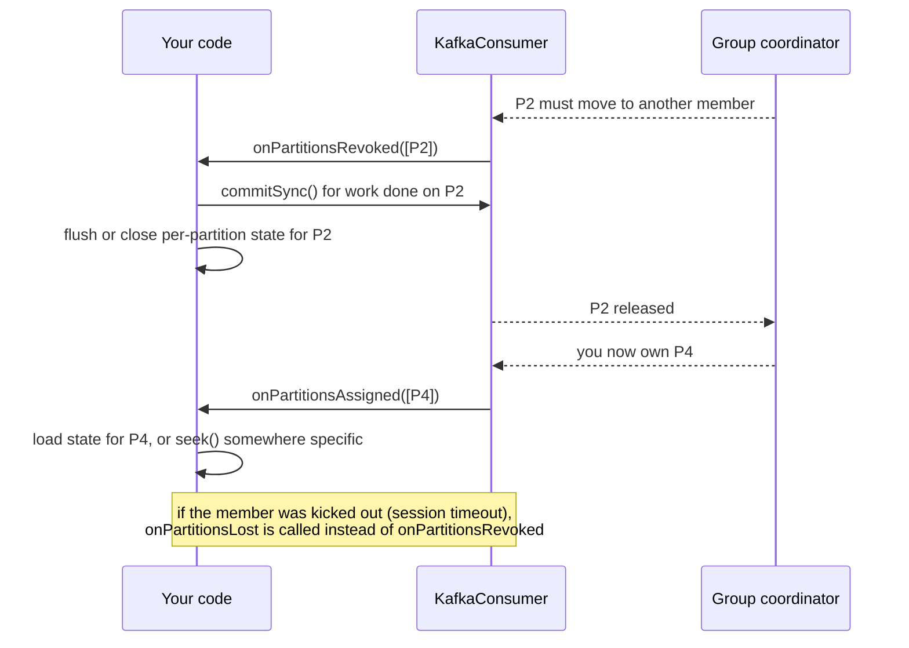

| Callback | When | What to do |
|---|---|---|
| `onPartitionsRevoked` | You are giving partitions up in an orderly way | Commit offsets for what you have processed, flush state. This is your last chance before another member continues from your last commit. |
| `onPartitionsAssigned` | You received partitions | Initialise per-partition state, optionally `seek()` |
| `onPartitionsLost` | You were already removed from the group; another member may own these partitions now | Clean up, but **do not commit**. The commit would be rejected, and it could overwrite the new owner's progress. |

In Scala:

```scala
import java.util
import org.apache.kafka.clients.consumer.ConsumerRebalanceListener
import org.apache.kafka.common.TopicPartition

consumer.subscribe(util.List.of("orders"), new ConsumerRebalanceListener {
  override def onPartitionsRevoked(parts: util.Collection[TopicPartition]): Unit =
    consumer.commitSync()                 // save progress before someone else takes over

  override def onPartitionsAssigned(parts: util.Collection[TopicPartition]): Unit =
    parts.forEach(tp => println(s"now reading $tp"))

  override def onPartitionsLost(parts: util.Collection[TopicPartition]): Unit =
    println(s"lost $parts without a clean handoff; not committing")
})
```

`commitSync()` with no arguments commits the current position of every owned partition. That is correct only if you have finished processing everything `poll()` returned. If you process asynchronously, commit the offsets you have actually completed instead.

### 8.8 Assignment strategies

The **assignor** decides which member gets which partition. Which one runs depends on the protocol:

| Protocol | Where the assignor runs | Built-in options | Default |
|---|---|---|---|
| Classic | In the client (the group leader member) | `range`, `roundrobin`, `sticky`, `cooperative-sticky` | `partition.assignment.strategy` = Range, then CooperativeSticky |
| Consumer (KIP-848) | On the broker | `uniform`, `range` | `uniform` (server config `group.consumer.assignors`) |

Two members, subscribed to topics T1 and T2, each with 3 partitions:

```
              member M0                    member M1
range         T1P0 T1P1 T2P0 T2P1          T1P2 T2P2          4 / 2, but co-partitioned
round-robin   T1P0 T1P2 T2P1               T1P1 T2P0 T2P2     3 / 3, partitions interleaved
uniform       3 partitions                 3 partitions       balanced, and sticky across changes
```

- **Range** gives each member the *same partition numbers* in every topic (M0 gets partition 0 and 1 of both T1 and T2). This is called **co-partitioning**. It matters for joins: if both topics are keyed by `customer-id`, the same customer is in the same partition number of both, so one member sees both sides of the join. The cost is imbalance.
- **Round-robin** and **uniform** balance the load. Uniform also tries to keep existing assignments when it can.

**Stickiness** decides how much moves when membership changes. Three members, then M2 leaves:

```
before          M0:[P0 P1]        M1:[P2 P3]        M2:[P4 P5]

not sticky      M0:[P0 P1 P2]     M1:[P3 P4 P5]                      P2 and P3 moved too
sticky          M0:[P0 P1 P4]     M1:[P2 P3 P5]                      only M2's partitions moved
```

Every partition that moves has to be committed by its old owner and picked up by its new owner, so moving fewer partitions means a shorter pause and less reprocessing.

### 8.9 Group states

The coordinator reports a state for each group, shown by `kafka-consumer-groups.sh --describe --state`. For groups using the consumer protocol (the states are defined in `ConsumerGroup.java`):

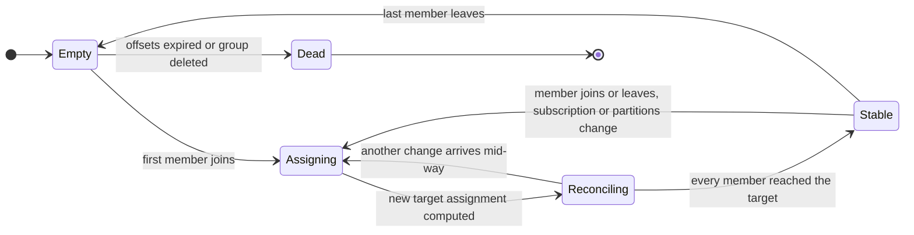

| State | Meaning |
|---|---|
| `Empty` | No members, but committed offsets still exist |
| `Assigning` | Membership changed and a new target assignment is being computed |
| `Reconciling` | Members are moving partitions toward the new target |
| `Stable` | Every member has its target partitions |
| `Dead` | No members and no metadata; the group is being removed |

Classic groups have different states: `Empty`, `PreparingRebalance` (waiting for every member to rejoin), `CompletingRebalance` (waiting for the leader's assignment), `Stable`, and `Dead`.

### 8.10 `subscribe()` vs `assign()`

You do not have to use group management at all.

| | `subscribe(topics)` | `assign(partitions)` |
|---|---|---|
| Who picks partitions | The group's assignor | You, explicitly |
| Rebalances, failover | Yes, automatic | None. If this process dies, nobody takes over its partitions. |
| Needs `group.id` | Yes | Only if you want to commit offsets to Kafka |
| Typical use | Almost all applications | Tools, replays, tests, or frameworks that manage their own placement |

### 8.11 Common pitfalls

- **Rebalance loops from slow processing.** A batch takes longer than `max.poll.interval.ms`, the member is removed, its partitions move, the new owner hits the same slow records, and so on. Fix it by lowering `max.poll.records` (default 500), speeding up processing, or raising `max.poll.interval.ms`.
- **More consumers than partitions.** The extra consumers do nothing. Check the partition count before scaling out.
- **Hot partitions.** One key (for example, one huge customer) sends most of the traffic to one partition. Only one member can read it, so adding consumers does not help. Spread the key, or split the work after reading.
- **Committing too early with worker threads.** If `poll()` hands records to a thread pool and auto-commit is on, offsets can be committed before processing finishes, and a crash then loses those records. Disable auto-commit and commit only completed offsets.
- **Not closing consumers.** Each deploy then pauses the affected partitions for the full session timeout.
- **Reusing a `group.id` by accident.** Two unrelated applications with the same `group.id` split the partitions between them, and each sees only part of the data.

### 8.12 Managing groups from the command line

```bash
# list all groups
bin/kafka-consumer-groups.sh --bootstrap-server localhost:9092 --list

# offsets and lag per partition (section 8.4)
bin/kafka-consumer-groups.sh --bootstrap-server localhost:9092 --describe --group billing

# members and how many partitions each one owns
bin/kafka-consumer-groups.sh --bootstrap-server localhost:9092 --describe --group billing --members

# group state, coordinator, assignor
bin/kafka-consumer-groups.sh --bootstrap-server localhost:9092 --describe --group billing --state

# rewind the group to the beginning (the group must have no active members)
bin/kafka-consumer-groups.sh --bootstrap-server localhost:9092 --group billing \
  --topic orders --reset-offsets --to-earliest --dry-run     # preview
bin/kafka-consumer-groups.sh --bootstrap-server localhost:9092 --group billing \
  --topic orders --reset-offsets --to-earliest --execute     # apply

# other reset targets: --to-latest, --to-offset 42, --shift-by -100,
#                      --to-datetime 2026-10-01T00:00:00.000, --by-duration PT1H

# delete a group and its committed offsets (no active members allowed)
bin/kafka-consumer-groups.sh --bootstrap-server localhost:9092 --delete --group billing
```

The next two sections go one level down: section 9 covers how the group coordinator is found and how it stores group state, and section 10 shows the message exchanges of a rebalance under both protocols.

## 9. The group coordinator

The group coordinator is not a separate server. It is a component running inside **every** broker. Each broker is responsible for the groups whose state lives in the `__consumer_offsets` partitions it leads. That internal topic has 50 partitions by default (`offsets.topic.num.partitions`).

### Finding the coordinator

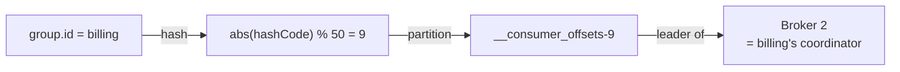

The client asks any broker `FindCoordinator(key="billing")` and gets Broker 2 back. Every heartbeat, join, and offset commit for that group then goes to Broker 2.

The real computation is `Utils.abs(groupId.hashCode()) % numPartitions` in `GroupCoordinatorService.partitionFor`. For `"billing"` it really is 9.

If Broker 2 dies, another replica of `__consumer_offsets-9` becomes leader, and that broker becomes the coordinator.

### A coordinator is a state machine over a log

This is the most useful mental model in modern Kafka:

1. The coordinator keeps group state (members, subscriptions, assignments, committed offsets) in memory.
2. Every change is first written as a record to its `__consumer_offsets` partition.
3. The request is answered only after that record is committed (replicated to the ISR).
4. If the broker fails, the new leader of that partition reads the partition from the start and rebuilds exactly the same state.

The KRaft controller works the same way over `__cluster_metadata`:

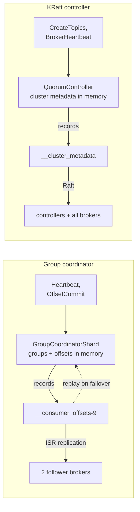

The generic engine behind the first row is `CoordinatorRuntime` in `coordinator-common`. The group, share, and (being migrated) transaction coordinators all run on it.

## 10. Rebalancing, old and new

Kafka has two consumer group protocols, chosen on the client with `group.protocol`. The default in this tree is still `classic`. The new `consumer` protocol (KIP-848, production-ready since Kafka 4.0) is the future, and the difference is worth understanding.

### Classic protocol: a client leader assigns, with a global barrier

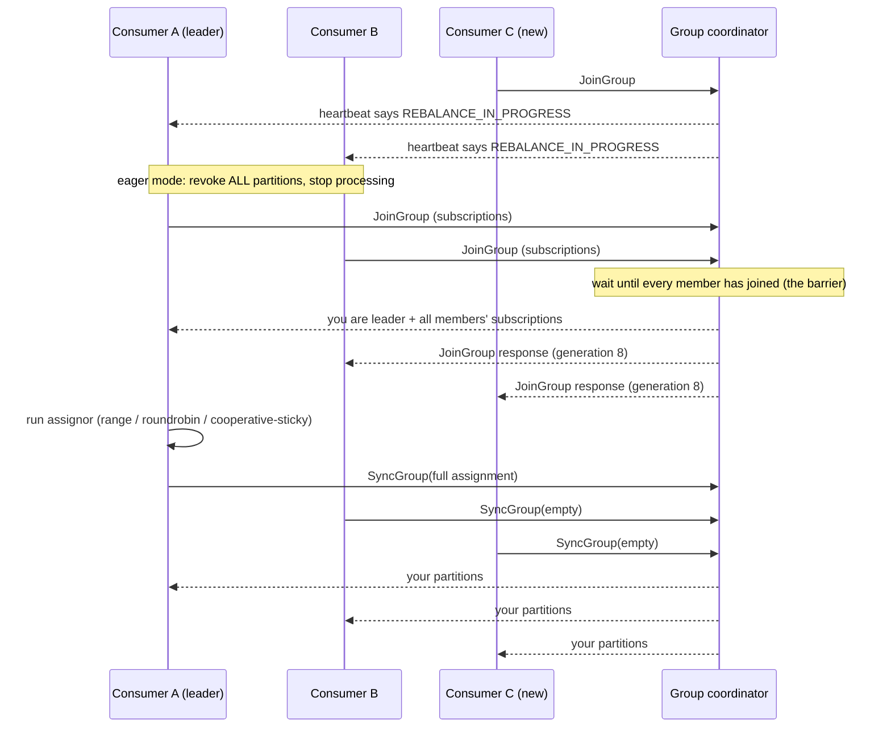

Everyone must rejoin, and with eager assignors everyone stops processing. The **cooperative-sticky** assignor softens this by revoking only partitions that actually move, at the cost of a second rebalance round. Either way, one slow member delays the whole group.

### New protocol (KIP-848): the broker assigns, each member moves alone

There is no JoinGroup or SyncGroup. Each member sends a `ConsumerGroupHeartbeat` every few seconds (interval set by the broker, 5 s by default) carrying its subscription. The coordinator runs the assignor itself (`uniform` or `range`, server-side) and then steers each member individually toward its target.

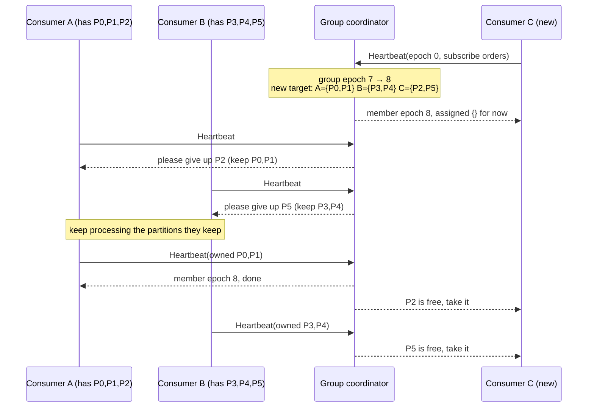

Only the partitions that move are paused. A partition is handed to its new owner only after the old owner confirms it let go. No member waits for any other member to rejoin.

The coordinator tracks three epochs to make this safe:

- **Group epoch**: bumped whenever membership or subscriptions change.
- **Target assignment epoch**: the group epoch the current target assignment was computed for.
- **Member epoch**: how far each member has reconciled. Offset commits carry it, so a member that is behind (a zombie) cannot commit for partitions it no longer owns.

### Side by side

| | Classic | Consumer (KIP-848) |
|---|---|---|
| Who assigns | Client-side assignor on the leader member | Broker-side assignor |
| Coordination | Global sync barrier | Each member reconciles independently |
| Cost of a change | Grows with group size | Incremental by design |
| Client complexity | Thick clients, logic in every language | Thin clients, one implementation on the broker |

**Static membership** (`group.instance.id`) works with both: a consumer that restarts with the same instance id within the session timeout gets its old partitions back without triggering a rebalance.

Kafka Streams has its own analogous protocol, the **streams group** (KIP-1071), which moves task assignment to the broker in the same way.

## 11. Share groups (queues for Kafka)

Consumer groups give each partition to one member, so you can never have more active readers than partitions, and there is no per-record acknowledgement. **Share groups** (KIP-932) add queue semantics on top of the same topics:

- Many members can read **the same partition** at once.
- Records are **acquired** with a time-limited lock, then individually **acknowledged** as *accept*, *release* (redeliver), or *reject* (poison message).
- Each record carries a **delivery count**. After `group.share.delivery.count.limit` attempts it is archived instead of retried forever.
- The broker tracks, per partition, an in-flight window between the share-partition start offset and end offset. The **share coordinator** persists it in `__share_group_state`: again, a coordinator over a log.

| | Consumer group | Share group |
|---|---|---|
| Readers per partition | One | Many |
| Progress tracked as | One offset per partition | State per in-flight record |
| Ordering | Strict per partition | Not guaranteed |
| Good for | Event streams, CDC, aggregation | Work queues, jobs, fan-out workers |

## 12. Delivery guarantees

| Guarantee | How you get it | What failure looks like |
|---|---|---|
| **At most once** | Commit offsets *before* processing, or `acks=0`. | A crash loses the records between commit and processing. |
| **At least once** | `acks=all`, retries, commit *after* processing. | A crash reprocesses records since the last commit. Make processing idempotent. |
| **Exactly once** | Kafka-to-Kafka: transactions + `read_committed` + `sendOffsetsToTransaction`, or Kafka Streams with `processing.guarantee=exactly_once_v2`. | Output and offset commit succeed or abort together. |

> **Boundary:** exactly-once applies inside Kafka. Once you write to an external database or call an API, you need idempotent writes or your own deduplication on that side.

---

# Part 4: Control plane (KRaft)

## 13. Why KRaft exists

Every partition needs someone to decide who leads it, and every broker needs to know the answer. Until Kafka 3.x, that metadata lived in **ZooKeeper**, a separate distributed system, and one broker at a time acted as "the controller". Kafka 4.0 removed ZooKeeper completely. Metadata now lives in a Kafka-native Raft log. That is what **KRaft** (Kafka Raft) means.

### Before and after

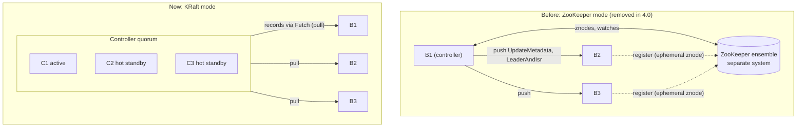

Two things change: the external system disappears, and metadata delivery flips from **push to pull**.

- **In ZooKeeper mode**, a new controller had to read all metadata from ZooKeeper and then push it to every broker. On clusters with hundreds of thousands of partitions, that took minutes.
- **In KRaft**, standby controllers already replay the log, so failover is near-instant. Brokers catch up by reading from their last offset.

### What KRaft fixes

- One system to deploy, secure, and monitor.
- Controller failover in milliseconds to seconds, not minutes.
- Millions of partitions per cluster become practical.
- Metadata has an offset, so "how stale is this broker?" has a precise answer.

### What it reuses

- Kafka's own log format and segment files.
- Kafka's own `Fetch` RPC for replication.
- Snapshots, which play the role compaction plays for state.
- The same "state machine over a log" pattern as the coordinators.

## 14. The Raft quorum

The controllers are the **voters** of a Raft quorum that replicates one single-partition log, `__cluster_metadata`. Brokers are **observers**: they replicate the same log but do not vote.

You size the quorum for fault tolerance. Every decision needs a majority, so 3 voters survive 1 failure and 5 voters survive 2.

### Terms you need

- **Epoch**: Raft's "term". Each election starts a higher epoch. There is at most one leader per epoch.
- **Leader**: the only voter that appends to the log. In KRaft, the Raft leader *is* the active controller.
- **Committed / high watermark**: an entry is committed once a majority of voters has it. The controller acts on records only after commit.

### Election

1. A voter that hears nothing from a leader for `controller.quorum.fetch.timeout.ms` (2 s) starts an election.
2. **Pre-vote** (KIP-996): the voter first asks "would you vote for me?" without bumping the epoch. A voter that was merely partitioned away therefore cannot disrupt a healthy leader when it comes back.
3. If a majority would vote for it, it becomes a candidate, bumps the epoch, and asks for real votes.
4. A voter grants its vote only if the candidate's log is at least as up to date as its own: it compares last epoch first, then last offset.
5. Randomized timeouts (`controller.quorum.election.timeout.ms`, 1 s base) keep two candidates from colliding forever.

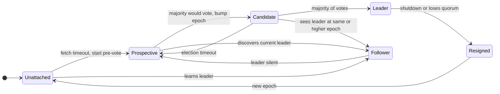

These are the real states, one class each, in `raft/src/main/java/org/apache/kafka/raft/`: `UnattachedState`, `ProspectiveState`, `CandidateState`, `LeaderState`, `FollowerState`, `ResignedState`. `QuorumState` owns the transitions and persists the epoch and vote to disk, so a restart cannot vote twice in the same epoch.

### Replication is pull, not push

Textbook Raft has the leader push `AppendEntries` to followers. KRaft inverts this to match Kafka:

- Followers and observers send `Fetch` requests with their next offset and the epoch of their last record.
- The fetch doubles as the heartbeat.
- If a follower's log has diverged (it holds records from an epoch that ended earlier on the leader), the leader replies with a **diverging epoch**, and the follower truncates and fetches again.

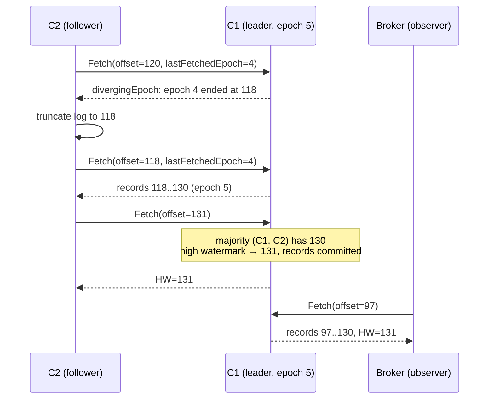

Each Fetch carries the follower's position, so the leader learns progress for free. The leader moves the high watermark when a majority of voters have fetched past an offset. Observers (brokers) never count toward that majority.

### Snapshots

The metadata log would grow forever, so controllers and brokers periodically write a **snapshot**: the full metadata state as of some offset. Snapshots live in `metadata.log.dir`, in files named `<offset>-<epoch>.checkpoint`. The log before a snapshot can then be deleted.

A brand-new broker, or one too far behind, downloads the latest snapshot with `FetchSnapshot` and then fetches only the records after it.

### Dynamic quorums

Since KIP-853 the voter set itself is stored in the log, so you can add or remove controllers at runtime (`kafka-metadata-quorum.sh add-controller` / `remove-controller`, using the `AddRaftVoter` / `RemoveRaftVoter` RPCs). New clusters bootstrap with `controller.quorum.bootstrap.servers` instead of a fixed `controller.quorum.voters` list.

## 15. The active controller

The Raft leader runs `QuorumController`. It is deliberately **single-threaded**: every request becomes an event on one queue, so there are no locks around metadata.

Handling an event works like this:

1. Validate the request against the current in-memory state.
2. Produce a list of metadata records, for example `TopicRecord`, `PartitionRecord`, `PartitionChangeRecord`, `RegisterBrokerRecord`, `FenceBrokerRecord`.
3. Apply them to in-memory state speculatively and append them to the Raft log.
4. Reply to the caller only once those records are **committed**. If the controller loses leadership first, it reverts to the last committed state and the request fails over.

The state is split into **managers**, each owning one kind of record:

| Manager | Owns |
|---|---|
| `ClusterControlManager` | Brokers and their registrations |
| `ReplicationControlManager` | Topics, partitions, leaders, ISR |
| `ConfigurationControlManager` | Dynamic configs |
| `FeatureControlManager` | `metadata.version` and other feature levels |
| `AclControlManager` | ACLs |

Standby controllers replay the same committed records into the same managers, so they are always ready to take over.

### Example: creating a topic

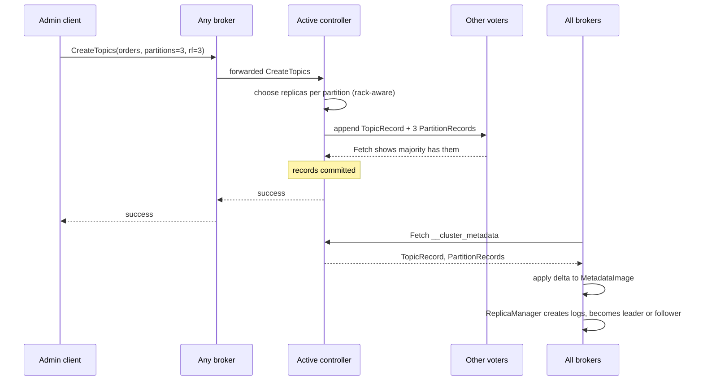

Clients never talk to controllers directly; brokers forward admin requests. The topic exists from the moment its records are committed. Each broker starts serving it as soon as it fetches and applies those records.

## 16. Brokers in KRaft

### Registration and heartbeats

A broker joins the cluster by sending `BrokerRegistration` to the active controller, with its listeners, rack, supported features, and a unique incarnation id. It then sends `BrokerHeartbeat` every `broker.heartbeat.interval.ms` (2 s). Each heartbeat reports how far the broker has read the metadata log, and the controller's reply tells the broker whether it is fenced.

- A broker starts **fenced**. It is unfenced (eligible to lead partitions) only after it has caught up with the metadata log.
- If no heartbeat arrives within `broker.session.timeout.ms` (9 s), the controller writes a `FenceBrokerRecord` and moves leadership of that broker's partitions to other ISR members with `PartitionChangeRecord`s.
- On a clean shutdown, the broker asks for a **controlled shutdown**. The controller moves its leaderships away first, so clients see no errors.

### Broker lifecycle

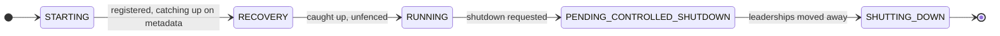

The states are defined in `metadata/src/main/java/org/apache/kafka/metadata/BrokerState.java`. On the broker side, `BrokerLifecycleManager` drives them.

### MetadataImage: how a broker sees the cluster

Each broker folds the metadata log into an immutable **`MetadataImage`** (topics, partitions, brokers, configs, ACLs, features).

- New records produce a `MetadataDelta`. Applying it yields a new image.
- Components such as `ReplicaManager` react to just what changed, for example "you are now leader of orders-1 at epoch 12".
- Client `Metadata` requests are answered from the current image, which is why every broker can answer them.

### Operations you will actually run

```bash
# format storage once per node (cluster id + initial controller set)
bin/kafka-storage.sh format -t $(bin/kafka-storage.sh random-uuid) \
  -c config/server.properties --standalone

# who is the leader, how far behind is everyone?
bin/kafka-metadata-quorum.sh --bootstrap-server localhost:9092 describe --status
bin/kafka-metadata-quorum.sh --bootstrap-server localhost:9092 describe --replication

# read the metadata log or a snapshot offline
bin/kafka-metadata-shell.sh --snapshot /var/lib/kafka/meta/__cluster_metadata-0/00000000000000000000.log
```

---

# Part 5: Putting it together

## 17. A record's whole journey

Follow one order event from `send()` to a processed result, with every component from this guide in the order it acts.

1. **Metadata.** On startup the producer fetches metadata from a bootstrap broker. That broker answers from its `MetadataImage`, built from `__cluster_metadata`, which the KRaft quorum committed.
2. **Partition.** `send(key="customer-42")` serializes the record, hashes the key to `orders-1`, and appends it to that partition's open batch in the accumulator.
3. **Batch.** After `linger.ms`, the Sender ships the batch, with producer ID and sequence number, to Broker 2, the leader of `orders-1`.
4. **Append.** Broker 2 validates the sequence, appends to the active segment, and parks the request until the batch is replicated (`acks=all`).
5. **Replicate.** Followers on Brokers 1 and 3 fetch the new records. Once both have them, the high watermark passes the batch and Broker 2 sends the ack. The Future completes.
6. **Find coordinator.** A consumer in group `billing` asks for its coordinator: `__consumer_offsets-9`, led by Broker 2.
7. **Join.** It heartbeats to the coordinator, which writes the new member and target assignment to `__consumer_offsets-9` and assigns it `orders-1`.
8. **Resume.** It fetches the committed offset for `orders-1` from the coordinator, then sends `Fetch` to Broker 2 starting there.
9. **Read.** Broker 2 returns batches below the high watermark, often straight from the page cache to the socket (zero-copy). `poll()` hands them to your code.
10. **Commit.** After processing, the consumer commits offset + 1. The coordinator appends an offset record to `__consumer_offsets-9` and replies once it is replicated.
11. **Failure.** If Broker 2 dies, the controller notices missed heartbeats after 9 s, fences it, and writes new leaders for `orders-1` and `__consumer_offsets-9`. Clients get `NotLeaderOrFollower`, refresh metadata, and continue against the new leaders. The new coordinator replays partition 9 to rebuild group state.

## 18. Configs that matter

| Config | Where | Default | What it controls |
|---|---|---|---|
| `acks` | producer | `all` | Durability vs latency of each write |
| `enable.idempotence` | producer | `true` | Dedup of retried batches |
| `linger.ms` / `batch.size` | producer | 5 ms / 16 KB | Batching, throughput |
| `buffer.memory` | producer | 32 MB | Accumulator size before `send()` blocks |
| `delivery.timeout.ms` | producer | 120 s | Total time to keep retrying a record |
| `transactional.id` | producer | none | Enables transactions and zombie fencing |
| `group.protocol` | consumer | `classic` | Old vs KIP-848 rebalance protocol |
| `enable.auto.commit` | consumer | `true` | Background offset commits every 5 s |
| `auto.offset.reset` | consumer | `latest` | Where to start with no committed offset |
| `max.poll.interval.ms` | consumer | 300 s | Max time between `poll()` calls before eviction |
| `isolation.level` | consumer | `read_uncommitted` | Whether to hide open/aborted transactions |
| `group.instance.id` | consumer | none | Static membership |
| `replication.factor` | topic | 1 (set 3) | Copies per partition |
| `min.insync.replicas` | topic / broker | 1 (set 2) | Minimum ISR for `acks=all` writes |
| `retention.ms` | topic | 7 days | How long data is kept |
| `cleanup.policy` | topic | `delete` | Delete old segments or compact by key |
| `unclean.leader.election.enable` | topic / broker | `false` | Allow electing an out-of-sync leader |
| `replica.lag.time.max.ms` | broker | 30 s | When a slow follower leaves the ISR |
| `offsets.topic.num.partitions` | broker | 50 | Spread of group coordinators |
| `group.consumer.session.timeout.ms` | broker | 45 s | KIP-848 member liveness |
| `group.consumer.heartbeat.interval.ms` | broker | 5 s | KIP-848 heartbeat interval |
| `process.roles` | node | none | `broker`, `controller`, or both |
| `broker.heartbeat.interval.ms` | broker | 2 s | Broker → controller heartbeat |
| `broker.session.timeout.ms` | controller | 9 s | When a silent broker is fenced |
| `controller.quorum.fetch.timeout.ms` | controller | 2 s | Leader silence before an election |
| `controller.quorum.election.timeout.ms` | controller | 1 s | Base election timeout (randomized) |

## 19. Where it lives in the code

Paths are relative to the root of the Kafka source tree.

| Concept | Start reading at |
|---|---|
| Producer batching | `clients/src/main/java/org/apache/kafka/clients/producer/internals/RecordAccumulator.java`, `Sender.java`, `BuiltInPartitioner.java` |
| Producer transactions | `clients/.../producer/internals/TransactionManager.java` |
| Consumers | `clients/.../consumer/internals/AsyncKafkaConsumer.java` (new), `ClassicKafkaConsumer.java` |
| Partition log on disk | `storage/src/main/java/org/apache/kafka/storage/internals/log/UnifiedLog.java`, `LogSegment.java`, `ProducerStateManager.java` |
| Leader epochs | `storage/src/main/java/org/apache/kafka/storage/internals/epoch/LeaderEpochFileCache.java` |
| Replication, ISR, HW | `core/src/main/scala/kafka/cluster/Partition.scala`, `core/src/main/scala/kafka/server/ReplicaManager.scala` |
| Group coordinator | `group-coordinator/src/main/java/org/apache/kafka/coordinator/group/GroupCoordinatorService.java`, `GroupMetadataManager.java`, `modern/consumer/ConsumerGroup.java` |
| Server-side assignors | `group-coordinator/src/main/java/org/apache/kafka/coordinator/group/assignor/` |
| Assignor plugin API | `group-coordinator/group-coordinator-api/src/main/java/org/apache/kafka/coordinator/group/api/assignor/ConsumerGroupPartitionAssignor.java` |
| Coordinator engine | `coordinator-common/src/main/java/org/apache/kafka/coordinator/common/runtime/CoordinatorRuntime.java` |
| Share groups | `group-coordinator/.../modern/share/ShareGroup.java`, `share-coordinator/.../ShareCoordinatorService.java` |
| Transaction coordinator | `core/src/main/scala/kafka/coordinator/transaction/TransactionCoordinator.scala` |
| Raft | `raft/src/main/java/org/apache/kafka/raft/KafkaRaftClient.java`, `QuorumState.java`, `LeaderState.java` |
| Active controller | `metadata/src/main/java/org/apache/kafka/controller/QuorumController.java`, `ReplicationControlManager.java`, `ClusterControlManager.java` |
| Broker metadata view | `metadata/src/main/java/org/apache/kafka/image/MetadataImage.java`, `server/src/main/java/org/apache/kafka/server/BrokerLifecycleManager.java` |
| Broker states | `metadata/src/main/java/org/apache/kafka/metadata/BrokerState.java` |
| Wire protocol | `clients/src/main/resources/common/message/*.json`, e.g. `ProduceRequest.json`, `FetchRequest.json`, `ConsumerGroupHeartbeatRequest.json`, `VoteRequest.json` |

**A good reading order:** read the message JSON files first, because they show exactly what each side sends. Then read the client class that sends the request, then the broker class that handles it.
