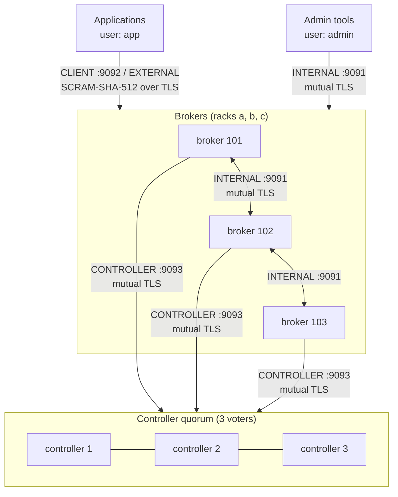

# Deploying Kafka

A production-style Apache Kafka 4.4 cluster, packaged two ways from one set of config files:

- **Docker Compose** (`docker-compose.yml`) for a single machine.
- **Kubernetes** (`kustomization.yaml` + `k8s/`) for a real cluster.

Both run the official `apache/kafka` image in KRaft mode, with no ZooKeeper.

## What you get



| Area | Setting | Why |
|---|---|---|
| Topology | 3 dedicated controllers, 3 brokers | Survives the loss of any one controller and any one broker |
| Durability | `default.replication.factor=3`, `min.insync.replicas=2`, `unclean.leader.election.enable=false` | An acknowledged write is on at least 2 brokers; no data-losing leader elections |
| Internal topics | Offsets, transactions and share-group state at RF 3 / min ISR 2 | The defaults are fine, but this makes them explicit |
| Topic creation | `auto.create.topics.enable=false` | Topics are created on purpose, with chosen partitions and retention |
| Encryption | TLS on every listener (TLS 1.3 between servers) | Nothing travels in plaintext |
| Server identity | Mutual TLS between controllers and brokers | A node must present a certificate signed by the cluster CA |
| Client identity | SASL/SCRAM-SHA-512 on the client listeners, re-authenticated hourly | Passwords never cross the wire; removed users lose access |
| Authorization | `StandardAuthorizer`, `allow.everyone.if.no.acl.found=false` | Default deny: a user can do only what an ACL allows |
| Secrets | Keystore passwords read through `FileConfigProvider` | No passwords in config files or environment variables |
| Rack awareness | `broker.rack` + `RackAwareReplicaSelector` | Replicas spread across racks; consumers can read from the nearest replica |
| Container | Non-root, read-only root filesystem, controlled shutdown on SIGTERM | Smaller attack surface, no log recovery after a normal restart |

### Listeners

| Listener | Port | Protocol | Who uses it |
|---|---|---|---|
| `CONTROLLER` | 9093 | SSL, client certificate required | Controllers among themselves, brokers to controllers |
| `INTERNAL` | 9091 | SSL, client certificate required | Broker replication, admin tools |
| `CLIENT` | 9092 | SASL_SSL (SCRAM-SHA-512) | Applications on the same network |
| `EXTERNAL` | 19092 / 29092 / 39092 | SASL_SSL (SCRAM-SHA-512) | Applications on your machine (Compose only) |

### Principals

| Principal | How it authenticates | Rights |
|---|---|---|
| `User:kafka-node` | Any certificate with `OU=kafka-nodes` (every broker and controller) | Super user |
| `User:admin` | The `admin.p12` client certificate | Super user |
| `User:app` | SCRAM password | Only the ACLs below |

`User:app` can produce to `orders`, consume `orders` in group `billing`, and produce to `orders.billing.dlq`. This matches what `ProduceOrders` and `ConsumeOrders` in this project need. Change the topics and ACLs in `scripts/init-cluster.sh`.

## Layout

```
deploy/
├── docker-compose.yml          Docker Compose entry point
├── .env                        image, cluster id, memory and thread sizes for Compose
├── kustomization.yaml          Kubernetes entry point (kubectl apply -k deploy/)
├── k8s/                        StatefulSets, Services, PDBs, NetworkPolicies, init Job
├── config/
│   ├── controller.properties   controller config template
│   ├── broker.properties       broker config template
│   └── admin.properties        admin client config (mTLS as User:admin)
├── scripts/
│   ├── gen-certs.sh            creates the CA, keystores and passwords in secrets/
│   ├── kafka-entrypoint.sh     renders the template, formats storage, starts Kafka
│   └── init-cluster.sh         creates the SCRAM user, topics and ACLs
└── secrets/                    generated, git-ignored
```

The config templates contain placeholders written as a name between two `@@` markers, such as `NODE_ID`. `kafka-entrypoint.sh` fills them from environment variables, so the same files serve every node on both platforms. Only per-node values (node id, listeners, rack) come from the environment.

## 1. Generate certificates and passwords

Needs only `openssl`.

```bash
cd deploy
./scripts/gen-certs.sh
```

This creates `secrets/`:

| File | Contents | Used by |
|---|---|---|
| `ca.crt` | CA certificate (truststore, PEM) | Everyone, including your applications |
| `controller-{1,2,3}.p12`, `broker-{1,2,3}.p12` | One keystore per node | Docker Compose |
| `kafka-node.p12` | One keystore with wildcard names for all pods | Kubernetes |
| `admin.p12` | Admin client certificate | Admin tools, init job |
| `node-credentials.properties` | Node keystore password | Brokers, controllers |
| `admin-credentials.properties` | Admin keystore password, the `app` user's SCRAM password | Admin tools, init job |
| `ca-private/ca.key` | CA private key | Nothing at runtime. Keep it offline. |

`secrets/` is in `.gitignore`. Never commit it.

## 2a. Run with Docker Compose

```bash
cd deploy
docker compose up -d
docker compose logs -f kafka-init     # SCRAM user, topics and ACLs; ends with "Cluster initialised"
docker compose ps
```

The memory and heap in `.env` are sized so six nodes fit on a laptop (about 18 GB in total). On real hosts, raise `BROKER_HEAP` to `-Xms6g -Xmx6g` and `BROKER_MEMORY` to at least 16g. The memory above the heap is the OS page cache, which serves most reads.

### How `docker-compose.yml` is organised

The blocks before `services:` are templates shared by the six Kafka containers, so each setting is written once. Three pieces of syntax make that work:

| Syntax | From | Meaning |
|---|---|---|
| `x-controller-env:` | Compose | Any top-level key starting with `x-` is ignored by Compose, so it can hold shared blocks without creating a container |
| `&controller-env` | YAML anchor | Names the block that follows |
| `*controller-env` | YAML alias | Reuses that block as a value or list item |
| `<<: *controller-env` | YAML merge key | Copies the block's keys into the surrounding mapping |

```yaml
x-controller-env: &controller-env          # shared environment for all controllers
  KAFKA_ROLE: controller
  CLUSTER_ID: ${CLUSTER_ID}
  QUORUM_VOTERS: 1@controller-1:9093,2@controller-2:9093,3@controller-3:9093

services:
  controller-1:
    <<: *kafka-node                        # image, entrypoint, tmpfs, ulimits, logging, network
    environment:
      <<: *controller-env                  # the shared environment above...
      NODE_ID: 1                           # ...plus what is specific to this node
    volumes:
      - *templates                         # list items are reused with a plain alias
    healthcheck: *controller-healthcheck   # a whole value reused as-is
```

| Template | Used by | Contains |
|---|---|---|
| `x-kafka-node` | all six nodes | Image, entrypoint, read-only root filesystem, tmpfs mounts, file limits, graceful stop, logging, network |
| `x-controller-env` / `x-broker-env` | controllers / brokers | Role, cluster id, quorum voters, heap, and thread counts for brokers |
| `x-common-mounts` | all six nodes | Config templates, scripts, CA certificate, node keystore password |
| `x-controller-healthcheck` / `x-broker-healthcheck` | controllers / brokers | TCP check on port 9093 / 9092 |
| `x-controller-resources` / `x-broker-resources` | controllers / brokers | Memory (and CPU for brokers) limits |

Rules worth knowing:

- **Keys written next to `<<:` win** over the template's keys, so a node can override any shared value.
- **The merge is shallow.** `<<: *kafka-node` copies top-level keys only; a node that writes its own `tmpfs:` replaces the whole list instead of extending it. That is why `environment` has its own `<<: *controller-env` inside it.
- **`<<:` only works inside a mapping.** List items use a plain alias (`- *templates`).
- `docker compose config` prints the file with every template expanded, which is the quickest way to check what a container really gets.

### Where the cluster id goes

`CLUSTER_ID` never appears next to a Kafka setting in the compose file; it travels through four places:

```
.env                                   CLUSTER_ID=JyM8fjpPROuic6KuRywfKw
  │  Compose reads .env automatically and substitutes ${CLUSTER_ID}
  ▼
docker-compose.yml                     x-controller-env / x-broker-env:   CLUSTER_ID: ${CLUSTER_ID}
  │  each service merges one of them:  environment: { <<: *controller-env, NODE_ID: 1 }
  ▼
container environment variable         CLUSTER_ID=JyM8fjpPROuic6KuRywfKw   (in all six containers)
  │
  ▼
scripts/kafka-entrypoint.sh            fails at startup if it is empty, then runs
                                       kafka-storage.sh format --cluster-id "$CLUSTER_ID" --config ... --ignore-formatted
```

There is no `cluster.id` setting in `server.properties`. `kafka-storage.sh format` writes the id into `meta.properties` in the node's data volume, and Kafka reads it from there on every start.

- **First start:** each container formats its empty volume with this id.
- **Later starts:** `--ignore-formatted` makes the format a no-op, so the id already in `meta.properties` wins. Changing `CLUSTER_ID` in `.env` has no effect on existing volumes.
- **All six must match:** a node whose `meta.properties` holds another cluster id cannot join, which protects against pointing a node at the wrong cluster's data.
- **Starting over:** `docker compose down -v` to delete the volumes, then put a new id (`kafka-storage.sh random-uuid`) in `.env`.

On Kubernetes the id comes from the `kafka-cluster` ConfigMap instead of `.env` (`k8s/controller.yaml`, `k8s/broker.yaml`); the entrypoint and `meta.properties` work the same way.

`QUORUM_VOTERS` makes this a **static** KRaft quorum (`controller.quorum.voters`). See [kraft.md](../kraft.md), sections 8 and 9, for why a dynamic quorum is safer when a controller loses its disk.

### Connect an application from your machine

```properties
bootstrap.servers=localhost:19092,localhost:29092,localhost:39092
security.protocol=SASL_SSL
sasl.mechanism=SCRAM-SHA-512
sasl.jaas.config=org.apache.kafka.common.security.scram.ScramLoginModule required username="app" password="<app.scram.password from secrets/admin-credentials.properties>";
ssl.truststore.type=PEM
ssl.truststore.location=/absolute/path/to/deploy/secrets/ca.crt
```

In this project, pass these through `KafkaConnection.security`:

```scala
val connection = KafkaConnection(
  bootstrapServers = "localhost:19092,localhost:29092,localhost:39092",
  clientId = "orders-producer",
  security = Map(
    "security.protocol"       -> "SASL_SSL",
    "sasl.mechanism"          -> "SCRAM-SHA-512",
    "sasl.jaas.config"        -> s"""org.apache.kafka.common.security.scram.ScramLoginModule required username="app" password="$password";""",
    "ssl.truststore.type"     -> "PEM",
    "ssl.truststore.location" -> "deploy/secrets/ca.crt"
  )
)
```

The examples in `Orders.scala` currently build a `KafkaConnection` without `security`, so they need this change to talk to this cluster.

### Admin commands

The brokers do not hold the admin certificate. Run tools from the init container, which does:

```bash
docker compose run --rm --entrypoint bash kafka-init
# inside:
B=broker-1:9091 C=/etc/kafka/admin/admin.properties
/opt/kafka/bin/kafka-topics.sh --bootstrap-server $B --command-config $C --describe --topic orders
/opt/kafka/bin/kafka-consumer-groups.sh --bootstrap-server $B --command-config $C --describe --group billing
/opt/kafka/bin/kafka-metadata-quorum.sh --bootstrap-server $B --command-config $C describe --status
```

### Stop and reset

```bash
docker compose down        # keep data
docker compose down -v     # delete all data volumes too
```

## 2b. Run on Kubernetes

```bash
cd deploy
./scripts/gen-certs.sh          # if not done already; NAMESPACE=... to use another namespace
kubectl apply -k .
kubectl -n kafka get pods -w
kubectl -n kafka logs -f job/kafka-init
```

What is deployed:

| Resource | Purpose |
|---|---|
| `StatefulSet/kafka-controller` (3) + headless Service | Controller quorum, node ids 1–3, 10 Gi volume each |
| `StatefulSet/kafka-broker` (3) + headless Service | Brokers, node ids 101–103, 200 Gi volume each, 16 Gi memory, 6 GB heap |
| `Service/kafka` | Bootstrap address for applications: `kafka.kafka.svc:9092` |
| `PodDisruptionBudget` × 2 | Node drains never take down more than one controller or one broker at a time |
| `NetworkPolicy` × 2 | Controllers reachable only from Kafka pods; brokers' client port only from labelled namespaces |
| `Job/kafka-init` | Creates the SCRAM user, topics and ACLs |
| ConfigMaps and Secrets | Generated from `config/`, `scripts/` and `secrets/`. Their names carry a content hash, so changing a file rolls the pods. |

Pods run as uid 1000 with no capabilities, a read-only root filesystem and the `RuntimeDefault` seccomp profile, which meets the `restricted` Pod Security Standard the namespace enforces. Required anti-affinity puts each controller and each broker on a different node, so a cluster needs at least 3 nodes.

### Connect an application in the cluster

Label the application's namespace so the NetworkPolicy lets it in:

```bash
kubectl label namespace my-app kafka-access=true
```

Then use `bootstrap.servers=kafka.kafka.svc:9092` with the same SASL_SSL settings as above, and mount `ca.crt` (for example by copying the `kafka-node-tls` secret's `ca.crt` key into your namespace).

Brokers advertise their pod DNS names, so `kubectl port-forward` is not enough for clients outside the cluster. For external access, add an `EXTERNAL` listener per broker behind a LoadBalancer or NodePort Service and advertise those addresses.

### Admin commands

The admin pod needs the labels `app.kubernetes.io/name=kafka,app.kubernetes.io/component=admin` (the NetworkPolicy only lets labelled pods reach the brokers' INTERNAL port), `fsGroup: 1000` (to read the mounted secret, whose files are root-owned with mode 0440), and the generated Secret and ConfigMap names:

```bash
TLS=$(kubectl -n kafka get secret -o name | grep kafka-admin-tls | cut -d/ -f2)
CFG=$(kubectl -n kafka get configmap -o name | grep kafka-admin-config | cut -d/ -f2)
kubectl -n kafka run kafka-admin --rm -it --restart=Never --image=apache/kafka:4.4.0 \
  --labels=app.kubernetes.io/name=kafka,app.kubernetes.io/component=admin \
  --overrides='{"spec":{"securityContext":{"runAsNonRoot":true,"runAsUser":1000,"runAsGroup":1000,"fsGroup":1000,"seccompProfile":{"type":"RuntimeDefault"}},"containers":[{"name":"kafka-admin","image":"apache/kafka:4.4.0","command":["bash"],"stdin":true,"tty":true,"securityContext":{"allowPrivilegeEscalation":false,"capabilities":{"drop":["ALL"]}},"volumeMounts":[{"name":"tls","mountPath":"/etc/kafka/secrets"},{"name":"cfg","mountPath":"/etc/kafka/admin"}]}],"volumes":[{"name":"tls","secret":{"secretName":"'"$TLS"'"}},{"name":"cfg","configMap":{"name":"'"$CFG"'"}}]}}'

# inside:
B=kafka-broker-0.kafka-broker-headless.kafka.svc.cluster.local:9091 C=/etc/kafka/admin/admin.properties
/opt/kafka/bin/kafka-metadata-quorum.sh --bootstrap-server $B --command-config $C describe --replication
/opt/kafka/bin/kafka-topics.sh --bootstrap-server $B --command-config $C --describe --topic orders
```

## How it was verified

**Docker Compose** (Docker Desktop with 7.7 GB of memory, so heaps and memory limits were lowered through environment variables for the run; the files themselves were not changed):

- All six nodes start healthy, `kafka-init` ends with "Cluster initialised", the quorum shows three caught-up voters and three observers, and `orders` has 12 partitions with full ISRs.
- From the host over the `EXTERNAL` listener (SASL_SSL, SCRAM as `app`): `acks=all` produce to `orders` and consume as group `billing` work. A wrong password, a group without ACLs and a topic without ACLs are rejected with `SaslAuthenticationException`, `GroupAuthorizationException` and `TopicAuthorizationException`.
- With one broker stopped, `acks=all` produce and consume still work (`min.insync.replicas=2`).
- A stopped or restarted broker or controller comes back and catches up (no under-replicated partitions afterwards). This test found that the `tmpfs` mounts were recreated root-owned on every restart, which stopped the entrypoint from writing the config; they now set `uid=1000,gid=1000`.

**Kubernetes** (minikube, 3 nodes, Calico so that NetworkPolicy is enforced; a test-only overlay lowered heaps, memory and volume sizes):

- All controllers and brokers become ready under the `restricted` Pod Security Standard, one per node, and `kafka-init` completes.
- An application pod in a namespace labelled `kafka-access=true` produces and consumes over `kafka.kafka.svc:9092`; the same pod in an unlabelled namespace cannot connect.
- The admin pod from "Admin commands" can reach the brokers and describe the quorum and topics.
- This test found two bugs, now fixed: the init job had no `fsGroup`, so it could not read its root-owned secret files; and admin pods were blocked by the NetworkPolicy, which now admits pods labelled `app.kubernetes.io/component=admin`.
- minikube's default storage provisioner does not apply `fsGroup` to its `hostPath` volumes on worker nodes, so on a multi-node minikube the data directories there need `chmod 0777` before first start. CSI-based storage classes used in real clusters do not have this problem.

Earlier, before Docker was available, these checks were also run:

- `docker compose config` and `kubectl kustomize` both succeed, and the generated names are wired into the workloads.
- The keystores made by OpenSSL open in Java's `keytool`, with the expected SANs and key usages.
- `ssl.principal.mapping.rules` was run through Kafka's own `SslPrincipalMapper`: node certificates map to `kafka-node`, and the admin certificate maps to `admin`.
- The rendered controller and broker configs pass `KafkaConfig` validation from Kafka 4.4.0, with the `${file:...}` secrets resolved.
- A real controller and broker were started from Kafka 4.4.0 jars with the rendered templates (changed only in ports, paths and replication factor 1). Over mutual TLS, the broker registered and was unfenced.
- The unmodified `init-cluster.sh` was run against that cluster (with `REPLICATION_FACTOR=1 MIN_ISR=1`). It created the user, the topics and the ACLs, and running it twice was safe.
- As `app` over SCRAM, producing to `orders` and consuming as group `billing` worked. A wrong password, a topic without ACLs, and a group without ACLs were all rejected with the right exceptions.
- SIGTERM led to a controlled shutdown.

## Before real production

These are deliberately left to your environment:

| Topic | What to do |
|---|---|
| Certificates | Issue them from your PKI or cert-manager instead of `gen-certs.sh`, with automatic rotation. Kafka can reload keystores without a restart through dynamic config. |
| Secrets | Store them in a secret manager (Vault, External Secrets, Sealed Secrets), not in files next to the manifests. |
| Rack | On Kubernetes, `BROKER_RACK` is the pod name. Set it to the node's zone (`topology.kubernetes.io/zone`), for example with an init container that reads the node label through the API, so replicas really spread across zones. |
| Storage | Set an SSD-backed `storageClassName`, and size volumes with the formulas in the main README (section 23). |
| Cluster id | Generate a new one per cluster (`kafka-storage.sh random-uuid`) and set it in `.env` and `kustomization.yaml`. |
| Monitoring | Add the Prometheus JMX exporter as a Java agent and alert on the metrics in the main README (section 31). JMX is disabled here because it has no authentication. |
| Quotas | Set produce/consume quotas per user so one application cannot starve the others. |
| External access | Add a per-broker external listener (see above). |
| Upgrades | Roll controllers first, then brokers, then finalise with `kafka-features.sh upgrade --release-version`. |
| Backups / DR | Mirror critical topics to a second cluster with MirrorMaker 2. |
