# KRaft: How Kafka's Control Plane Works

How three controllers agree on the cluster's metadata with Raft, how brokers follow along and catch up, and what happens in every failure you are likely to meet.

Companion documents: [README.md](README.md) (sections 13–16 give the short version) and [tiered-storage-and-security.md](tiered-storage-and-security.md).

## Contents

1. [The cluster used in every example](#1-the-cluster-used-in-every-example)
2. [One log holds everything](#2-one-log-holds-everything)
3. [Voters, observers, and the active controller](#3-voters-observers-and-the-active-controller)
4. [Bootstrapping three controllers](#4-bootstrapping-three-controllers)
5. [Raft in KRaft: states, timers, and elections](#5-raft-in-kraft-states-timers-and-elections)
6. [How one change is committed](#6-how-one-change-is-committed)
7. [How brokers follow and catch up](#7-how-brokers-follow-and-catch-up)
8. [Failure scenarios](#8-failure-scenarios)
9. [Changing the controller set](#9-changing-the-controller-set)
10. [Operating KRaft](#10-operating-kraft)
11. [Where it lives in the code](#11-where-it-lives-in-the-code)
12. [Self-test](#12-self-test)

---

## 1. The cluster used in every example

Three dedicated controllers and three brokers. Node ids must be unique across both roles.

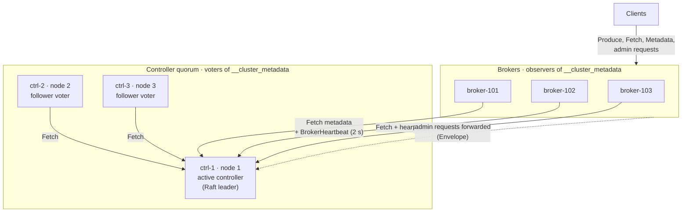

Everything talks to the **active controller** only: followers and brokers fetch from it, brokers heartbeat to it, brokers forward admin requests to it. Clients never connect to controllers.

`controller.properties` on ctrl-1 (ctrl-2 and ctrl-3 differ only in `node.id` and host):

```properties
process.roles=controller
node.id=1
listeners=CONTROLLER://ctrl-1:9093
controller.listener.names=CONTROLLER
controller.quorum.bootstrap.servers=ctrl-1:9093,ctrl-2:9093,ctrl-3:9093
metadata.log.dir=/var/lib/kafka/meta
```

`broker.properties` on broker-101:

```properties
process.roles=broker
node.id=101
listeners=PLAINTEXT://broker-101:9092
controller.listener.names=CONTROLLER
controller.quorum.bootstrap.servers=ctrl-1:9093,ctrl-2:9093,ctrl-3:9093
log.dirs=/var/lib/kafka/data
```

`controller.quorum.bootstrap.servers` works like a client's `bootstrap.servers`: any reachable controller is enough to discover the current leader and the voter set. The older `controller.quorum.voters=1@ctrl-1:9093,2@ctrl-2:9093,3@ctrl-3:9093` defines a **static** quorum that cannot be changed at runtime; use it only for clusters that already have it (section 9 shows how to migrate).

Do not run `process.roles=broker,controller` in production. A combined node mixes data-plane load with quorum latency, and losing it costs you a voter and a broker at once.

## 2. One log holds everything

All cluster metadata is one single-partition log, `__cluster_metadata-0`. Every controller and every broker keeps a full copy.

On ctrl-1:

```
/var/lib/kafka/meta/
├── meta.properties                         cluster.id, node.id, directory.id (this disk's identity)
└── __cluster_metadata-0/
    ├── quorum-state                        current epoch, leader, who this node voted for (fsynced)
    ├── 00000000000000000000.log            metadata records, normal Kafka segments
    ├── 00000000000000000000.index
    ├── 00000000000000000000.timeindex
    ├── 00000000000000000000-0000000000.checkpoint    bootstrap snapshot written by `format`
    ├── 00000000000000052116-0000000007.checkpoint    snapshot at offset 52116, epoch 7
    └── leader-epoch-checkpoint
```

Two kinds of records live in this log:

| Kind | Examples | Who reads them |
|---|---|---|
| **Raft control records** | `LeaderChangeMessage` (first record of every epoch), `VotersRecord` (the voter set), `KRaftVersionRecord`, `SnapshotHeaderRecord` / `SnapshotFooterRecord` | The Raft layer |
| **Metadata records** | `RegisterBrokerRecord`, `FenceBrokerRecord`, `UnfenceBrokerRecord`, `TopicRecord`, `PartitionRecord`, `PartitionChangeRecord`, `ConfigRecord`, `FeatureLevelRecord`, `AccessControlEntryRecord`, `ProducerIdsRecord`, `NoOpRecord`, … | The controller and every broker |

A snapshot file is the entire metadata state at one offset, written as the same records (one `TopicRecord` per topic, one `PartitionRecord` per partition, and so on). `<offset>-<epoch>.checkpoint` means "everything up to, not including, this offset".

Read either kind of file:

```bash
bin/kafka-dump-log.sh --cluster-metadata-decoder \
  --files /var/lib/kafka/meta/__cluster_metadata-0/00000000000000000000.log
bin/kafka-metadata-shell.sh \
  --snapshot /var/lib/kafka/meta/__cluster_metadata-0/00000000000000052116-0000000007.checkpoint
```

### Why brokers keep a copy

Brokers keep metadata so they can do their job **locally**, without asking the controller on every request. They keep it **on disk** so a restart does not mean downloading the whole cluster state again.

What a broker uses it for, constantly:

| Need | Metadata it reads |
|---|---|
| Knowing which partitions to lead or follow, and from whom to fetch | Partition records: replicas, leader, leader epoch, ISR |
| Answering clients' `Metadata` requests ("who leads `orders-2`?") | Topics, partitions, broker endpoints, which brokers are fenced |
| Authorizing every request | ACLs |
| Applying topic settings (retention, compaction, `min.insync.replicas`) and quotas | Config and quota records |
| Rejecting stale requests | Leader epochs, broker epochs, topic ids |
| Choosing which protocol versions to allow | Feature levels (`metadata.version`, …) |

Every Produce, Fetch and Metadata request touches some of this. If brokers had to ask the controller each time, three controllers would sit in the hot path of every client request in the cluster. Instead, the controller only *changes* metadata, and each broker holds its own read-only view (the `MetadataImage`) and answers from memory.

Why on disk and not just in memory:

- **Fast restart.** A restarting broker loads its latest local snapshot and log and fetches only what it missed, instead of downloading a full snapshot from the controller. That matters when hundreds of brokers restart in a rolling upgrade.
- **Working without the controllers.** If the quorum is lost, brokers keep serving with the metadata they have (section 8, scenario 3).
- **Less load on the controllers.** Brokers fetch "everything after offset N", like followers of any partition. The leader never rebuilds per-broker state or pushes full updates.
- **Precise staleness.** Because the broker's copy is a log with offsets, "how up to date is this broker?" has an exact answer (`last-applied-record-offset`). The controller uses it to decide when a broker may be unfenced and when a controlled shutdown may finish (section 7).

A broker's copy carries no authority: it does not vote, it does not count toward commits, and the broker only ever applies records the controllers have already committed. Like controllers, brokers snapshot every 20 MB of records or every hour and delete the log before the snapshot.

## 3. Voters, observers, and the active controller

| Role | Who | Replicates the log | Votes in elections | Counts for commit |
|---|---|---|---|---|
| **Leader** | exactly one voter per epoch | it *is* the source | yes | yes |
| **Follower voter** | the other controllers | yes, by Fetch | yes | yes |
| **Observer** | every broker (and a controller not yet added to the voter set) | yes, by Fetch | no | no |

The Raft leader runs the **active controller** (`QuorumController` in active mode). The other two controllers run it in standby mode: they replay every committed record into the same in-memory state and can take over immediately.

### One partition, one writer, no replication factor

`__cluster_metadata` has exactly **one partition**, and only the Raft leader appends to it. The other controllers never write records of their own; they only copy the leader's log. Every metadata change, whoever it comes from, goes to the leader: brokers forward admin requests to it and send their registrations, heartbeats and `AlterPartition` requests there. Because there is a single writer, all metadata changes have **one total order**, and the controller needs no locks or conflict resolution.

It is not a normal topic, so `replication.factor`, the ISR and `min.insync.replicas` do not apply to it. What decides where the copies live is the **voter set**: the list of controllers, stored in the log itself as a `VotersRecord` (or given in `controller.quorum.voters` for an old static quorum).

| | Normal topic partition | `__cluster_metadata` |
|---|---|---|
| Who holds copies | The replicas listed in partition metadata (`replication.factor`) | Every controller (voters) and every broker (observers) |
| Who writes | The partition leader, chosen by the controller | The Raft leader, chosen by an election among the voters |
| How followers copy | Fetch from the leader | Fetch from the leader (the same mechanism) |
| When a record is committed | Every replica in the ISR has it | A **majority of voters** has it on disk (2 of 3) |
| Who decides the leader | The active controller | The voters themselves, by vote |
| Unclean leader election | Possible if enabled | Impossible; the vote rules forbid it |

With three controllers there are three voting copies, and a record is committed as soon as any two of them have fsynced it; the third catches up afterwards. Brokers hold full copies too, but they do not vote and do not count toward the majority. That is why the quorum is "2 of 3", not "2 of 6".

### Why the metadata log has no ISR

For a normal topic, the ISR is what `acks=all` waits for: the partition leader answers the producer only when **every** replica in the ISR has the batch (and the ISR is at least `min.insync.replicas`). A change to `__cluster_metadata` instead is answered when a **majority** of voters has fsynced it; there is no ISR, no `min.insync.replicas`, and no `acks` setting, because there are no Produce requests.

| | Normal topic, `acks=all` | `__cluster_metadata` |
|---|---|---|
| Who sends the write | A producer | A broker or admin client, as a request to the controller (`CreateTopics`, `AlterPartition`, `BrokerHeartbeat`, …) |
| Who must have it before the reply | **Every** replica in the ISR, and at least `min.insync.replicas` of them | **A majority** of voters (2 of 3), whichever two are fastest |
| A slow replica | Holds up writes until it is dropped from the ISR (`replica.lag.time.max.ms`, 30 s) | Changes nothing: the other two form the majority |
| Who changes membership | The controller, through `AlterPartition` | The voters, through `VotersRecord` changes (section 9) |

The difference is not *where* the copies live (brokers hold copies of the metadata log too, without any ISR). It is **who decides membership and leadership**:

- **ISR replication needs an outside referee.** For a data partition, the controller decides the ISR and elects new leaders; the replicas never vote. The scheme works only because a trusted authority exists above it.
- **The metadata log cannot have a referee, because it *is* the referee.** If it used an ISR, something would have to manage its ISR and elect its leader, and nothing sits above it. So it uses Raft: the replicas elect their own leader by majority vote and commit by majority. The scheme is self-contained.

The two schemes also cost different amounts:

| | ISR (data partitions) | Majority / Raft (metadata) |
|---|---|---|
| Copies needed to survive *f* failures | *f* + 1 (RF 3 survives two losses and keeps serving reads) | 2*f* + 1 (3 voters survive one) |
| Needs an outside authority | Yes, the controller | No |
| Slow replica | Waited for until dropped from the ISR | Simply outvoted |
| Fits | Large data volumes, where every extra copy costs disk and network | Small, critical metadata that must make every decision by itself |

Paying for 2*f* + 1 copies of terabytes of topic data would be expensive, so Kafka uses the cheaper ISR scheme there and leans on the controller for decisions. For a few gigabytes of metadata, the majority quorum is worth it, because it is what makes every other decision in the cluster.

The two meet in one place: the controller **stores and manages** the ISR of every data partition. An ISR change is a `PartitionChangeRecord` in `__cluster_metadata`, committed by majority like any other record. That is why losing the quorum blocks ISR shrinking, which can stall `acks=all` producers on data partitions (section 8, scenario 3).

**Quorum arithmetic for 3 voters:**

| Voters alive | Majority (2 of 3)? | What works |
|---|---|---|
| 3 | yes | everything |
| 2 | yes | everything; one more failure stops metadata changes |
| 1 | no | no leader, no metadata changes (section 8, scenario 3) |
| 0 | no | same, and brokers keep running on the metadata they already have |

Three voters tolerate one failure. Five tolerate two, at the cost of one more round trip being in the majority path. Four is no better than three (a majority of 4 is 3), so always use an odd number.

## 4. Bootstrapping three controllers

### Format

Every node is formatted once before its first start. The cluster id must be the same everywhere.

```bash
CLUSTER_ID=$(bin/kafka-storage.sh random-uuid)

# each controller gets a directory id (the identity of its metadata disk)
C1=$(bin/kafka-storage.sh random-uuid); C2=$(bin/kafka-storage.sh random-uuid); C3=$(bin/kafka-storage.sh random-uuid)

# on ctrl-1, ctrl-2, ctrl-3: the SAME --initial-controllers value
bin/kafka-storage.sh format --cluster-id $CLUSTER_ID --config config/controller.properties \
  --initial-controllers "1@ctrl-1:9093:$C1,2@ctrl-2:9093:$C2,3@ctrl-3:9093:$C3"

# on each broker
bin/kafka-storage.sh format --cluster-id $CLUSTER_ID --config config/broker.properties \
  --no-initial-controllers
```

`format` on a controller writes `meta.properties` (with its `directory.id`) and the bootstrap snapshot `00000000000000000000-0000000000.checkpoint` containing a `KRaftVersionRecord` and a `VotersRecord` listing all three voters. The alternative is `--standalone` on one controller, then adding the other two with `add-controller` (section 9).

Why a *directory* id and not just the node id? If ctrl-2 loses its disk and comes back empty with the same node id, a plain id would let it vote as if it still had the log it promised to keep, and a committed record could be lost. The directory id identifies the disk, so an empty replacement is a different voter and must be added explicitly.

Kafka never auto-formats for the same reason: a majority of controllers starting with empty logs could elect a leader that is missing committed data.

Since Kafka 4.4 (KIP-1170), formatted directories are **not forward-compatible**: a node must run the same or a newer Kafka version than the `kafka-storage.sh` that formatted it, whatever `--release-version` was chosen. Format with the oldest version you intend to run.

### First start

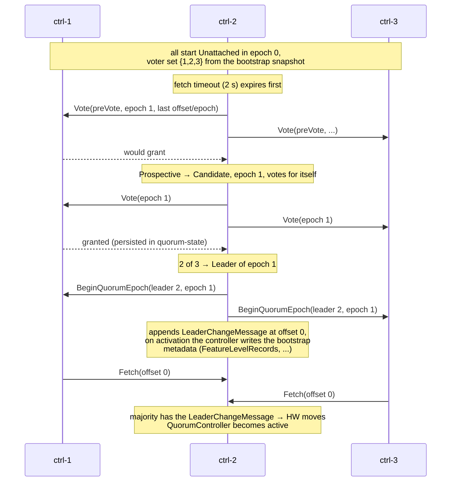

Shortly after, each controller registers itself (`RegisterControllerRecord`, with its endpoints and supported features). Whichever controller times out first usually wins the election; it does not have to be ctrl-1. Brokers that started meanwhile keep trying `controller.quorum.bootstrap.servers` until they find the leader.

## 5. Raft in KRaft: states, timers, and elections

### The states

Each controller is always in exactly one of these states (one class each in `raft/src/main/java/org/apache/kafka/raft/`):

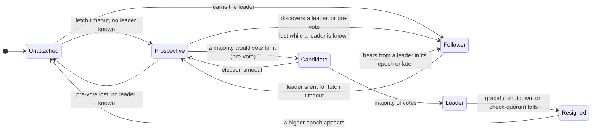

| State | Meaning |
|---|---|
| `Unattached` | Knows the epoch, but no leader and no vote cast in it yet |
| `Prospective` | Running a **pre-vote**: "would you vote for me?", without bumping the epoch (KIP-996) |
| `Candidate` | Bumped the epoch, voted for itself, collecting votes |
| `Leader` | Won the epoch; the only node that appends |
| `Follower` | Knows the leader of the current epoch and fetches from it |
| `Resigned` | Was leader of this epoch and has given it up; waits for the next epoch |

`QuorumState` writes the epoch, the leader and the vote to the `quorum-state` file and fsyncs it **before** answering. A controller that restarts therefore cannot vote twice in one epoch, which is the property that makes "at most one leader per epoch" hold.

### The timers

| Timer | Config | Default | Effect |
|---|---|---|---|
| Fetch timeout | `controller.quorum.fetch.timeout.ms` | 2 s | A follower that has not had a successful Fetch from the leader for this long starts a pre-vote |
| Election timeout | `controller.quorum.election.timeout.ms` | 1 s, randomized to 1–2 s | How long a Candidate (or Prospective) waits for votes before trying again |
| Election backoff | `controller.quorum.election.backoff.max.ms` | 1 s | Upper bound of the exponential backoff after a lost election, so two nodes do not keep splitting the vote |
| Check-quorum | 1.5 × fetch timeout | 3 s | The leader resigns if a majority of voters has not fetched from it within this window |
| Request timeout | `controller.quorum.request.timeout.ms` | 2 s | Vote, BeginQuorumEpoch, Fetch requests between controllers |
| Append linger | `controller.quorum.append.linger.ms` | 25 ms | The leader groups new records for up to this long before writing and flushing them |

### Who can win a vote

A voter grants its vote only if all of these hold:

1. The candidate's epoch is at least the voter's current epoch.
2. The voter has not already voted for someone else in that epoch.
3. The candidate's log is **at least as up to date** as the voter's: compare the epoch of the last record first, then its offset.
4. For a pre-vote only: the voter has not fetched successfully from a leader in the current epoch. A follower that is happily fetching rejects every pre-vote, which is what stops a returning node from disrupting a working leader.

Rule 3 is what makes elections safe. Every committed record is on a majority of voters, and every winner needs a majority of votes, so at least one voter in any winning majority holds every committed record and refuses to vote for a candidate that lacks them.

```
            last record (epoch, offset)
ctrl-1      (7, 9041)
ctrl-2      (7, 9044)   ← most up to date
ctrl-3      (6, 9050)   ← more records, but from an older epoch: least up to date

ctrl-3 asks for votes:  ctrl-1 refuses (7 > 6), ctrl-2 refuses → ctrl-3 cannot win
ctrl-1 asks for votes:  ctrl-3 grants (7 > 6), ctrl-2 refuses (9044 > 9041)
                        → ctrl-1 wins with 2 of 3 votes: its own and ctrl-3's
```

**How can ctrl-3 have more records but an older epoch?** Because **uncommitted** offsets can be reused after a leader change. A new leader starts writing right after the last record *it* has. If another replica holds records beyond that point that never reached a majority, the new leader writes different records at the same offsets, and the other replica's records become a dead branch. Committed offsets are never reused: every possible leader already has them. One history that produces the logs above:

```
1. ctrl-3 leads epoch 6; everything up to offset 8989 is committed on all three controllers.
2. ctrl-3 is cut off from the other two. For up to ~3 s (until check-quorum makes it resign)
   it keeps appending locally: 8990 … 9050 in epoch 6. Nobody else receives them: never committed.
3. ctrl-1 and ctrl-2 elect ctrl-2 as leader of epoch 7. It starts right after its last record,
   at 8990, and commits 8990 … 9041 together with ctrl-1. It has also appended 9042 … 9044,
   which ctrl-1 has not fetched yet. If ctrl-2 now stalls, ctrl-1 and ctrl-3 hold the election
   shown above, which ctrl-1 wins in epoch 8.
```

Resulting logs:

```
offset        … 8989 | 8990 ………………………… 9041 | 9042 … 9044 | 9045 … 9050
ctrl-1 (7)    …  e6  |  e7 (committed)           |             |
ctrl-2 (7)    …  e6  |  e7 (committed)           |  e7         |
ctrl-3 (6)    …  e6  |  e6 (never committed) ………………………………………………………… e6
```

ctrl-3's longer tail is a dead branch written by a leader that had already lost its majority. That is why the vote compares the **epoch of the last record first**: epoch 7 can only exist because a majority elected someone after epoch 6, so a log ending in epoch 7 contains everything epoch 6 ever committed. Length only breaks ties within the same epoch. When ctrl-3 rejoins, it learns that epoch 6 ended at 8990 and truncates 8990–9050 (scenario 6).

ctrl-1 wins even though ctrl-2 has three more records. Those three were never committed (they were not on a majority), so losing them is allowed: ctrl-2 will truncate them when it follows ctrl-1 (scenario 6).

### The first records of a new epoch

A new leader appends a `LeaderChangeMessage` (listing the voters that elected it) as the first record of its epoch. Its high watermark cannot advance until a record **from its own epoch** is committed. That is the standard Raft rule: a leader cannot tell whether records from earlier epochs are committed just by counting replicas, but once its own first record is on a majority, everything before it is committed too. Only then does the controller become active.

## 6. How one change is committed

Creating topic `orders` (3 partitions, replication factor 3) on the example cluster, with ctrl-1 as leader in epoch 7:

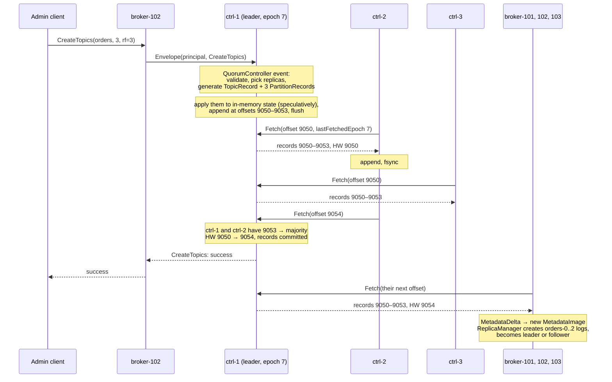

- **A voter counts only after it has flushed.** Followers fsync what they appended before their next Fetch, so the leader's "majority has offset n" means "n is on disk on a majority". Observers (brokers) do not need to fsync.
- **The leader learns progress from the fetch offset.** ctrl-2's `Fetch(9054)` is its acknowledgement of 9050–9053, exactly like follower replication of data partitions.
- **The client waits for the commit, the controller does not.** The next event can already see the new topic in memory. If ctrl-1 loses leadership before 9053 commits, it rolls its in-memory state back to the last committed offset (timeline data structures, README section 15) and the client gets an error and retries.
- **Brokers apply the change only after it is committed.** They never see the speculative state.
- **A large change is atomic.** Creating a topic with thousands of partitions produces more records than fit in one batch. The controller wraps them in `BeginTransactionRecord` / `EndTransactionRecord` (KIP-868), and brokers apply none of them until the end marker arrives.

Typical commit latency is a few milliseconds plus up to 25 ms of append linger plus one fsync on the leader and on the fastest follower. That is why metadata disks should be fast and not shared with heavy data traffic.

## 7. How brokers follow and catch up

### Steady state

Each broker runs a Raft client in **observer** mode, fetching `__cluster_metadata` from the leader just like a follower, without voting. On every committed batch:

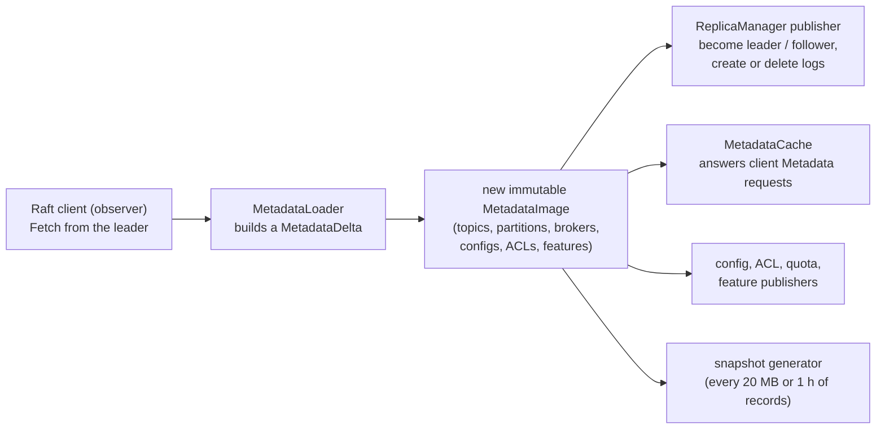

The broker also sends a `BrokerHeartbeat` every `broker.heartbeat.interval.ms` (2 s) carrying `currentMetadataOffset`: how far it has applied the log. The controller uses that number to decide when a broker is caught up and when a controlled shutdown may finish.

### A broker starting up

A broker moves through `STARTING → RECOVERY → RUNNING` (`BrokerState`, driven by `BrokerLifecycleManager`). The exact conditions, from `ReplicationControlManager` and `BrokerHeartbeatManager`:

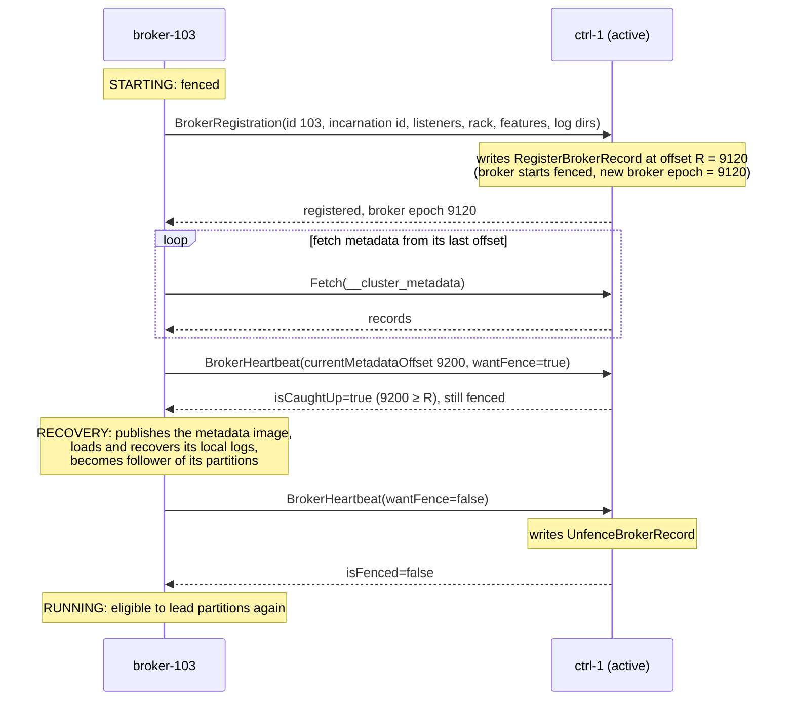

- **"Caught up" has a precise meaning:** the broker has applied the metadata log at least up to its own `RegisterBrokerRecord`. Everything that happened before it registered is then known to it.
- **Fenced brokers are never chosen as leaders** and are left out of client `Metadata` responses. A fenced broker can still replicate as a follower, which is how it catches up its data before being unfenced.
- **The broker epoch** is the offset of its `RegisterBrokerRecord`. Requests from an older incarnation (a zombie process from before a restart) carry an older broker epoch and are rejected.

### A broker that is far behind

The leader keeps only the log after its latest snapshot. If a broker asks for an offset the leader no longer has (a new broker, or one that was down for days), the Fetch response points it at the snapshot instead:

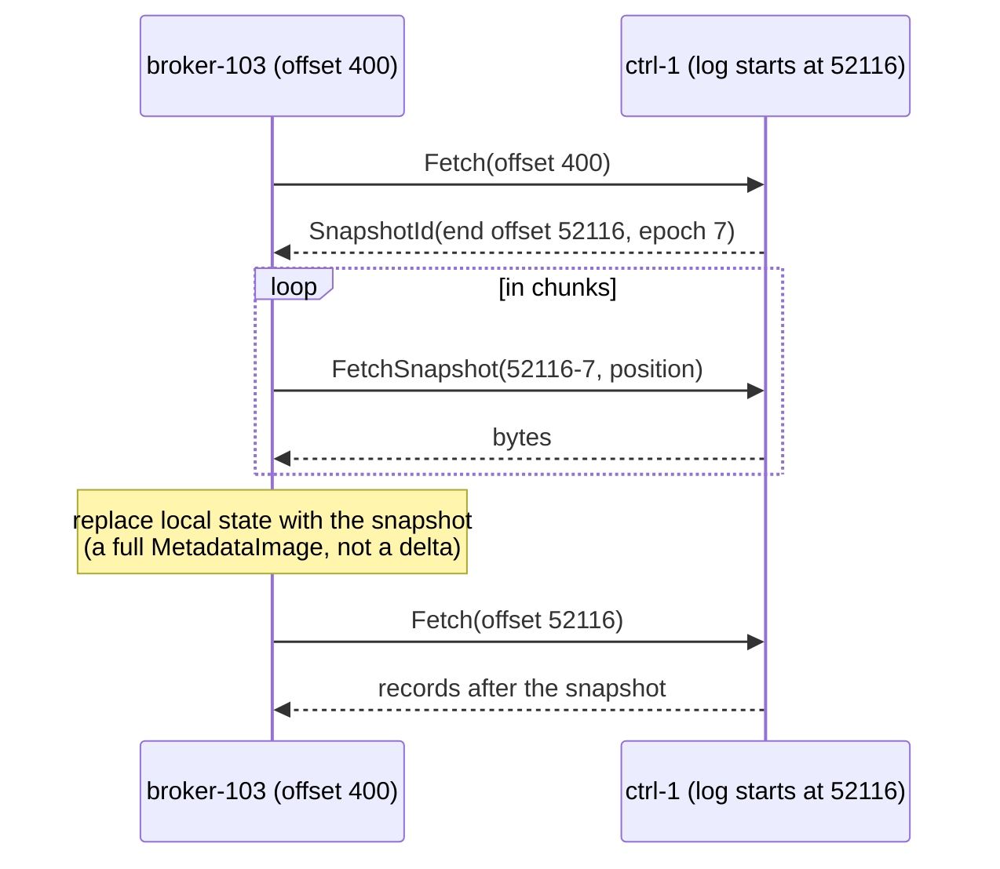

Snapshots are produced independently by every node from its own in-memory state, when `metadata.log.max.record.bytes.between.snapshots` (20 MB) of new records have accumulated or `metadata.log.max.snapshot.interval.ms` (1 h) has passed. Only the leader's snapshot is ever sent over the network.

### How far behind is a broker?

```bash
bin/kafka-metadata-quorum.sh --bootstrap-controller ctrl-1:9093 describe --replication
```

```
NodeId  DirectoryId             LogEndOffset  Lag  LastFetchTimestamp  LastCaughtUpTimestamp  Status
1       ILZ5MPTeRWakmJu99uBJCA  9254          0    1761136892120       1761136892120          Leader
2       b-DwmhtOheTqZzPoh52kfA  9254          0    1761136892050       1761136892050          Follower
3       g42deArWBTRM5A1yuVpMCg  9251          3    1761136892040       1761136892040          Follower
101     3Db5QLSqSZieL3rJBUUegA  9254          0    1761136891990       1761136891990          Observer
102     UegA3Db5QLSqSZieL3rJBU  9254          0    1761136891985       1761136891985          Observer
103     L3rJBUUegA3Db5QLSqSZie  9200          54   1761136891400       1761136891400          Observer
```

None of this table is stored in Kafka. The tool sends a `DescribeQuorum` request to the Raft leader, which answers from the per-replica state it keeps **in memory** and updates on every Fetch: the fetch offset (`LogEndOffset`), when that replica last fetched, and when it last reached the leader's log end. The `Lag` column is computed by the tool as leader `LogEndOffset` − replica `LogEndOffset`. So the numbers start over after a leader change (timestamps show `-1` until each replica has fetched from the new leader), and an observer that stops fetching is dropped from the list after 5 minutes. Add `--human-readable` to print "120 ms ago" instead of epoch milliseconds.

For history and alerting, use metrics instead. On the broker itself, `kafka.server:type=broker-metadata-metrics` reports `last-applied-record-offset` and `last-applied-record-lag-ms`. Healthy brokers stay within a few milliseconds of the leader, because the controller writes a `NoOpRecord` every `metadata.max.idle.interval.ms` (500 ms) even when nothing changes, so a broker can always tell whether it is current.

## 8. Failure scenarios

All scenarios start from the same healthy state: ctrl-1 leads epoch 7, ctrl-2 and ctrl-3 follow, the three brokers are unfenced, and topic `orders` has its partition `orders-2` led by broker-103 with ISR {103, 101, 102}.

| # | Scenario | Metadata changes | Data plane |
|---|---|---|---|
| 1 | Active controller crashes | paused ~2–5 s | unaffected |
| 2 | A follower controller crashes | unaffected (no slack left) | unaffected |
| 3 | Two controllers down: quorum lost | **stopped** | mostly works; failover and ISR changes stop |
| 4 | Active controller cut off from the other two | paused ~3–5 s | unaffected |
| 5 | A partitioned follower comes back | unaffected | unaffected |
| 6 | A controller holds uncommitted records from an old epoch | unaffected | unaffected |
| 7 | A broker crashes | normal | its partitions fail over after 9 s |
| 8 | A broker is cut off from the controllers only | normal | its partitions fail over; `acks=1` writes to it can be lost |
| 9 | A broker shuts down cleanly | normal | leaders moved first, no client errors |
| 10 | A broker comes back after a long outage, or a new broker joins | normal | catches up via snapshot |
| 11 | A controller loses its disk | see section 9 | unaffected |
| 12 | Rolling restart of the controllers | brief pause per leader change | unaffected |

### Scenario 1: the active controller crashes

ctrl-1's process dies at t = 0.

```
t (s)   ctrl-1     ctrl-2 and ctrl-3                                            brokers
0       ✗ dies     followers; their next Fetch to ctrl-1 fails                  Fetch/heartbeat to ctrl-1 fail, keep retrying
~2      —          fetch timeout (2 s) → both become Prospective and            keep serving clients from their
                   send pre-votes; each grants the other's pre-vote if          current MetadataImage
                   the other's log is at least as up to date as its own
~2–4    —          the winner becomes Candidate (epoch 8), gets 2 of 3 votes
                   (its own + the other follower's) → Leader of epoch 8
        —          LeaderChangeMessage committed with the other follower
        —          QuorumController active: replays to the end, gives every
                   unfenced broker a fresh 9 s heartbeat window
~3–5    —                                                                       find the new leader, Fetch and heartbeat to it
```

- **No broker is fenced** by the failover. On activation the new controller treats every unfenced broker as having just heartbeated (`ClusterControlManager.activate`), so they have a full `broker.session.timeout.ms` (9 s) to reach it.
- **Producers and consumers notice nothing.** Partition leaders, ISRs and the high watermarks of data partitions are not affected by which controller is active.
- **Admin requests in flight** fail with a retriable error (`NOT_CONTROLLER`, request timeout) and are retried by the client against the new controller.
- **A subtle case:** records ctrl-1 had appended and sent to ctrl-2 *before* dying, but not yet committed, are kept if ctrl-2 wins, and become committed once its first epoch-8 record commits. So a `CreateTopics` that failed on the client may in fact have happened; the retry then gets `TopicExistsException`. Admin tooling should treat "already exists" after a retry as success.
- **ctrl-1 restarting** rejoins as a follower of epoch 8: it reads `quorum-state`, learns the new leader from any voter, truncates any of its own uncommitted records (scenario 6), and fetches the rest.

### Scenario 2: a follower controller crashes

ctrl-3 dies. ctrl-1 stays leader; commits now need **both** ctrl-1 and ctrl-2.

- Nothing is visible to clients or brokers.
- There is no slack left. If ctrl-2's disk is slow, every commit waits for it, and `commit-latency-avg` rises. If ctrl-2 also fails, you are in scenario 3. Treat a lost controller as urgent even though nothing is broken yet.
- When ctrl-3 comes back it fetches from its last offset. If the leader has already deleted that part of the log behind a snapshot, ctrl-3 downloads the snapshot first, exactly like a broker (section 7).

### Scenario 3: two controllers are down (quorum lost)

ctrl-2 and ctrl-3 are down. ctrl-1 cannot commit anything: it has 1 of 3. Within 3 s, check-quorum makes it resign, and from then on it keeps trying pre-votes that cannot succeed. **The metadata log is frozen**, but every broker keeps its last `MetadataImage` and keeps serving.

| Still works | Stops working |
|---|---|
| Produce and fetch on partitions whose leader is alive | Leader election: partitions led by a broker that dies go **offline** |
| Consumer groups, offset commits (the coordinators live on brokers) | ISR changes (`AlterPartition` cannot commit): see below |
| Transactions and idempotent producers, until a broker exhausts its cached block of 1,000 producer ids | Creating, deleting, reconfiguring topics; ACL, quota and config changes |
| Authorization with the ACLs already known | Brokers registering or restarting: a restarted broker stays fenced |
| Clients connecting and fetching metadata from brokers | Fencing: a dead broker is never fenced, so clients keep being told it leads its partitions |

The worst hidden effect is on ISR shrinking. Say broker-101 dies while the quorum is down. broker-103 (leader of `orders-2`) notices that 101 stopped fetching and sends `AlterPartition` to shrink the ISR to {103, 102}. That request cannot commit. Until it does, the leader keeps counting 101 in the "maximal ISR" (README section 3), so the high watermark of `orders-2` cannot move past what 101 had. Result: `acks=all` produces to `orders-2` time out, and consumers of `orders-2` see no new data, even though two healthy replicas exist.

Recovery is automatic: start one more controller. With 2 of 3 voters up, an election succeeds (the more up-to-date of the two wins), the frozen `AlterPartition`s and fencing decisions commit, and brokers catch up from the log.

**Never "fix" a lost quorum by reformatting controllers.** An empty controller with the old voter identity could help elect a leader that is missing committed metadata. Bring the original disks back, or follow section 9 to replace voters.

### Scenario 4: the active controller is cut off from the other two

A network fault separates ctrl-1 from ctrl-2 and ctrl-3. Brokers may still reach some or all of them.

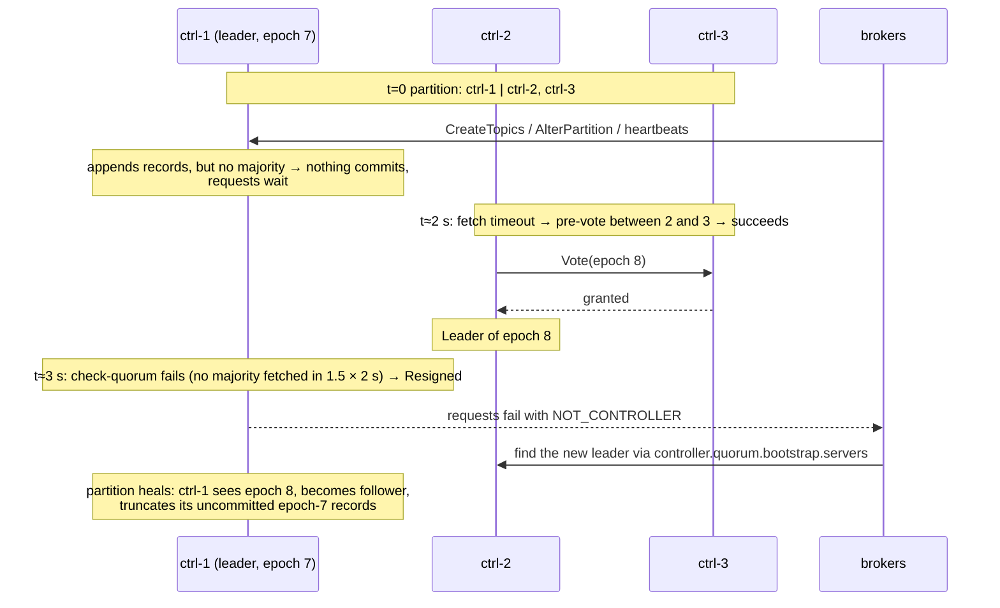

- **There is never a second working leader.** ctrl-1 kept the title "leader of epoch 7" for a moment, but it could not commit anything, so it could not change the cluster.
- **Check-quorum** is why ctrl-1 steps down by itself instead of holding brokers and clients on a dead end until the partition heals.
- A broker that can reach **only** ctrl-1 cannot heartbeat to the new leader. After 9 s it is fenced, which is scenario 8.

### Scenario 5: a partitioned follower comes back

ctrl-3 is cut off for a minute and then reconnects.

- While cut off, its fetch timeout expires and it becomes Prospective. Its pre-votes reach nobody, so **it never bumps its epoch**: a pre-vote does not change state on anyone.
- When it reconnects, ctrl-2 is still fetching happily from ctrl-1, so it rejects ctrl-3's pre-vote. ctrl-3 learns the current leader from the responses, becomes a follower, and catches up.

Without pre-vote (classic Raft), ctrl-3 would have increased its epoch on every election timeout while cut off. On reconnecting, its higher epoch would force ctrl-1 to step down and trigger a pointless election. Pre-vote (KIP-996) exists to stop exactly that.

### Scenario 6: a controller holds uncommitted records from an old epoch

The election example in section 5: ctrl-2 had records 9042–9044 from epoch 7 that never reached a majority; ctrl-1 won epoch 8 and wrote its `LeaderChangeMessage` at offset 9042.

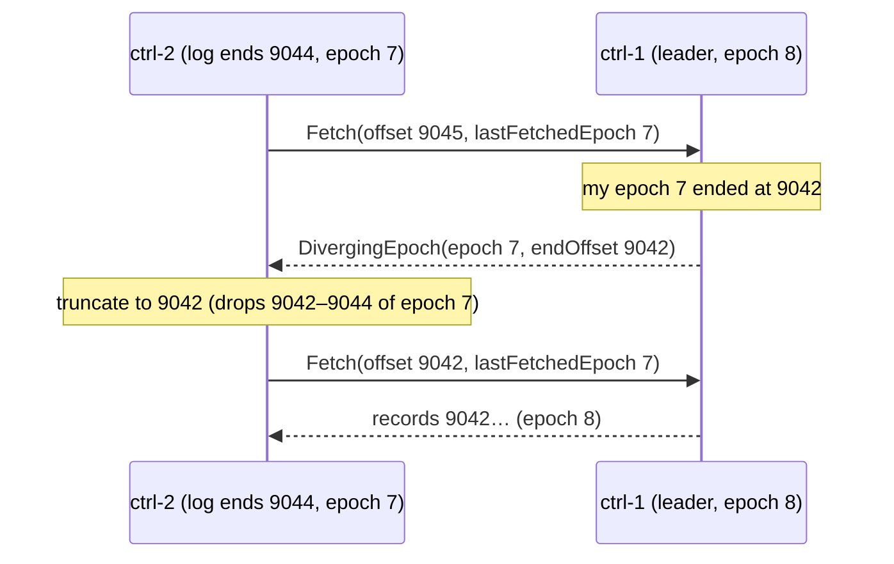

The dropped records were never committed, so no client was ever told they succeeded and no broker ever applied them.

### Scenario 7: a broker crashes

broker-103 (leader of `orders-2`) loses power.

```
t (s)   broker-103   ctrl-1 (active)                                  broker-101, broker-102                clients
0       ✗            last heartbeat from 103 at t≈0                    stop getting data from 103            produce/fetch to 103 fail, retry
9       —            session timeout: writes FenceBrokerRecord(103)    
                     and PartitionChangeRecords: for every partition
                     with 103 in its ISR, remove 103; for every partition
                     it led, elect a new leader from the ISR (orders-2 → 101,
                     leader epoch +1)
9+ms    —                                                              apply the records: 101 becomes leader
                                                                       of orders-2, 102 follows 101
9+      —                                                                                                    refresh metadata (or KIP-951 hints),
                                                                                                             continue against 101
```

- **Failover time ≈ `broker.session.timeout.ms`** (9 s) plus a few milliseconds of commit and propagation. Lowering it speeds up failover but risks fencing brokers during GC pauses.
- If the ISR had shrunk below `min.insync.replicas` before the crash, the remaining replicas may be in the ELR and the controller can still elect one without data loss (README section 3).

**When broker-103 restarts:**

1. It registers with a new incarnation id. Its `previousBrokerEpoch` tells the controller whether it shut down cleanly. After an unclean shutdown it is removed from every ELR, since its unflushed tail may be gone.
2. It fetches metadata until it passes its new `RegisterBrokerRecord` (STARTING → RECOVERY).
3. It recovers its local logs and, from the metadata image, learns it is now a **follower** of `orders-2` in leader epoch N+1. Using leader epochs, it truncates any records the new leader does not have, then fetches the rest.
4. It asks to be unfenced and becomes RUNNING. The leaders add it back to their ISRs once it has caught up (`AlterPartition`).
5. Leadership does not move back by itself immediately. With `auto.leader.rebalance.enable=true` the controller moves it back to the preferred replica (the first in the replica list) after its periodic imbalance check (`leader.imbalance.check.interval.seconds`, 300 s).

### Scenario 8: a broker is cut off from the controllers but not from clients

broker-103 can still talk to clients, but not to any controller.

1. Its metadata fetches and heartbeats fail. It keeps serving with its last metadata: it still believes it leads `orders-2`.
2. After 9 s the controller fences 103 and elects broker-101 as leader of `orders-2` in a new leader epoch. Brokers 101 and 102 apply that; 102 now fetches from 101, not from 103.
3. A producer with stale metadata still sends to 103:
   - With **`acks=all`**, 103 cannot get the write replicated (nobody fetches from it any more), its high watermark is stuck, and the request times out. The producer refreshes metadata from another broker, finds 101, and retries there. **No data is lost.**
   - With **`acks=1`**, 103 appends and acknowledges immediately. When 103 later rejoins, it learns that leader epoch N+1 started at an earlier offset and truncates those records. **Acknowledged data is lost.** This is the textbook reason to use `acks=all`.
4. Consumers reading from 103 only see data below its old high watermark, so they never see the doomed `acks=1` records; they just stall until they refresh metadata.

The leader-epoch fencing on fetches makes this safe for replication: when 103 later fetches from 101 with its stale epoch, 101 answers with a diverging epoch and 103 truncates.

### Scenario 9: a broker shuts down cleanly

`kill -TERM` (or a rolling restart) on broker-103:

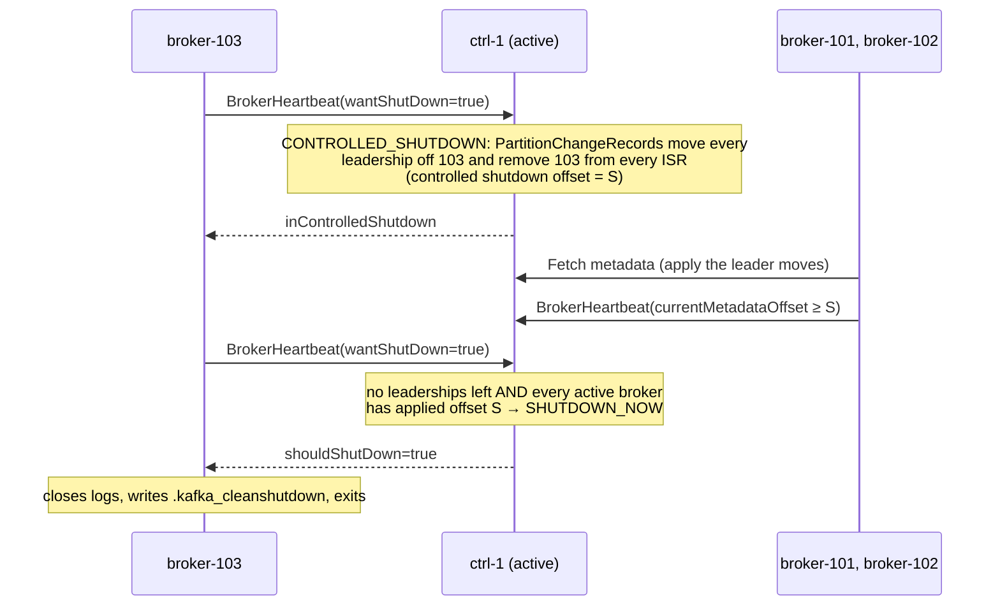

The controller waits until **every other active broker** has applied the leadership changes before letting 103 go. Clients therefore always find a new leader that already knows it is the leader, and see at most a `NOT_LEADER_OR_FOLLOWER` that a metadata refresh fixes. Because 103 was removed from the ISRs in an orderly way, `min.insync.replicas` decisions are correct during the restart.

During a rolling restart, wait for `UnderReplicatedPartitions` to return to 0 before stopping the next broker; otherwise the next shutdown may take the ISR of some partitions below `min.insync.replicas`.

### Scenario 10: a broker returns after a long outage, or a new broker joins

broker-103 was down for a week. Since then the controllers have snapshotted many times and deleted old log segments.

1. broker-103 registers and is fenced.
2. Its first Fetch asks for an offset the leader no longer has. The leader returns the id of its latest snapshot, and broker-103 downloads it with `FetchSnapshot` (section 7), then fetches the records after it.
3. Instead of applying a week of deltas, it loads one complete image. Topics that were deleted in the meantime are simply absent from the image, and broker-103 deletes their logs locally (marked as stray, `-stray` directories, then removed).
4. Data catch-up happens per partition as a follower, possibly from remote storage for tiered topics (tiered-storage-and-security.md, section 7).

A brand-new broker (formatted with the cluster id and `--no-initial-controllers`) follows the same path. It hosts no partitions until you reassign some to it: adding a broker never moves data by itself.

### Scenario 11: a controller loses its disk

ctrl-3's metadata disk is replaced and the node comes back empty.

- **Dynamic quorum (`kraft.version=1`):** the voter set contains (3, old directory id). The rebuilt node formats with `--no-initial-controllers` and gets a **new** directory id, so it starts as an observer and cannot vote with an empty log. Remove the old voter and add the new one (section 9). Safe by construction.
- **Static quorum (`controller.quorum.voters`):** voters are identified only by node id, so the empty node rejoins as voter 3 with an empty log. Picture a record X committed on ctrl-1 and on ctrl-3's *old* disk, while ctrl-2 lagged behind. Now ctrl-1 crashes. ctrl-2 and the empty ctrl-3 form a majority, ctrl-3 votes for ctrl-2 (its log beats an empty one), and X is gone from the cluster. This is the main reason to migrate to a dynamic quorum (section 9).

### Scenario 12: rolling restart of the controllers

1. Restart the two **followers** first, one at a time. After each, wait until `describe --replication` shows its lag at 0.
2. Restart the **leader** last. On a clean shutdown it resigns with `EndQuorumEpoch`, listing the most caught-up followers as preferred successors. They start the election immediately instead of waiting for the 2 s fetch timeout, so the pause is usually well under a second.
3. Never take a second controller down while one is still catching up: that is scenario 3.

## 9. Changing the controller set

With a dynamic quorum (`kraft.version=1`, KIP-853) the voter set is itself stored in the log as a `VotersRecord`, so it changes the same way as any other metadata: by committing a record. The leader enforces three rules (`AddVoterHandler`, `RemoveVoterHandler`):

1. **One change at a time.** While a `VotersRecord` is uncommitted, another add or remove is rejected.
2. **No duplicate ids.** A node id that is already a voter cannot be added again, even with a new directory id. Remove the old (id, directory id) first.
3. **Catch up first.** A new voter must have replicated up to the leader's log end offset, so adding it never stalls the high watermark.

### Adding a controller (ctrl-4, node 4)

```bash
# on ctrl-4: same cluster id, no initial voters → it starts as an observer
bin/kafka-storage.sh format --cluster-id $CLUSTER_ID --config config/controller.properties \
  --no-initial-controllers
bin/kafka-server-start.sh config/controller.properties

# wait until it has caught up (Lag 0, Status Observer)
bin/kafka-metadata-quorum.sh --bootstrap-controller ctrl-1:9093 describe --replication

# promote it; --command-config is ctrl-4's OWN config file
bin/kafka-metadata-quorum.sh --bootstrap-controller ctrl-1:9093 \
  --command-config config/controller.properties add-controller
```

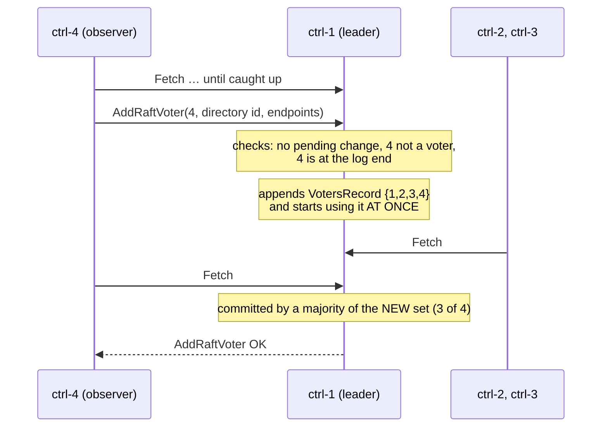

A new voter set takes effect the moment it is appended, not when it commits. That is the Raft single-server membership change, and it is why only one change may be in flight: two overlapping changes could produce two disjoint majorities.

**Automatic joining.** With `controller.quorum.auto.join.enable=true` (since Kafka 4.2, default `false`) a controller that is caught up adds itself to the voter set, so the manual `add-controller` step is not needed. The flip side: a controller with this setting must be **shut down before** you remove it, or it will simply join again.

### Removing a controller

```bash
bin/kafka-metadata-quorum.sh --bootstrap-controller ctrl-1:9093 \
  remove-controller --controller-id 3 --controller-directory-id g42deArWBTRM5A1yuVpMCg --unregister
```

Remove a controller **before** shutting it down. If you remove the current leader, it commits the new voter set and then resigns so the remaining voters elect a new leader.

### Replacing ctrl-3 whose disk died (scenario 11)

Prefer **add first, then remove**, so you never drop to two voters:

1. Bring up the replacement under a new node id (ctrl-4) as above, and add it: voters {1, 2, 3(dead), 4}. Commits need 3 of 4, which {1, 2, 4} provide.
2. Remove (3, old directory id): voters {1, 2, 4}.

If you must reuse node id 3, remove (3, old directory id) first (voters {1, 2}, now with **no** fault tolerance), format the new disk with `--no-initial-controllers`, start it, wait for it to catch up, and add (3, new directory id).

### From a static to a dynamic quorum

```bash
bin/kafka-features.sh --bootstrap-controller ctrl-1:9093 describe        # kraft.version 0 = static
bin/kafka-features.sh --bootstrap-server broker-101:9092 upgrade --feature kraft.version=1
```

Then, on every node, replace `controller.quorum.voters` with `controller.quorum.bootstrap.servers` and roll the cluster.

## 10. Operating KRaft

### Commands

```bash
# leader, epoch, high watermark, voters and observers
bin/kafka-metadata-quorum.sh --bootstrap-controller ctrl-1:9093 describe --status

# per-node log end offset and lag (section 7 shows sample output)
bin/kafka-metadata-quorum.sh --bootstrap-controller ctrl-1:9093 describe --replication

# feature levels: metadata.version, kraft.version, ...
bin/kafka-features.sh --bootstrap-controller ctrl-1:9093 describe

# offline inspection
bin/kafka-dump-log.sh --cluster-metadata-decoder --files <metadata dir>/__cluster_metadata-0/<segment>.log
bin/kafka-metadata-shell.sh --snapshot <metadata dir>/__cluster_metadata-0/<offset>-<epoch>.checkpoint
```

`describe --status` sample (field names as printed by the tool):

```
ClusterId:              fMCL8kv1SWm87L_Md-I2hg
LeaderId:               1
LeaderEpoch:            7
HighWatermark:          9254
MaxFollowerLag:         3
MaxFollowerLagTimeMs:   12
CurrentVoters:          [{"id": 1, ...}, {"id": 2, ...}, {"id": 3, ...}]
CurrentObservers:       [{"id": 101, ...}, {"id": 102, ...}, {"id": 103, ...}]
```

A rising `LeaderEpoch` without anyone restarting a controller means elections are happening: look for GC pauses, slow disks, or network trouble between controllers.

### Metrics

| Metric | Healthy | Meaning |
|---|---|---|
| `kafka.controller:type=KafkaController,name=ActiveControllerCount` | sum over controllers = 1 | 0 means no active controller (scenario 3) |
| `raft-metrics`: `current-state`, `current-leader`, `current-epoch` | stable | Which role each node is in, and how often the epoch changes |
| `raft-metrics`: `commit-latency-avg` / `-max` | a few ms to tens of ms | Time from append to commit; grows with slow follower disks |
| `raft-metrics`: `election-latency-avg` / `-max` | rare, < a few s | How long elections take |
| `raft-metrics`: `high-watermark`, `log-end-offset` | close together | A gap means records waiting for a majority |
| `kafka.controller`: `EventQueueTimeMs`, `EventQueueProcessingTimeMs` | low | The single-threaded controller is the bottleneck when these grow |
| `kafka.controller`: `LastAppliedRecordOffset`, `LastCommittedRecordOffset`, `LastAppliedRecordLagMs` | close | Standby controllers keeping up |
| `kafka.controller`: `FencedBrokerCount`, `ActiveBrokerCount`, `TimedOutBrokerHeartbeatCount` | 0 fenced, all active, 0 timeouts | Broker liveness as the controller sees it |
| `kafka.controller`: `NewActiveControllersCount` | rarely increasing | Controller failovers |
| `kafka.controller`: `MetadataErrorCount` | 0 | Records a node failed to apply: investigate immediately |
| `broker-metadata-metrics`: `last-applied-record-offset`, `last-applied-record-lag-ms` (on brokers) | lag in ms | How current each broker's metadata is |

### Configs

| Config | Default | Notes |
|---|---|---|
| `controller.quorum.bootstrap.servers` | none | Dynamic quorum: any subset of the controllers |
| `controller.quorum.fetch.timeout.ms` | 2 s | Follower failure detection; check-quorum is 1.5× this |
| `controller.quorum.election.timeout.ms` | 1 s | Randomized to 1–2 s |
| `controller.quorum.election.backoff.max.ms` | 1 s | Backoff between failed elections |
| `controller.quorum.request.timeout.ms` | 2 s | Requests between controllers |
| `controller.quorum.append.linger.ms` | 25 ms | Batching on the leader |
| `broker.heartbeat.interval.ms` | 2 s | Broker → controller heartbeats |
| `broker.session.timeout.ms` | 9 s | Fencing after missed heartbeats; drives broker failover time |
| `metadata.log.dir` | first of `log.dirs` | Put it on a fast, dedicated disk on controllers |
| `metadata.log.max.record.bytes.between.snapshots` | 20 MB | Snapshot trigger |
| `metadata.log.max.snapshot.interval.ms` | 1 h | Snapshot trigger |
| `metadata.max.idle.interval.ms` | 500 ms | `NoOpRecord` interval |

### Sizing and placement

- **3 controllers** for most clusters, **5** if you must survive two simultaneous failures (for example one zone down plus one maintenance restart). Spread them across racks or zones: with 3 zones, one controller per zone survives a zone loss.
- Kafka's guidance is about 5 GB of memory and 5 GB of disk for the metadata log on each controller for a typical cluster.
- Keep controllers on their own machines (`process.roles=controller`). Their latency affects every metadata change cluster-wide.

### Common mistakes

| Mistake | Consequence |
|---|---|
| 2 or 4 controllers | No better fault tolerance than 1 or 3 |
| All controllers in one zone | A zone failure freezes metadata: no failover anywhere |
| Reformatting a controller to "fix" it | Possible loss of committed metadata (scenarios 3 and 11) |
| Restarting the next controller before the last one caught up | Quorum loss during maintenance |
| Exposing the controller listener to clients | Clients have no business there; it is also a security boundary |
| `broker.session.timeout.ms` very low | Brokers fenced during GC pauses, leadership churn |
| Combined `broker,controller` nodes in production | Data-plane load slows commits; one failure costs a voter and a broker |

## 11. Where it lives in the code

| Concept | Start reading at |
|---|---|
| Raft client, fetch, elections | `raft/src/main/java/org/apache/kafka/raft/KafkaRaftClient.java` |
| States and transitions | `raft/.../QuorumState.java`, `UnattachedState.java`, `ProspectiveState.java`, `CandidateState.java`, `LeaderState.java`, `FollowerState.java`, `ResignedState.java` |
| Persisted vote and epoch | `raft/.../FileQuorumStateStore.java` (`quorum-state`) |
| Timers and configs | `raft/.../QuorumConfig.java`, `raft/.../MetadataLogConfig.java`, `raft/.../KRaftConfigs.java` |
| Voter changes | `raft/src/main/java/org/apache/kafka/raft/internals/AddVoterHandler.java`, `RemoveVoterHandler.java` |
| Snapshots | `raft/src/main/java/org/apache/kafka/snapshot/` |
| Active controller | `metadata/src/main/java/org/apache/kafka/controller/QuorumController.java` |
| Broker liveness and fencing | `metadata/.../controller/BrokerHeartbeatManager.java`, `ClusterControlManager.java` |
| Partition leaders and ISR | `metadata/.../controller/ReplicationControlManager.java`, `PartitionChangeBuilder.java` |
| Broker side | `server/src/main/java/org/apache/kafka/server/BrokerLifecycleManager.java`, `metadata/src/main/java/org/apache/kafka/image/` (`MetadataImage`, `MetadataDelta`, `loader/MetadataLoader`) |
| Formatting | `core/src/main/scala/kafka/tools/StorageTool.scala`, `metadata/src/main/java/org/apache/kafka/metadata/storage/Formatter.java` |
| RPCs | `clients/src/main/resources/common/message/` `VoteRequest.json`, `BeginQuorumEpochRequest.json`, `EndQuorumEpochRequest.json`, `FetchRequest.json`, `FetchSnapshotRequest.json`, `AddRaftVoterRequest.json`, `RemoveRaftVoterRequest.json`, `BrokerRegistrationRequest.json`, `BrokerHeartbeatRequest.json` |
| Official operations guide | `docs/operations/kraft.md` |

## 12. Self-test

<details><summary>1. Three controllers, ctrl-1 leads. ctrl-2 and ctrl-3 both die. Can producers still write?</summary>

Yes, to partitions whose leaders are alive, as long as no replica of that partition fails. But nothing can change in the metadata: no leader election, no ISR shrink, no fencing. If a follower of a partition dies now, `acks=all` writes to that partition stall, because the ISR cannot shrink without the controller.
</details>

<details><summary>2. Why can a controller that comes back after a network partition not trigger a new election?</summary>

Pre-vote. While isolated it only ran pre-votes, so it never raised its epoch. When it reconnects, the other followers are fetching from a live leader and reject its pre-vote, and it simply follows the current leader.
</details>

<details><summary>3. The active controller fails over. Why aren't all brokers fenced, given the new controller has no heartbeat history?</summary>

On activation, `ClusterControlManager.activate` records "now" as the last contact time of every unfenced broker, giving each a full `broker.session.timeout.ms` to find and heartbeat the new controller.
</details>

<details><summary>4. When exactly is a starting broker unfenced?</summary>

When it has applied the metadata log at least up to the offset of its own `RegisterBrokerRecord` (then the heartbeat reply says `IsCaughtUp`), has finished loading and recovering its logs (RECOVERY), and then sends a heartbeat with `wantFence=false`. The controller writes an `UnfenceBrokerRecord`.
</details>

<details><summary>5. A <code>CreateTopics</code> call fails with a timeout during a controller failover, and the retry says the topic already exists. How?</summary>

The old leader appended the records and replicated them to a follower before dying, but they were not committed in time to answer. That follower won the election, and its first epoch record committed everything before it, including the topic.
</details>

<details><summary>6. Why does a dynamic quorum identify voters by node id <i>and</i> directory id?</summary>

So a controller whose disk was wiped cannot vote as if it still held the log it had promised to keep. With a new directory id it is a different replica and must be added explicitly after catching up.
</details>

<details><summary>7. Why does a broker with acks=1 traffic lose data when it is cut off from the controllers but not from producers?</summary>

It keeps believing it is leader and acknowledges `acks=1` writes. Meanwhile the controller fenced it and elected another leader in a higher leader epoch. When it rejoins, it truncates everything past the point where the new epoch started, including those acknowledged writes. With `acks=all` the writes could never have been acknowledged, because no follower was fetching from it.
</details>

<details><summary>8. What makes a controlled shutdown wait, and why?</summary>

The controller waits until the broker leads no partitions and until every active broker's metadata offset has passed the shutdown offset. So when the broker exits, every other broker already knows the new leaders, and clients never meet a broker that does not yet know it is the leader.
</details>
