# Kafka Tiered Storage and Security

A guide to two parts of Apache Kafka 4.x (KRaft mode): **tiered storage**, which moves old log segments to cheap remote storage, and **security**, which covers encryption, authentication, authorization, quotas, and secret handling.

## Contents

**Part 1: Tiered storage**
1. [The problem it solves](#1-the-problem-it-solves)
2. [The two tiers](#2-the-two-tiers)
3. [The plugins: RemoteStorageManager and RemoteLogMetadataManager](#3-the-plugins-remotestoragemanager-and-remotelogmetadatamanager)
4. [Copying segments to remote storage](#4-copying-segments-to-remote-storage)
5. [Retention: local vs total](#5-retention-local-vs-total)
6. [Reading from remote storage](#6-reading-from-remote-storage)
7. [Followers and leader changes](#7-followers-and-leader-changes)
8. [Configuration reference](#8-configuration-reference)
9. [Hands-on quick start](#9-hands-on-quick-start)
10. [Disabling tiered storage](#10-disabling-tiered-storage)
11. [Limitations and gotchas](#11-limitations-and-gotchas)
12. [Monitoring](#12-monitoring)

**Part 2: Security**

13. [The security model in one page](#13-the-security-model-in-one-page)
14. [Listeners: where security is configured](#14-listeners-where-security-is-configured)
15. [Encryption in transit (TLS)](#15-encryption-in-transit-tls)
16. [Authentication](#16-authentication)
17. [Principals: turning identities into names](#17-principals-turning-identities-into-names)
18. [Authorization and ACLs](#18-authorization-and-acls)
19. [Quotas](#19-quotas)
20. [Secrets, encryption at rest, auditing](#20-secrets-encryption-at-rest-auditing)
21. [Securing a running cluster](#21-securing-a-running-cluster)
22. [A complete secure configuration](#22-a-complete-secure-configuration)
23. [Security and tiered storage together](#23-security-and-tiered-storage-together)
24. [Where it lives in the code](#24-where-it-lives-in-the-code)

---

# Part 1: Tiered storage

## 1. The problem it solves

Without tiered storage, every byte of a topic's retention lives on the brokers' local disks. Keeping 30 days of data means buying 30 days of fast disk on every replica, three times over.

That creates three problems:

- **Cost.** Broker disks are expensive compared with object storage like S3, GCS, Azure Blob, or HDFS.
- **Elasticity.** Adding a broker or replacing a failed one means copying all the partition data it will host. With weeks of data per partition, that can take hours.
- **Coupling.** Storage capacity and compute capacity grow together. You add brokers because you ran out of disk, not because you need more CPU.

Most reads are **tail reads**: consumers are near the end of the log and are served from the OS page cache. Old data is read rarely, for backfills, replays, or recovery. Tiered storage (KIP-405) keeps the hot tail on local disk and puts the cold history in remote storage, while consumers still see one continuous log.

## 2. The two tiers

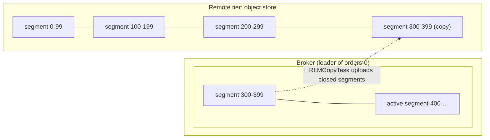

One partition now spans two places:

```
offset:  0 ─────────────── 299 │ 300 ───── 399 │ 400 ────────── LEO
         remote only           │ both tiers    │ local only (active segment)
         ▲                     │               │
   log start offset     local log start offset
```

- **Remote tier:** only *closed* segments, never the active one. Segments are immutable once rolled, so they can be copied safely.
- **Local tier:** the most recent segments, including the active one. A local segment is deleted only *after* it has been copied to remote storage and local retention has passed.
- **Log start offset** is now the start of the *remote* log. **Local log start offset** is where local data begins.

Producers are not affected at all. Writes still go to the leader's active segment exactly as before.

## 3. The plugins: RemoteStorageManager and RemoteLogMetadataManager

Kafka does not know how to talk to S3 or HDFS. It defines two plugin interfaces in `storage/api` and leaves the remote I/O to an implementation you install.

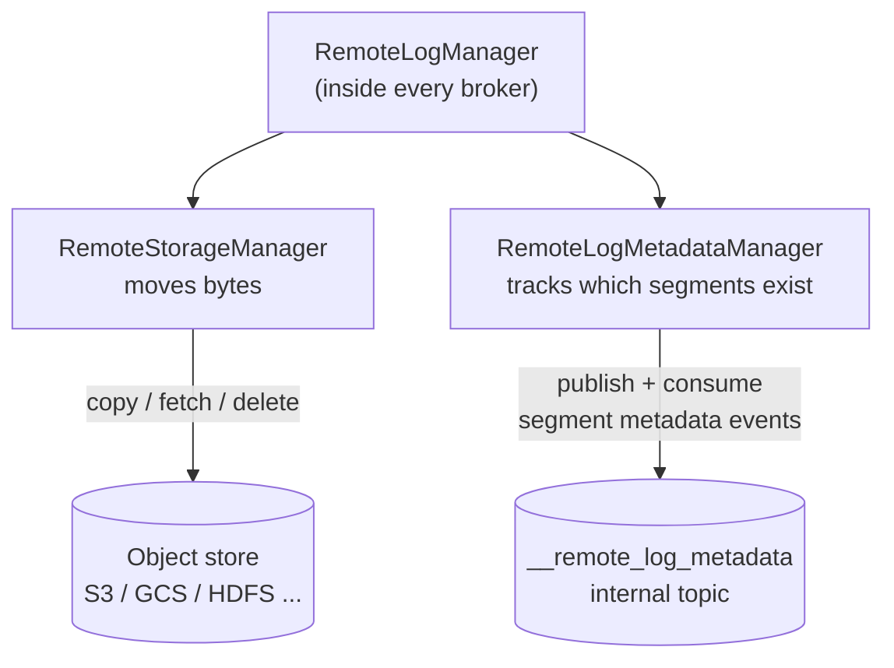

### RemoteStorageManager (RSM): the data

Interface: `storage/api/src/main/java/org/apache/kafka/server/log/remote/storage/RemoteStorageManager.java`

| Method | Purpose |
|---|---|
| `copyLogSegmentData(metadata, LogSegmentData)` | Upload one segment plus its auxiliary files. Can return small custom metadata (e.g. the object key) that Kafka stores for you. |
| `fetchLogSegment(metadata, startPosition[, endPosition])` | Stream bytes of a remote segment. |
| `fetchIndex(metadata, IndexType)` | Fetch one of the segment's index files. |
| `deleteLogSegmentData(metadata)` | Delete a segment and its files. |

`LogSegmentData` bundles everything needed to rebuild that segment's state later. `IndexType` lists the files:

| IndexType | File | Why it is needed remotely |
|---|---|---|
| `OFFSET` | `.index` | Find a byte position for an offset |
| `TIMESTAMP` | `.timeindex` | Find an offset for a timestamp (`offsetsForTimes`) |
| `TRANSACTION` | `.txnindex` | Find aborted transactions for `read_committed` reads |
| `PRODUCER_SNAPSHOT` | `.snapshot` | Rebuild idempotent/transactional producer state |
| `LEADER_EPOCH` | leader-epoch checkpoint | Rebuild epoch history for truncation decisions |

**Kafka ships no production RSM.** You use one from a vendor or the community (for example Aiven's or Confluent-compatible open-source S3/GCS/Azure plugins). The test implementation `LocalTieredStorage` (in `storage/src/testFixtures/...`) writes to a local directory and is good for learning.

### RemoteLogMetadataManager (RLMM): the metadata

Interface: `storage/api/.../RemoteLogMetadataManager.java`

The RLMM keeps a strongly consistent record of every remote segment: its id, offset range, leader epochs, size, and state. The default implementation, `TopicBasedRemoteLogMetadataManager`, stores this in an internal Kafka topic, **`__remote_log_metadata`** (50 partitions, replication factor 3, min ISR 2, infinite retention by default). Each broker consumes the metadata partitions for the user partitions it hosts and keeps an in-memory cache.

Each remote segment moves through these states (`RemoteLogSegmentState`):

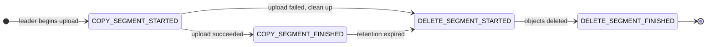

Only `COPY_SEGMENT_FINISHED` segments are visible to readers. Writing `COPY_SEGMENT_STARTED` *before* uploading means a crash mid-upload leaves a record of the orphaned objects so they can be cleaned up.

Whole-partition deletion (when a topic is deleted) has its own states (`RemotePartitionDeleteState`): `DELETE_PARTITION_MARKED` → `DELETE_PARTITION_STARTED` → `DELETE_PARTITION_FINISHED`.

> **Pattern to notice:** this is the same idea as the group coordinator and KRaft. State changes are written to a Kafka log first, and anyone can rebuild the state by reading that log.

## 4. Copying segments to remote storage

`RemoteLogManager` (in `storage/src/main/java/org/apache/kafka/server/log/remote/storage/RemoteLogManager.java`) runs three kinds of scheduled tasks per partition:

| Task | Runs on | Thread pool config (default) | Job |
|---|---|---|---|
| `RLMCopyTask` | Leader | `remote.log.manager.copier.thread.pool.size` (10) | Upload eligible segments |
| `RLMExpirationTask` | Leader | `remote.log.manager.expiration.thread.pool.size` (10) | Delete remote segments past total retention |
| `RLMFollowerTask` | Followers | `remote.log.manager.follower.thread.pool.size` (2) | Track the highest copied offset so followers can delete local data too |

Each task runs every `remote.log.manager.task.interval.ms` (30 s), with exponential backoff on failure.

**Only the leader uploads.** Followers never write to remote storage, so each segment is uploaded once, not once per replica.

A segment is eligible for upload when **all** of these hold:

1. It is not the active segment (it has been rolled, by `segment.bytes` or `segment.ms`).
2. Its end offset is below the **last stable offset**, so it contains no data from open transactions and nothing above the high watermark.
3. It has not already been copied (the task tracks the highest copied offset).

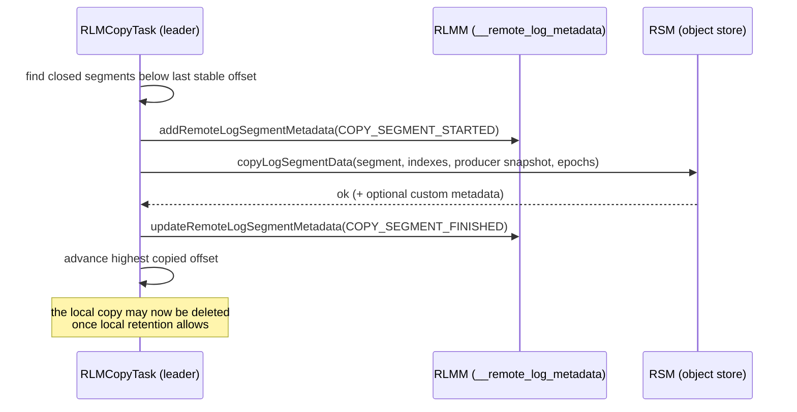

Upload speed can be capped with `remote.log.manager.copy.max.bytes.per.second` so uploads do not saturate the network. Failed tasks retry with exponential backoff from `remote.log.manager.task.retry.backoff.ms` (500 ms) up to `remote.log.manager.task.retry.backoff.max.ms` (30 s), with 20% jitter.

**Delaying uploads on purpose.** By default a closed segment is uploaded as soon as the next copy task runs (`log.remote.copy.lag.ms=0`). Two broker settings, with topic-level overrides `remote.copy.lag.ms` and `remote.copy.lag.bytes`, let a segment stay local-only for a while. A segment is eligible when **either** check passes:

| Setting | Default | Segment becomes eligible when… |
|---|---|---|
| `log.remote.copy.lag.ms` | `0` (upload at once) | its newest record is at least this old. `-1` derives the value from the effective local retention time. |
| `log.remote.copy.lag.bytes` | `-1` (derived from local retention size) | at least this many bytes of newer data sit after it in the local log |

Why delay? Data that is read heavily for a short time after it is written (replays, late consumers) is then served from local disk, and short-lived topics may expire before ever paying for remote PUT requests. The value should not exceed local retention, or data would have to stay local longer than local retention allows.

### The life of one segment

```
time ───────────────────────────────────────────────────────────────────────────────────────►
      active          rolled          below LSO, copy-lag    copied               local retention   total retention
      (local only)    (segment.ms /   satisfied              (COPY_SEGMENT_       passed            passed
                       segment.bytes)                         FINISHED)
  ────┬───────────────┬───────────────┬──────────────────────┬────────────────────┬─────────────────┬──────────►
      │ written to    │ immutable,    │ RLMCopyTask uploads  │ on both tiers,     │ deleted locally │ RLMExpirationTask
      │ page cache    │ still local   │ it (leader only)     │ reads served       │ (followers too, │ deletes it remotely
      │               │               │                      │ locally            │ via RLMFollower │ (DELETE_SEGMENT_*)
      │               │               │                      │                    │ Task)           │
  local tier: ███████████████████████████████████████████████████████████████████████
  remote tier:                                               █████████████████████████████████████████████
```

## 5. Retention: local vs total

With tiered storage a topic has **two retention budgets**:

| Config | Applies to | Meaning |
|---|---|---|
| `retention.ms` / `retention.bytes` | Whole log (remote + local) | When data is gone for good |
| `local.retention.ms` / `local.retention.bytes` | Local tier only | How long data stays on broker disk |

Special values for the `local.*` settings:

- **`-2`** (the default): use the same value as `retention.*`. Data stays local for the full retention, which defeats the purpose, so set this explicitly.
- **`-1`**: unlimited.

The local value must be ≤ the total value.

```
retention.ms        = 30 days   ├─────────────── whole log ─────────────────┤
local.retention.ms  =  1 day                                    ├── local ──┤
```

Important rule: **a local segment is never deleted until it has been copied to remote storage**, regardless of local retention. If uploads stall (the object store is down or credentials expire), local disk keeps growing. Watch for that.

Broker-wide defaults use the `log.` prefix: `log.local.retention.ms`, `log.local.retention.bytes`.

## 6. Reading from remote storage

When a consumer asks for an offset below the local log start offset, the leader reads from remote storage. It does this asynchronously so the request-handler threads are never blocked on slow object-store I/O.

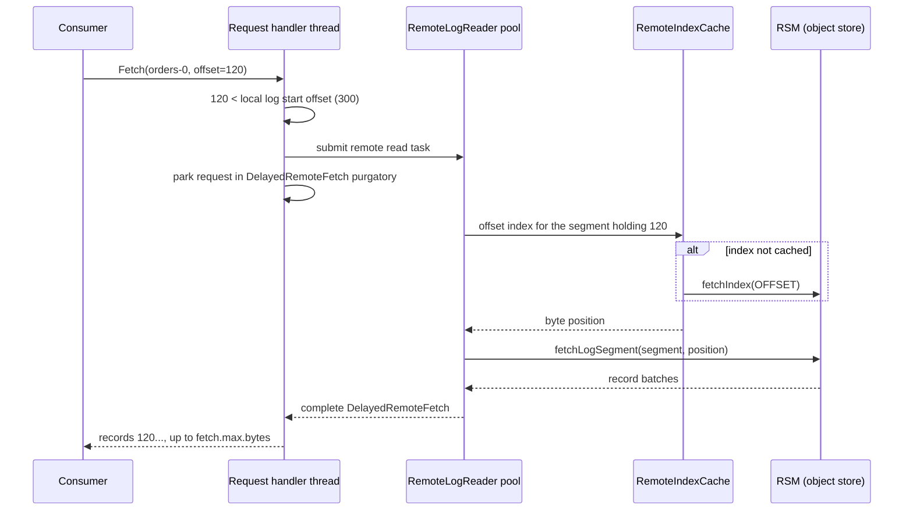

Details worth knowing:

- **Reader threads:** `remote.log.reader.threads` (10), with a queue of `remote.log.reader.max.pending.tasks` (100). When the queue is full, remote fetches fail fast.
- **Wait time:** `remote.fetch.max.wait.ms` (500 ms) bounds how long a remote fetch can be parked.
- **Index cache:** `RemoteIndexCache` keeps downloaded indexes on local disk, up to `remote.log.index.file.cache.total.size.bytes` (1 GiB), so repeated lookups do not re-download them.
- **Fetch quota:** `remote.log.manager.fetch.max.bytes.per.second` caps remote read bandwidth per broker.
- **Other APIs also go remote:** `ListOffsets` by timestamp (`offsetsForTimes`) may need the remote time index, bounded by `remote.list.offsets.request.timeout.ms` (30 s).
- **Latency:** the first read of a cold segment pays object-store latency (tens to hundreds of ms). Sequential reads after that are fast. Tail consumers are unaffected.

## 7. Followers and leader changes

**Followers do not re-download history.** A new or lagging follower that asks the leader for an offset below the leader's local log start gets the error `OFFSET_MOVED_TO_TIERED_STORAGE`. The follower then:

1. Asks the leader for its local log start offset.
2. Reads the **auxiliary state** for that point from remote storage: the leader-epoch checkpoint and the producer snapshot.
3. Starts its local log at the leader's local log start offset and replicates only the local tail.

This is done by `TierStateMachine` (`core/src/main/java/kafka/server/TierStateMachine.java`). It is why replacing a broker is fast with tiered storage: a new replica copies only hours of local data, not weeks.

Since Kafka 4.3 (KIP-1023) a new follower can skip even more. With the dynamic broker config `follower.fetch.last.tiered.offset.enable=true` (default `false`), a follower with no local data starts at the leader's **earliest pending upload offset** instead of its local log start offset, so it does not fetch segments that are on local disk but already uploaded. `ListOffsets` can return that offset too (timestamp type `EARLIEST_PENDING_UPLOAD_TIMESTAMP`, -6).

**On leader change,** the new leader reads `__remote_log_metadata` to learn the highest copied offset and continues uploading from there. Leader epochs in the segment metadata make sure that segments from a log lineage that was truncated away are never served.

## 8. Configuration reference

### Broker (cluster-wide)

| Config | Default | Purpose |
|---|---|---|
| `remote.log.storage.system.enable` | `false` | Master switch. Must be `true` on every broker. |
| `remote.log.storage.manager.class.name` | none (required) | Your RSM class |
| `remote.log.storage.manager.class.path` | none | Classpath for the RSM, loaded in an isolated classloader |
| `remote.log.storage.manager.impl.prefix` | `rsm.config.` | Configs with this prefix are passed to the RSM |
| `remote.log.metadata.manager.class.name` | `TopicBasedRemoteLogMetadataManager` | RLMM class |
| `remote.log.metadata.manager.impl.prefix` | `rlmm.config.` | Configs with this prefix are passed to the RLMM |
| `remote.log.metadata.manager.listener.name` | none | Listener the default RLMM's internal clients use. **Required** with the default RLMM. |
| `remote.log.manager.task.interval.ms` | 30000 | How often copy/expire tasks run |
| `remote.log.manager.task.retry.backoff.ms` / `.max.ms` | 500 / 30000 | Backoff after a failed task (with 20% jitter) |
| `log.remote.copy.lag.ms` / `.bytes` | 0 / -1 | Keep closed segments local-only for a while before uploading (section 4) |
| `remote.log.manager.copier.thread.pool.size` | 10 | Upload threads |
| `remote.log.manager.expiration.thread.pool.size` | 10 | Remote deletion threads |
| `remote.log.manager.follower.thread.pool.size` | 2 | Follower tracking threads |
| `remote.log.reader.threads` | 10 | Remote read threads |
| `remote.log.reader.max.pending.tasks` | 100 | Remote read queue size |
| `remote.log.index.file.cache.total.size.bytes` | 1 GiB | Local cache for remote indexes |
| `remote.log.index.file.cache.ttl.ms` | 900000 | Cached remote indexes unused this long are evicted |
| `remote.log.metadata.custom.metadata.max.bytes` | 128 | Largest custom metadata an RSM may return per segment |
| `remote.log.manager.copy.max.bytes.per.second` | unlimited | Upload throttle |
| `remote.log.manager.fetch.max.bytes.per.second` | unlimited | Remote read throttle |
| `remote.fetch.max.wait.ms` | 500 | Max time a remote fetch is parked |
| `log.local.retention.ms` / `.bytes` | -2 | Broker default for local retention |

RLMM topic settings (set via the `rlmm.config.` prefix):

| Config | Default |
|---|---|
| `rlmm.config.remote.log.metadata.topic.num.partitions` | 50 |
| `rlmm.config.remote.log.metadata.topic.replication.factor` | 3 |
| `rlmm.config.remote.log.metadata.topic.min.isr` | 2 |
| `rlmm.config.remote.log.metadata.topic.retention.ms` | -1 (forever) |

### Topic

| Config | Default | Purpose |
|---|---|---|
| `remote.storage.enable` | `false` | Turn tiering on for this topic |
| `local.retention.ms` / `local.retention.bytes` | -2 | Local tier budget |
| `retention.ms` / `retention.bytes` | 7 days / -1 | Total budget |
| `remote.copy.lag.ms` / `remote.copy.lag.bytes` | broker value | Keep closed segments local-only for a while (section 4) |
| `remote.log.copy.disable` | `false` | Stop uploading; remote data becomes read-only |
| `remote.log.delete.on.disable` | `false` | Delete remote data when tiering is turned off |
| `segment.bytes` / `segment.ms` | 1 GiB / 7 days | Segment size and age. Only closed segments upload, so these control how soon data can tier. |

## 9. Hands-on quick start

This uses the test `LocalTieredStorage` plugin to simulate a remote store with a local directory.

**1. Get the jar that contains the plugin.** `LocalTieredStorage` now lives in the storage module's **test fixtures**, not its tests, so the `-test.jar` that older guides (including `docs/operations/tiered-storage.md`) mention no longer contains it. Either download the published one:

```bash
curl -O https://repo1.maven.org/maven2/org/apache/kafka/kafka-storage/4.4.0/kafka-storage-4.4.0-test-fixtures.jar
```

or build it from a source tree:

```bash
./gradlew :storage:testFixturesJar
# produces storage/build/libs/kafka-storage-<version>-test-fixtures.jar
```

**2. Add to the broker's `server.properties`:**

```properties
remote.log.storage.system.enable=true
remote.log.metadata.manager.listener.name=PLAINTEXT

remote.log.storage.manager.class.name=org.apache.kafka.server.log.remote.storage.LocalTieredStorage
remote.log.storage.manager.class.path=/path/to/kafka-storage-<version>-test-fixtures.jar
# required here: without it the plugin needs test helpers from another jar to make a temp dir
rsm.config.dir=/tmp/kafka-remote-storage

# single-broker test cluster only
rlmm.config.remote.log.metadata.topic.replication.factor=1
rlmm.config.remote.log.metadata.topic.min.isr=1

# make things happen quickly while testing
log.retention.check.interval.ms=1000
```

**3. Create a tiered topic with tiny segments and short local retention:**

```bash
bin/kafka-topics.sh --bootstrap-server localhost:9092 --create --topic tieredTopic \
  --config remote.storage.enable=true \
  --config local.retention.ms=1000 \
  --config retention.ms=3600000 \
  --config segment.bytes=1048576 \
  --config file.delete.delay.ms=1000
```

**4. Produce enough to roll segments:**

```bash
bin/kafka-producer-perf-test.sh --bootstrap-server localhost:9092 --topic tieredTopic \
  --num-records 1200 --record-size 1024 --throughput -1
```

**5. Look at the "remote" store.** Each segment is uploaded with all its auxiliary files:

```bash
ls /tmp/kafka-remote-storage/kafka-tiered-storage/tieredTopic-0-<topicId>/
# 00000000000000000000-<segmentId>.log
# 00000000000000000000-<segmentId>.index
# 00000000000000000000-<segmentId>.timeindex
# 00000000000000000000-<segmentId>.snapshot
# 00000000000000000000-<segmentId>.leader_epoch_checkpoint
```

**6. Read from offset 0.** That data is no longer on local disk, so it is served from the remote tier:

```bash
bin/kafka-console-consumer.sh --bootstrap-server localhost:9092 --topic tieredTopic \
  --from-beginning --max-messages 1 --formatter-property print.offset=true
```

## 10. Disabling tiered storage

| Goal | Topic configs |
|---|---|
| Stop uploading, keep remote data readable | `remote.storage.enable=true,remote.log.copy.disable=true,local.retention.ms=-2,local.retention.bytes=-2` |
| Turn tiering off and delete remote data | `remote.storage.enable=false,remote.log.delete.on.disable=true` |
| Turn tiering off cluster-wide | Delete or untier every tiered topic first, then set `remote.log.storage.system.enable=false` |

These combinations are enforced by `LogConfig` validation:

- Setting `remote.storage.enable=false` on a tiered topic **without** `remote.log.delete.on.disable=true` is rejected. Kafka will not silently orphan remote data. To keep it, use the read-only option instead.
- With `remote.log.copy.disable=true`, `local.retention.*` must be `-2` or equal to `retention.*`. Nothing is uploaded any more, so local retention has to cover the full retention or disks would fill.

```bash
bin/kafka-configs.sh --bootstrap-server localhost:9092 --alter \
  --entity-type topics --entity-name tieredTopic \
  --add-config 'remote.storage.enable=false,remote.log.delete.on.disable=true'
```

A broker refuses to start with `remote.log.storage.system.enable=false` while tiered topics still exist.

## 11. Limitations and gotchas

- **No compacted topics.** Tiering requires `cleanup.policy=delete` (or an empty policy). `compact` and `compact,delete` are rejected.
- **No production plugin ships with Kafka.** Choose and operate an RSM yourself.
- **Uploads lag behind writes.** Only closed segments below the last stable offset are tiered. A huge `segment.bytes` or a long-open transaction delays tiering.
- **Local disk is still the safety buffer.** If the remote store is unreachable, local segments are kept and disks fill. Size local disk for the longest remote outage you want to survive.
- **Old topics.** Segments without a producer snapshot file (topics created before 2.8) are not supported.
- **Admin clients** need version 3.0 or later for tiered-storage admin operations.
- **Cost model changes.** Object stores charge per request. Small segments mean many PUT and GET calls. Prefer normal segment sizes in production.
- **Security of the remote store** is your plugin's responsibility. See [section 23](#23-security-and-tiered-storage-together).

## 12. Monitoring

Remote-storage metrics are defined in `storage/api/.../RemoteStorageMetrics.java`. Most are under `kafka.server:type=BrokerTopicMetrics` (per topic and for all topics); the thread-pool and retention metrics are under `kafka.log.remote`, as the MBean column shows. Watch these:

| Metric | MBean | What to look for |
|---|---|---|
| `RemoteCopyBytesPerSec`, `RemoteCopyRequestsPerSec` | `kafka.server:type=BrokerTopicMetrics` | Upload throughput |
| `RemoteCopyErrorsPerSec` | `BrokerTopicMetrics` | Any sustained value means local disk will start growing |
| `RemoteCopyLagBytes`, `RemoteCopyLagSegments` | `BrokerTopicMetrics` | How much eligible data has not been uploaded yet |
| `RemoteFetchBytesPerSec`, `RemoteFetchRequestsPerSec`, `RemoteFetchErrorsPerSec` | `BrokerTopicMetrics` | Remote read activity and failures |
| `RemoteDeleteLagBytes`, `RemoteDeleteLagSegments`, `RemoteDeleteErrorsPerSec` | `BrokerTopicMetrics` | Remote retention keeping up |
| `LocalRetentionSizeInPercent`, `RetentionSizeInPercent` | `kafka.log.remote:type=RemoteLogManager` | How full each retention budget is |
| `RemoteLogManagerTasksAvgIdlePercent` | `kafka.log.remote:type=RemoteLogManager` | Copy/expiration thread pool saturation |
| `RemoteLogSizeBytes`, `RemoteLogMetadataCount` | `BrokerTopicMetrics` | Total size and segment count in the remote tier |
| `BuildRemoteLogAuxStateRequestsPerSec` | `BrokerTopicMetrics` | Followers bootstrapping from remote state |
| `RemoteLogReaderTaskQueueSize`, `RemoteLogReaderAvgIdlePercent` | `kafka.log.remote:type=RemoteStorageThreadPool` (the old `org.apache.kafka.storage.internals.log` group is deprecated since 4.2) | Remote read thread pool saturation |

---

# Part 2: Security

## 13. The security model in one page

The project's official model is in `docs/security/security-model.md`. The essentials:

1. **Security is off by default.** A fresh cluster accepts unauthenticated `PLAINTEXT` connections and authorizes nothing. You must turn on encryption, authentication, and authorization yourself.
2. **Operators are trusted.** Anyone with shell or disk access to a broker or controller can read every topic, impersonate principals, and change ACLs. Kafka protects data in transit and controls what *clients* can do. It does not protect brokers from their own administrators.
3. **The broker fleet is trusted.** Anything that can authenticate on the inter-broker or controller listener is part of the cluster.
4. **The classpath is trusted.** Plugins (authorizers, serializers, connectors, config providers, RSMs) run with full process privileges. Configuring a plugin is equivalent to running its code.
5. **No encryption at rest.** Segments, indexes, and snapshots are stored as plain bytes.
6. **Each surface is secured separately.** Client listeners, inter-broker traffic, controller traffic, the Admin API, and JMX each need their own configuration.

Security in Kafka has four layers. Each layer depends on the one before it:

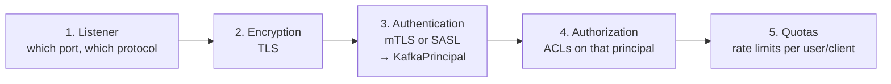

## 14. Listeners: where security is configured

A **listener** is a named port with its own security protocol. Every security setting hangs off a listener.

| Protocol | Authentication | Encryption |
|---|---|---|
| `PLAINTEXT` | None | None |
| `SSL` | Optional mutual TLS | TLS |
| `SASL_PLAINTEXT` | SASL | None |
| `SASL_SSL` | SASL (+ optional mTLS) | TLS |

A typical KRaft node has three kinds of traffic, and each should get its own listener:

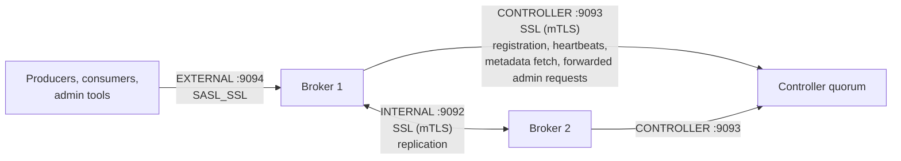

```properties
listeners=INTERNAL://0.0.0.0:9092,EXTERNAL://0.0.0.0:9094
advertised.listeners=INTERNAL://broker1.internal:9092,EXTERNAL://broker1.example.com:9094
listener.security.protocol.map=INTERNAL:SSL,EXTERNAL:SASL_SSL,CONTROLLER:SSL
inter.broker.listener.name=INTERNAL
controller.listener.names=CONTROLLER
controller.quorum.bootstrap.servers=ctrl1:9093,ctrl2:9093,ctrl3:9093
```

Rules:

- `controller.listener.names` must differ from `inter.broker.listener.name`.
- A broker-only node does not list `CONTROLLER` in `listeners`, but it still needs its security settings, because the broker *connects* to controllers over it.
- **Never expose the controller listener to client networks.**
- `advertised.listeners` is a security setting: after bootstrap, clients connect to whatever the broker advertises.
- Any setting can be scoped to one listener with the prefix `listener.name.<listener>.`, for example `listener.name.external.ssl.keystore.location`. SASL settings add the mechanism too: `listener.name.external.scram-sha-512.sasl.jaas.config`.

## 15. Encryption in transit (TLS)

### How it fits together

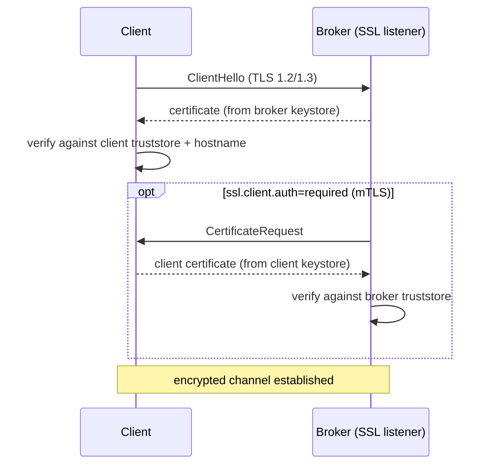

- **Keystore:** your own private key and certificate. Brokers always need one on TLS listeners; clients need one only for mTLS.
- **Truststore:** the CA certificates you trust.
- **Hostname verification:** `ssl.endpoint.identification.algorithm=https` (the default) makes clients check that the broker certificate's SAN matches the hostname they connected to. Keep it on.

### Making certificates (development CA)

```bash
# 1. a CA
openssl req -new -x509 -keyout ca-key -out ca-cert -days 365 -subj "/CN=kafka-dev-ca"

# 2. a broker key pair, with SANs that match its hostnames
keytool -keystore broker1.keystore.jks -alias broker1 -validity 365 -genkey -keyalg RSA \
  -dname "CN=broker1.example.com" -ext SAN=DNS:broker1.example.com,DNS:broker1.internal

# 3. sign it with the CA
keytool -keystore broker1.keystore.jks -alias broker1 -certreq -file broker1.csr
openssl x509 -req -CA ca-cert -CAkey ca-key -in broker1.csr -out broker1.crt -days 365 \
  -CAcreateserial -copy_extensions copyall

# 4. import CA + signed cert into the keystore, CA into truststores
keytool -keystore broker1.keystore.jks -alias CARoot -import -file ca-cert
keytool -keystore broker1.keystore.jks -alias broker1 -import -file broker1.crt
keytool -keystore kafka.truststore.jks -alias CARoot -import -file ca-cert
```

PEM files are also supported directly (`ssl.keystore.type=PEM`, with `ssl.keystore.certificate.chain` and `ssl.keystore.key`), which avoids JKS entirely.

### Broker and client settings

```properties
# broker
ssl.keystore.location=/etc/kafka/ssl/broker1.keystore.jks
ssl.keystore.password=${file:/etc/kafka/secrets.properties:keystore.password}
ssl.key.password=${file:/etc/kafka/secrets.properties:key.password}
ssl.truststore.location=/etc/kafka/ssl/kafka.truststore.jks
ssl.truststore.password=${file:/etc/kafka/secrets.properties:truststore.password}
ssl.client.auth=required          # mTLS on SSL listeners; avoid "requested"
ssl.enabled.protocols=TLSv1.3,TLSv1.2

# client
security.protocol=SSL
ssl.truststore.location=/etc/kafka/ssl/kafka.truststore.jks
ssl.truststore.password=...
# for mTLS also:
ssl.keystore.location=/etc/kafka/ssl/client.keystore.jks
ssl.keystore.password=...
```

### Pitfalls with corporate CAs

1. **Extended Key Usage.** Brokers act as both TLS server and TLS client (to other brokers and controllers). Their certificates need **both** `serverAuth` and `clientAuth`. A "web server" profile with only `serverAuth` makes inter-broker handshakes fail.
2. **Intermediate CAs.** Import the full chain into the keystore.
3. **Missing SANs.** CAs sometimes drop requested SANs. Check with `openssl x509 -in cert.crt -text -noout`.

### Rotation without restart

Keystores and truststores can be swapped live with dynamic config:

```bash
bin/kafka-configs.sh --bootstrap-server broker1:9092 --command-config admin.properties \
  --entity-type brokers --entity-name 1 --alter \
  --add-config 'listener.name.external.ssl.keystore.location=/etc/kafka/ssl/new.keystore.jks'
```

TLS costs CPU because the broker can no longer use zero-copy `sendfile` for encrypted traffic. Budget for that.

## 16. Authentication

Authentication answers "who is this connection?" The result is always a **`KafkaPrincipal`**, for example `User:alice`.

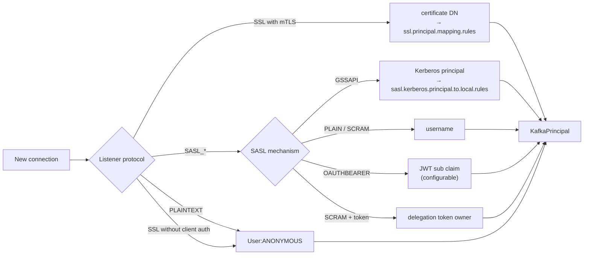

### Comparing the mechanisms

| Mechanism | Credential | Where credentials live | Use when |
|---|---|---|---|
| **mTLS** | X.509 cert | Your PKI | Service-to-service, inter-broker, controller traffic |
| **SASL/GSSAPI** | Kerberos ticket | KDC (Active Directory, MIT) | You already run Kerberos |
| **SASL/PLAIN** | Username + password | JAAS file or custom callback | Simple setups; **only over `SASL_SSL`** (password is sent as-is) |
| **SASL/SCRAM-SHA-256/512** | Username + password, salted challenge/response | Cluster metadata log | Self-contained password auth; password never crosses the wire |
| **SASL/OAUTHBEARER** | JWT | Your identity provider | Centralized identity (Okta, Keycloak, Entra ID ...) |
| **Delegation tokens** | Token id + HMAC | Cluster metadata | Frameworks (Spark, Flink) handing short-lived credentials to many tasks |

### JAAS configuration

SASL settings use JAAS syntax. Put it inline in config (preferred) rather than in a separate `-Djava.security.auth.login.config` file:

```properties
# client
security.protocol=SASL_SSL
sasl.mechanism=SCRAM-SHA-512
sasl.jaas.config=org.apache.kafka.common.security.scram.ScramLoginModule required \
  username="alice" password="${file:/etc/kafka/secrets.properties:alice.password}";
```

On brokers, scope it per listener and mechanism:

```properties
sasl.enabled.mechanisms=SCRAM-SHA-512,OAUTHBEARER
listener.name.external.scram-sha-512.sasl.jaas.config=org.apache.kafka.common.security.scram.ScramLoginModule required;
```

### SASL/SCRAM in detail

SCRAM never sends the password. The server stores only a salted hash. Both sides prove they know the password with a challenge/response.

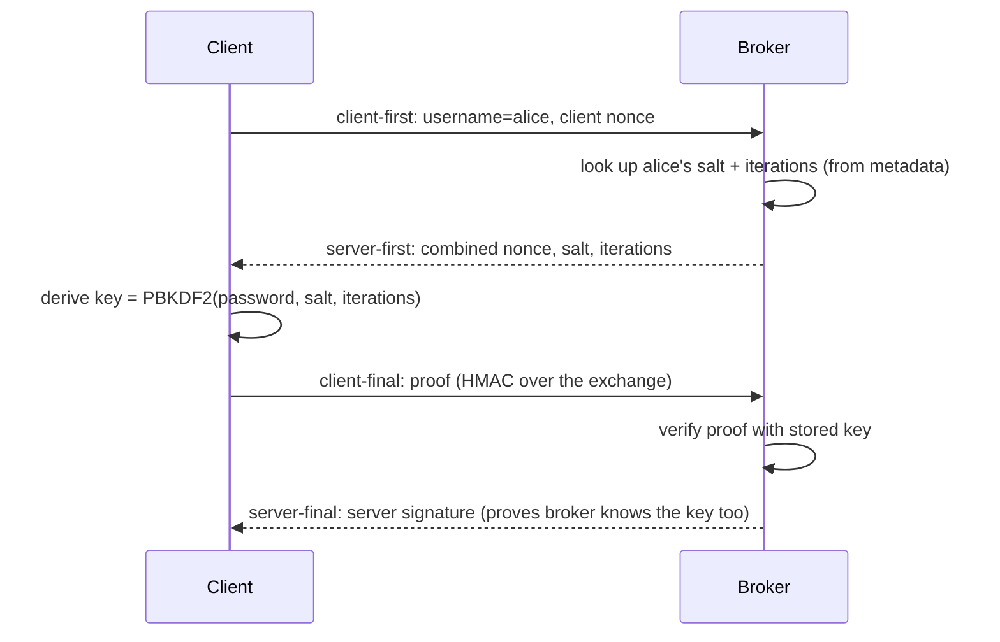

Create credentials. In KRaft they are stored as `UserScramCredentialRecord`s in the metadata log:

```bash
bin/kafka-configs.sh --bootstrap-server broker1:9094 --command-config admin.properties \
  --alter --add-config 'SCRAM-SHA-512=[iterations=8192,password=alice-secret]' \
  --entity-type users --entity-name alice
```

Chicken-and-egg problem: the brokers need a SCRAM user to talk to each other before any admin client can create one. Solve it at format time:

```bash
bin/kafka-storage.sh format -t <cluster-id> -c server.properties \
  --add-scram 'SCRAM-SHA-512=[name=admin,password=admin-secret]'
```

Use SCRAM over TLS (`SASL_SSL`) so the exchange cannot be observed and replayed offline against weak passwords.

### SASL/OAUTHBEARER in detail

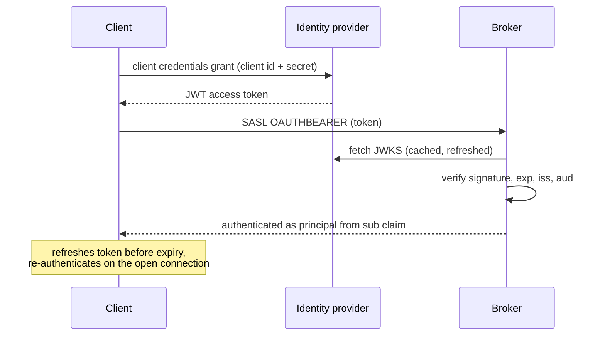

The built-in default validator is the *unsecured* one, for testing only. In production configure the JWKS-based validator. Since Kafka 4.4 a broker with `sasl.oauthbearer.jwks.endpoint.url` set **refuses to start** unless both `sasl.oauthbearer.expected.audience` and `sasl.oauthbearer.expected.issuer` are set (or you deliberately opt out with `sasl.oauthbearer.allow.unverified.audience` / `.issuer`, both `false` by default):

```properties
# broker
listener.name.external.oauthbearer.sasl.server.callback.handler.class=\
  org.apache.kafka.common.security.oauthbearer.OAuthBearerValidatorCallbackHandler
listener.name.external.oauthbearer.sasl.oauthbearer.jwks.endpoint.url=https://idp.example.com/.well-known/jwks.json
listener.name.external.oauthbearer.sasl.oauthbearer.expected.audience=kafka
listener.name.external.oauthbearer.sasl.oauthbearer.expected.issuer=https://idp.example.com
listener.name.external.oauthbearer.sasl.jaas.config=\
  org.apache.kafka.common.security.oauthbearer.OAuthBearerLoginModule required;

# client
sasl.mechanism=OAUTHBEARER
sasl.oauthbearer.token.endpoint.url=https://idp.example.com/oauth2/token
sasl.login.callback.handler.class=org.apache.kafka.common.security.oauthbearer.OAuthBearerLoginCallbackHandler
sasl.jaas.config=org.apache.kafka.common.security.oauthbearer.OAuthBearerLoginModule required \
  clientId="orders-service" clientSecret="${file:/etc/kafka/secrets.properties:oauth.secret}";
```

The JVM system property `org.apache.kafka.sasl.oauthbearer.allowed.urls` must list the token and JWKS URLs. Kafka refuses to call other URLs, which prevents a malicious config from making the broker fetch arbitrary addresses.

**How the client gets its token** is pluggable (`sasl.oauthbearer.jwt.retriever.class`):

| Retriever | Grant | Use when |
|---|---|---|
| `ClientCredentialsJwtRetriever` | OAuth `client_credentials`, authenticating either with a client **secret** or with a **client assertion**: a JWT the client signs with its own private key (`sasl.oauthbearer.assertion.*`, RS256 by default), so no shared secret sits in client configs | The common case |
| `JwtBearerJwtRetriever` | OAuth `urn:ietf:params:oauth:grant-type:jwt-bearer` (RFC 7523): the client exchanges a signed JWT for an access token | Your identity provider expects the JWT-bearer grant; must be configured explicitly |
| `FileJwtRetriever` | None: reads a token from a file that something else refreshes | Kubernetes projected service-account tokens, sidecars |
| `DefaultJwtRetriever` (default) | Delegates: `FileJwtRetriever` if `sasl.oauthbearer.token.endpoint.url` starts with `file:`, otherwise `ClientCredentialsJwtRetriever` | Backwards compatibility |

On the broker side, the matching knob is `sasl.oauthbearer.jwt.validator.class` (`BrokerJwtValidator` for JWKS-based validation).

### SASL/GSSAPI (Kerberos)

Each broker has a service principal like `kafka/broker1.example.com@EXAMPLE.COM` and a keytab:

```properties
sasl.enabled.mechanisms=GSSAPI
sasl.kerberos.service.name=kafka
listener.name.external.gssapi.sasl.jaas.config=com.sun.security.auth.module.Krb5LoginModule required \
  useKeyTab=true storeKey=true keyTab="/etc/security/keytabs/kafka.keytab" \
  principal="kafka/broker1.example.com@EXAMPLE.COM";
```

Clients need `sasl.kerberos.service.name=kafka`, a matching JAAS entry, and a working `krb5.conf`. Clock skew and DNS problems are the usual causes of failures.

### Delegation tokens

A client that has authenticated with a strong mechanism can request a token. The token then works as a SCRAM credential:

```bash
bin/kafka-delegation-tokens.sh --bootstrap-server broker1:9094 --command-config admin.properties \
  --create --max-life-time-period -1 --renewer-principal User:spark
```

Clients authenticate with `ScramLoginModule ... username="<tokenId>" password="<hmac>" tokenauth="true";`. Tokens carry the owner's principal and ACLs, can be renewed and expired, and need `delegation.token.secret.key` set the same on every node.

### Re-authentication and limits

- `connections.max.reauth.ms` (broker, per listener and mechanism): long-lived SASL connections must re-authenticate before this interval, so revoked credentials and expired tokens stop working without closing connections.
- `sasl.server.max.receive.size` (512 KiB default) bounds the size of SASL messages before authentication, which stops oversized unauthenticated payloads.
- JAAS login modules are restricted by default, which blocks dangerous modules such as JNDI-based ones. Use the system property `org.apache.kafka.allowed.login.modules` to turn this into an allow-list: only the modules you name can be used. The older deny-list property, `org.apache.kafka.disallowed.login.modules`, is deprecated since Kafka 4.2.

## 17. Principals: turning identities into names

ACLs are written against short names like `User:alice`. The raw identity often looks different.

**TLS:** the default principal is the full DN, e.g. `User:CN=alice,OU=Payments,O=Example,C=US`. Shorten it with `ssl.principal.mapping.rules`. The first matching rule wins:

```properties
ssl.principal.mapping.rules=\
  RULE:^CN=(.*?),OU=ServiceUsers.*$/$1/,\
  RULE:^CN=(.*?),OU=(.*?),O=.*$/$1@$2/L,\
  DEFAULT
```

`CN=serviceuser,OU=ServiceUsers,...` becomes `serviceuser`; `CN=adminUser,OU=Admin,...` becomes `adminuser@admin` (`/L` lowercases).

**Kerberos:** `alice@EXAMPLE.COM` becomes `alice` by default. Customize with `sasl.kerberos.principal.to.local.rules`:

```properties
sasl.kerberos.principal.to.local.rules=RULE:[1:$1@$0](.*@EXAMPLE.COM)s/@.*//,DEFAULT
```

**Fully custom:** implement `KafkaPrincipalBuilder` and set `principal.builder.class`. Since Kafka 4.2 (KIP-1157) `KafkaPrincipalBuilder` extends `KafkaPrincipalSerde`, so a custom builder must implement serialization too. Brokers forward admin requests to the controller inside an `Envelope` that carries the client's principal, so the principal must be serializable. The default builder (`DefaultKafkaPrincipalBuilder`) already does this.

## 18. Authorization and ACLs

### Turning it on

```properties
# on every node: brokers AND controllers
authorizer.class.name=org.apache.kafka.metadata.authorizer.StandardAuthorizer
super.users=User:admin;User:broker;User:controller
```

`StandardAuthorizer` stores ACLs in the KRaft metadata log, so every broker has the same ACLs, replicated and versioned like all other metadata. The separator in `super.users` is `;` because DNs contain commas.

### How a decision is made

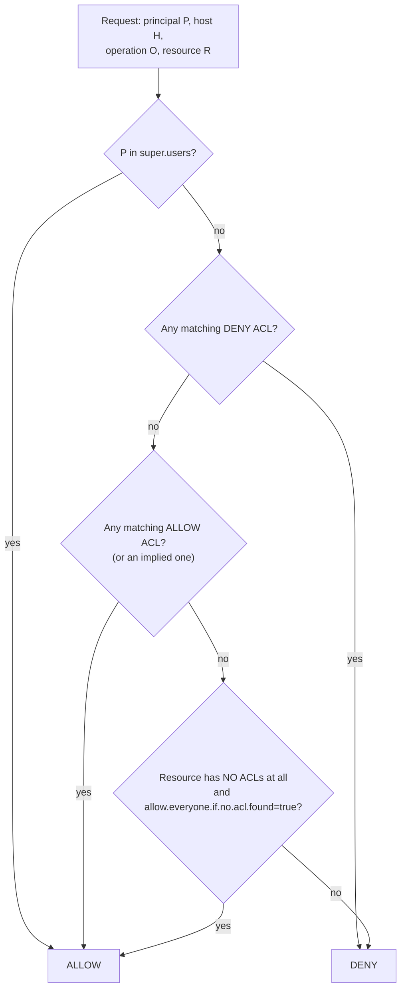

- **Deny wins** over allow.
- **Default deny:** with an authorizer and no matching ACL, access is denied.
- **No authorizer configured** means every authenticated principal can do everything. Authentication alone gives identity, not protection.
- `allow.everyone.if.no.acl.found=true` is a migration aid only. Any new topic created without ACLs is open to everyone while it is set.
- **Implied operations:** `Read`, `Write`, `Delete`, or `Alter` on a resource implies `Describe`. `AlterConfigs` implies `DescribeConfigs`.

### The ACL model

An ACL reads: *Principal P is ALLOWED/DENIED operation O from host H on resources matching pattern RP.*

**Resources:**

| Resource | Examples of what it guards | Error code when denied |
|---|---|---|
| `Topic` | produce, fetch, create, delete, describe | `TOPIC_AUTHORIZATION_FAILED` (29) |
| `Group` | join, heartbeat, offset commit/fetch | `GROUP_AUTHORIZATION_FAILED` (30) |
| `Cluster` | idempotent write, create topics, ACL admin, configs, replication | `CLUSTER_AUTHORIZATION_FAILED` (31) |
| `TransactionalId` | transactions | `TRANSACTIONAL_ID_AUTHORIZATION_FAILED` (53) |
| `DelegationToken` | describe tokens | |
| `User` | create/describe tokens on behalf of others | |

**Operations:** `Read`, `Write`, `Create`, `Delete`, `Alter`, `Describe`, `ClusterAction`, `DescribeConfigs`, `AlterConfigs`, `IdempotentWrite`, `CreateTokens`, `DescribeTokens`, `All`.

**Pattern types:** `LITERAL` (exact name, or `*` for all), `PREFIXED` (name starts with...). `MATCH` and `ANY` are for filtering when listing or deleting.

### What each client role needs

| Client | ACLs |
|---|---|
| Producer | `Write` + `Describe` on the topic. Idempotence also needs `IdempotentWrite` on Cluster, or `Write` on the topic. |
| Transactional producer | Above + `Write` + `Describe` on the `TransactionalId` |
| Consumer | `Read` on the topic + `Read` on the group |
| Exactly-once (consume–transform–produce) | Consumer ACLs + transactional producer ACLs |
| Kafka Streams app | `Read`/`Write` on its topics, `All` on `PREFIXED` topics and groups starting with `application.id` (internal topics), transactional ids for EOS |
| Admin creating topics | `Create` on the topic (or Cluster) |
| Share group consumer | `Read` on the topic + `Read` on the group |

### Managing ACLs

```bash
# producer
bin/kafka-acls.sh --bootstrap-server broker1:9094 --command-config admin.properties \
  --add --allow-principal User:orders-svc --producer --topic orders

# consumer in group billing
bin/kafka-acls.sh --bootstrap-server broker1:9094 --command-config admin.properties \
  --add --allow-principal User:billing-svc --consumer --topic orders --group billing

# all topics starting with "payments." for one team
bin/kafka-acls.sh --bootstrap-server broker1:9094 --command-config admin.properties \
  --add --allow-principal User:payments-team --operation All \
  --topic payments. --resource-pattern-type prefixed

# block one host for everyone, everywhere
bin/kafka-acls.sh --bootstrap-server broker1:9094 --command-config admin.properties \
  --add --deny-principal 'User:*' --deny-host 10.0.0.66 --operation All --topic '*'

# list
bin/kafka-acls.sh --bootstrap-server broker1:9094 --command-config admin.properties \
  --list --topic orders
```

`--producer` and `--consumer` are shortcuts that add the full set of ACLs for that role. The same operations exist on `Admin` (`createAcls`, `describeAcls`, `deleteAcls`), and changing ACLs itself requires `Alter` on the `Cluster` resource.

### Admin requests in KRaft

Clients send admin requests (for example `CreateTopics`) to a broker. The broker forwards them to the active controller inside an `Envelope`:

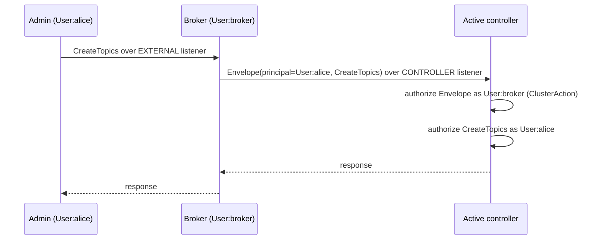

That is why the authorizer must be configured on controllers too, and why broker principals must be super users or hold `ClusterAction`.

## 19. Quotas

Quotas stop one client from starving others. They are enforced per broker, by **user** principal, **client.id**, or both.

| Quota | Limits |
|---|---|
| `producer_byte_rate` | Bytes/s produced |
| `consumer_byte_rate` | Bytes/s fetched |
| `request_percentage` | Share of broker network + I/O thread time |
| `controller_mutation_rate` | Partition creations/deletions per second |
| `connection_creation_rate` | New connections per second (per IP or broker-wide) |

```bash
# alice may produce 10 MB/s and consume 20 MB/s on each broker
bin/kafka-configs.sh --bootstrap-server broker1:9094 --command-config admin.properties \
  --alter --entity-type users --entity-name alice \
  --add-config 'producer_byte_rate=10485760,consumer_byte_rate=20971520'

# default for all users
bin/kafka-configs.sh --bootstrap-server broker1:9094 --command-config admin.properties \
  --alter --entity-type users --entity-default --add-config 'request_percentage=50'
```

When a client exceeds its quota, the broker does not return an error. It **delays the response** (throttling) and sets `throttle_time_ms`, so well-behaved clients slow down by themselves. Quotas keyed by user only mean something when authentication is enabled, since otherwise everyone is `ANONYMOUS`. Connection limits (`max.connections`, `max.connections.per.ip`) add protection against connection floods.

## 20. Secrets, encryption at rest, auditing

### Keep secrets out of config files

Use **config providers** to reference secrets instead of embedding them:

```properties
config.providers=file,dir,env
config.providers.file.class=org.apache.kafka.common.config.provider.FileConfigProvider
config.providers.file.param.allowed.paths=/etc/kafka/secrets
config.providers.dir.class=org.apache.kafka.common.config.provider.DirectoryConfigProvider
config.providers.dir.param.allowed.paths=/run/secrets
config.providers.env.class=org.apache.kafka.common.config.provider.EnvVarConfigProvider

ssl.keystore.password=${file:/etc/kafka/secrets/broker.properties:keystore.password}
ssl.key.password=${dir:/run/secrets:ssl-key-password}
```

Always set `allowed.paths`. Without it, a mistaken or malicious config could make the provider read any file the process can read.

Sensitive **dynamic** broker configs (set with `kafka-configs.sh`, such as a new keystore password) are stored **unencrypted** in the metadata log as `ConfigRecord`s; Kafka only hides their values in log output. The `password.encoder.*` settings that encrypted them in ZooKeeper mode were removed with ZooKeeper (`docs/getting-started/zk2kraft.md`). Note that `docs/security/security-model.md` in the Kafka source tree still describes the old behaviour. So anyone who can read a controller's or broker's metadata directory, or a metadata snapshot, can read those values: protect `metadata.log.dir` like a secrets store, or keep such secrets out of dynamic configs and load them through a config provider instead.

### Encryption at rest

Kafka writes everything to disk in plain bytes. Options, from cheapest to strongest:

| Option | Protects against | Does not protect against |
|---|---|---|
| Disk or filesystem encryption (LUKS, cloud volume encryption) | Stolen disks, misplaced backups | Anyone logged in to the broker |
| Remote store encryption (tiered storage with S3 SSE/KMS) | Exposure of the object store | Local tier, broker operators |
| Message-level encryption in producers (keys in a KMS) | Brokers and their operators | Nothing on the broker side, but breaks broker-side features that need to read payloads |

### Audit logging

- `kafka.authorizer.logger`: at `INFO`, logs every **denied** request; at `DEBUG`, also every allowed one. Ship it off-broker to append-only storage.
- `kafka.request.logger`: per-request detail, verbose, off by default. Useful for investigations.
- Kafka has no built-in tamper-evident audit trail.

### JMX

JMX is an operators-only interface and is **unauthenticated by default**. Either disable remote JMX, bind it to localhost with a metrics exporter beside it, or enable `com.sun.management.jmxremote.authenticate=true` with TLS. Never expose it to users.

## 21. Securing a running cluster

You can add security to a live cluster without downtime by rolling restarts. Clients keep using the old listener while you migrate.

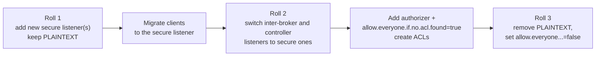

Changing SASL mechanisms works the same way: enable the new mechanism alongside the old one, move clients, then remove the old one.

## 22. A complete secure configuration

A dedicated broker with mTLS between servers and SCRAM or OAuth for clients:

```properties
# ---- roles ----
process.roles=broker
node.id=1
controller.quorum.bootstrap.servers=ctrl1.internal:9093,ctrl2.internal:9093,ctrl3.internal:9093

# ---- listeners ----
listeners=INTERNAL://0.0.0.0:9092,EXTERNAL://0.0.0.0:9094
advertised.listeners=INTERNAL://broker1.internal:9092,EXTERNAL://broker1.example.com:9094
listener.security.protocol.map=INTERNAL:SSL,EXTERNAL:SASL_SSL,CONTROLLER:SSL
inter.broker.listener.name=INTERNAL
controller.listener.names=CONTROLLER

# ---- secrets ----
config.providers=file
config.providers.file.class=org.apache.kafka.common.config.provider.FileConfigProvider
config.providers.file.param.allowed.paths=/etc/kafka/secrets

# ---- TLS (shared by all listeners unless overridden) ----
ssl.keystore.location=/etc/kafka/ssl/broker1.keystore.jks
ssl.keystore.password=${file:/etc/kafka/secrets/ssl.properties:keystore.password}
ssl.key.password=${file:/etc/kafka/secrets/ssl.properties:key.password}
ssl.truststore.location=/etc/kafka/ssl/kafka.truststore.jks
ssl.truststore.password=${file:/etc/kafka/secrets/ssl.properties:truststore.password}
ssl.enabled.protocols=TLSv1.3,TLSv1.2
ssl.client.auth=required
listener.name.external.ssl.client.auth=none

# server certificate DN -> short principal (User:broker1, User:ctrl1 ...)
ssl.principal.mapping.rules=RULE:^CN=([^.,]+).*$/$1/L,DEFAULT

# ---- SASL on EXTERNAL ----
sasl.enabled.mechanisms=SCRAM-SHA-512,OAUTHBEARER
listener.name.external.scram-sha-512.sasl.jaas.config=org.apache.kafka.common.security.scram.ScramLoginModule required;
listener.name.external.oauthbearer.sasl.server.callback.handler.class=org.apache.kafka.common.security.oauthbearer.OAuthBearerValidatorCallbackHandler
listener.name.external.oauthbearer.sasl.oauthbearer.jwks.endpoint.url=https://idp.example.com/.well-known/jwks.json
listener.name.external.oauthbearer.sasl.oauthbearer.expected.audience=kafka
listener.name.external.oauthbearer.sasl.oauthbearer.expected.issuer=https://idp.example.com
listener.name.external.oauthbearer.sasl.jaas.config=org.apache.kafka.common.security.oauthbearer.OAuthBearerLoginModule required;
listener.name.external.oauthbearer.connections.max.reauth.ms=3600000

# ---- authorization ----
authorizer.class.name=org.apache.kafka.metadata.authorizer.StandardAuthorizer
super.users=User:admin;User:broker1;User:broker2;User:broker3;User:ctrl1;User:ctrl2;User:ctrl3
allow.everyone.if.no.acl.found=false

# ---- limits ----
max.connections.per.ip=200
```

Run the JVM with `-Dorg.apache.kafka.sasl.oauthbearer.allowed.urls=https://idp.example.com/.well-known/jwks.json`.

Controllers use the same TLS block, `process.roles=controller`, `listeners=CONTROLLER://0.0.0.0:9093`, and the same authorizer and `super.users`.

## 23. Security and tiered storage together

Tiered storage adds a new place where your data lives and new credentials to protect.

- **Remote store credentials** (S3 keys, IAM role, GCS service account) go to the RSM through `rsm.config.*`. Use a config provider or workload identity rather than literal keys. Grant the broker only the bucket and prefix it needs.
- **Encryption at rest in the remote tier** is up to the plugin and the store: enable server-side encryption (SSE-KMS or similar) and TLS to the store. Kafka itself sends the RSM plain segment bytes.
- **The RSM runs with full broker privileges.** It is classpath code. Use only plugins you trust. `remote.log.storage.manager.class.path` gives it an isolated classloader, which isolates dependencies, not permissions.
- **`__remote_log_metadata` is an internal topic.** On a secured cluster, the RLMM's internal clients connect through `remote.log.metadata.manager.listener.name`. Give that listener's principal what it needs (a super user, typically the broker principal), and pass client security settings with prefixes such as `rlmm.config.remote.log.metadata.common.client.security.protocol=SSL`.
- **ACLs still apply.** Reads served from remote storage go through the same `Fetch` path and the same authorizer as local reads. Tiering never bypasses topic ACLs.
- **Deleting data:** with `retention.ms` or topic deletion, remote segments are deleted by the expiration task. If you rely on deletion for compliance, monitor `RemoteDeleteErrorsPerSec` and the store's own lifecycle rules.

## 24. Where it lives in the code

| Area | Path |
|---|---|
| RSM / RLMM interfaces, segment states | `storage/api/src/main/java/org/apache/kafka/server/log/remote/storage/` |
| `RemoteLogManager` (copy, expire, follower tasks) | `storage/src/main/java/org/apache/kafka/server/log/remote/storage/RemoteLogManager.java` |
| Tiered storage configs | `storage/.../remote/storage/RemoteLogManagerConfig.java` |
| Remote reads and index cache | `storage/.../remote/storage/RemoteLogReader.java`, `storage/src/main/java/org/apache/kafka/storage/internals/log/RemoteIndexCache.java` |
| Default RLMM (`__remote_log_metadata`) | `storage/src/main/java/org/apache/kafka/server/log/remote/metadata/storage/TopicBasedRemoteLogMetadataManager.java` |
| Follower bootstrap from remote | `core/src/main/java/kafka/server/TierStateMachine.java` |
| Remote fetch purgatory | `storage/src/main/java/org/apache/kafka/server/purgatory/DelayedRemoteFetch.java` |
| Test RSM | `storage/src/testFixtures/java/org/apache/kafka/server/log/remote/storage/LocalTieredStorage.java` |
| SASL mechanisms | `clients/src/main/java/org/apache/kafka/common/security/{plain,scram,oauthbearer,kerberos,token}/` |
| TLS | `clients/src/main/java/org/apache/kafka/common/security/ssl/` |
| Principal builder | `clients/.../security/authenticator/DefaultKafkaPrincipalBuilder.java` |
| Broker security configs | `clients/src/main/java/org/apache/kafka/common/config/internals/BrokerSecurityConfigs.java` |
| Authorizer | `metadata/src/main/java/org/apache/kafka/metadata/authorizer/StandardAuthorizer.java` |
| Config providers | `clients/src/main/java/org/apache/kafka/common/config/provider/` |
| Official docs | `docs/operations/tiered-storage.md`, `docs/configuration/tiered-storage-configs.md`, `docs/security/*.md` |
